# Lógica de Programação com JavaScript

> **Aprenda a resolver problemas antes de escrever código.** Um curso prático e progressivo, baseado em **Problema → Conceito → Solução → Diagrama → Exercícios**, com exemplos executáveis em Node.js, desafios e um projeto integrador.

## Sumário

1. [Apresentação e objetivos](#1-apresentação-e-objetivos)
2. [Metodologia e organização](#2-metodologia-e-organização)
3. [Preparação do ambiente](#3-preparação-do-ambiente)
4. [Módulo 1 — Tipos de dados](#módulo-1--tipos-de-dados)
5. [Módulo 2 — Variáveis](#módulo-2--variáveis)
6. [Módulo 3 — Operações lógicas](#módulo-3--operações-lógicas)
7. [Módulo 4 — Operações relacionais](#módulo-4--operações-relacionais)
8. [Módulo 5 — Estruturas de decisão](#módulo-5--estruturas-de-decisão)
9. [Módulo 6 — Estruturas de repetição](#módulo-6--estruturas-de-repetição)
10. [Módulo 7 — Estruturas de dados: lista, array e set](#módulo-7--estruturas-de-dados-lista-array-e-set)
11. [Módulo 8 — Algoritmos de busca e ordenação](#módulo-8--algoritmos-de-busca-e-ordenação)
12. [Módulo 9 — Métodos e funções](#módulo-9--métodos-e-funções)
13. [Projeto integrador](#projeto-integrador--sistema-de-pedidos-da-cantina)
14. [Avaliação, roteiro de estudo e referências](#avaliação-roteiro-de-estudo-e-referências)
15. [Respostas dos exercícios](#respostas-dos-exercícios)

---

## 1. Apresentação e objetivos

**Público-alvo:** iniciantes em programação, estudantes de cursos técnicos e superiores e profissionais em transição para desenvolvimento de software.

**Pré-requisitos:** saber utilizar um editor de texto e um terminal. Não é necessário conhecer JavaScript.

**Carga horária sugerida:** **40 horas** (atividades adicionais podem ser realizadas como estudo extraclasse) — nove módulos de 4 horas (36h), mais 4 horas para integração e apresentação do projeto.

Ao concluir o curso, a pessoa estudante deverá conseguir:

- Decompor um problema em **entradas, processamento, decisões e saídas**.
- Escolher tipos de dados, variáveis, operadores e estruturas de controle adequados.
- Representar algoritmos por **fluxogramas Mermaid** e implementá-los em JavaScript.
- Manipular coleções, compreender diferenças entre **arrays, conjuntos e listas**.
- Implementar e comparar **busca linear, busca binária e algoritmos básicos de ordenação**.
- Organizar soluções em **funções reutilizáveis**, distinguindo funções e métodos.
- Testar casos normais, limites e entradas inválidas.

**Caso transversal:** uma **cantina universitária** precisa controlar itens de cardápio, pedidos, descontos, disponibilidade e faturamento. Cada módulo resolve uma pequena parte do problema, até chegar ao sistema integrado.

### Cronograma

| Etapa | Conteúdo | Duração | Entrega prática |
|---|---|---:|---|
| 1 | Tipos de dados | 4h | Identificar dados de um produto |
| 2 | Variáveis | 4h | Calcular total e troco de uma compra |
| 3 | Operações lógicas | 4h | Validar regras combinadas |
| 4 | Operações relacionais | 4h | Verificar preços, estoque e limites |
| 5 | Estruturas de decisão | 4h | Definir descontos e estados do pedido |
| 6 | Estruturas de repetição | 4h | Processar múltiplos pedidos |
| 7 | Lista, array e set | 4h | Construir carrinho e catálogo |
| 8 | Busca e ordenação | 4h | Localizar e classificar produtos |
| 9 | Métodos e funções | 4h | Modularizar regras de negócio |
| Integração | Projeto final e demonstração | 4h | Sistema executável + testes |
| **Total** | | **40h** | |

## 2. Metodologia e organização

Cada módulo segue o mesmo ciclo didático:

1. **Problema:** contexto real, entradas, processamento e resultado esperado.
2. **Conceito:** noções mínimas necessárias para resolver o problema.
3. **Solução:** implementação completa e executável, comentada quando necessário.
4. **Diagrama:** fluxograma Mermaid para explicar o raciocínio.
5. **Exercícios:** atividades graduais; primeiro compreender, depois modificar e, por fim, criar.

**Orientação ao aluno:** antes de consultar a solução, escreva um algoritmo em linguagem natural, identifique casos de teste e desenhe o fluxograma. Em seguida, implemente e compare o resultado com os valores esperados.

**Ritual recomendado para as aulas:** 20% discussão do problema, 20% conceitos e demonstração, 40% laboratório e 20% testes, revisão e discussão.

### Estrutura sugerida para o repositório

```text
logica-programacao-javascript/
├── README.md
├── src/
│   ├── 01-tipos.js
│   ├── 02-variaveis.js
│   ├── 03-logicos.js
│   ├── 04-relacionais.js
│   ├── 05-decisoes.js
│   ├── 06-repeticoes.js
│   ├── 07-estruturas-dados.js
│   ├── 08-busca-ordenacao.js
│   └── 09-funcoes-metodos.js
├── exercicios/
│   ├── modulo-01/
│   ├── modulo-02/
│   ├── ...
│   └── modulo-09/
└── projeto-integrador/
    ├── app.js
    └── README.md
```

> O arquivo entregue é este `README.md`. O esquema acima orienta como o repositório pode ser organizado; os exemplos de `src/` devem ser copiados dos blocos de código de cada módulo.

## 3. Preparação do ambiente

**Ferramentas:** [Node.js](https://nodejs.org/), [Visual Studio Code](https://code.visualstudio.com/) ou editor equivalente e um terminal.

```bash
# Verifique a instalação
node --version

# Crie o repositório local
mkdir -p logica-programacao-javascript/src
cd logica-programacao-javascript

# Crie o primeiro arquivo
printf 'console.log("Olá, lógica de programação!");\n' > src/ola.js
node src/ola.js
```

**Saída esperada:** `Olá, lógica de programação!`

Todos os exemplos seguintes usam JavaScript puro no Node.js, sem bibliotecas externas. Salve cada bloco de solução no arquivo indicado no respectivo módulo e execute com `node src/nome-do-arquivo.js`.

---

## Módulo 1 — Tipos de dados

### Problema

A cantina quer cadastrar um produto com nome, preço, quantidade em estoque e indicação de disponibilidade. **Que tipo de dado representa cada informação?** Como distinguir o número `10` do texto `"10"`?

**Entradas do exemplo:** nome `"Sanduíche"`, preço `12.5`, quantidade `10`, disponível `true`.

### Conceito

JavaScript possui tipos **primitivos** como `string` (texto), `number` (número), `boolean` (verdadeiro/falso), `undefined`, `null` (valor de ausência definido intencionalmente), `bigint` e `symbol`. Objetos e arrays são valores de **tipo objeto**.

| Informação | Exemplo | Tipo / observação |
|---|---|---|
| Nome do produto | `"Sanduíche"` | `string` |
| Preço | `12.5` | `number` (usa ponto decimal) |
| Quantidade | `10` | `number` |
| Disponibilidade | `true` | `boolean` |
| Descrição ainda não atribuída | `undefined` | `undefined` |
| Cupom ausente intencionalmente | `null` | Ausência explícita; `typeof null` retorna `"object"` por peculiaridade histórica |
| Produto completo | `{ nome: "Suco" }` | `object` |
| Itens | `["Suco", "Pão"]` | Array; `Array.isArray` identifica corretamente |

**Atenção:** JavaScript usa um único tipo numérico comum (`number`) tanto para inteiros quanto para números com casas decimais. Valores monetários podem apresentar diferenças de precisão em ponto flutuante; em aplicações financeiras, prefira guardar **centavos inteiros** ou empregar uma solução decimal apropriada.

### Solução — `src/01-tipos.js`

```js
const nome = "Sanduíche";
const preco = 12.5;
const estoque = 10;
const disponivel = true;
const cupom = null;
const categorias = ["Lanche", "Refeição"];

console.log(typeof nome);            // string
console.log(typeof preco);           // number
console.log(typeof estoque);         // number
console.log(typeof disponivel);      // boolean
console.log(cupom === null);         // true
console.log(Array.isArray(categorias)); // true

const quantidadeDigitada = "3";
const quantidade = Number(quantidadeDigitada);
console.log(quantidade * preco);     // 37.5
console.log(Number.isNaN(quantidade)); // false
```

### Diagrama

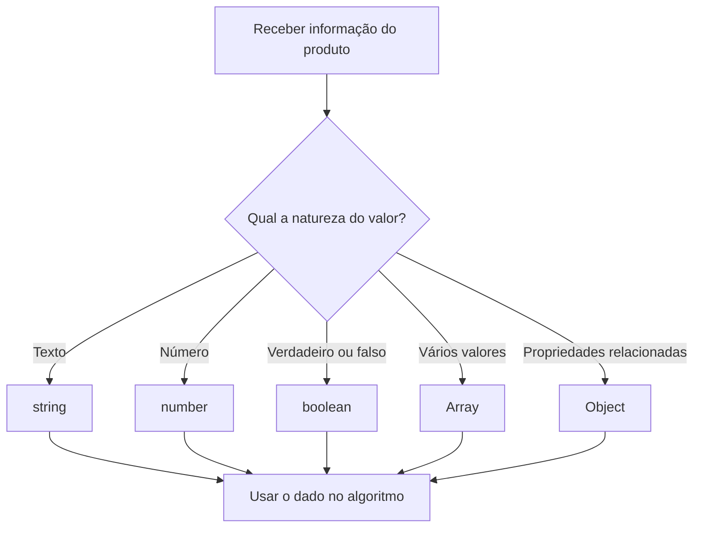

### Exemplos complementares

**Conversão e valores ausentes**

```js
console.log(Number("12.5"), String(42), Boolean(0)); // 12.5, "42", false
console.log(Number(""), Number("abc")); // 0, NaN
console.log(Boolean("false")); // true: texto não vazio
```

**Precisão e objetos**

```js
const produto = { nome: "Pão", precoCentavos: 350 };
console.log(produto.precoCentavos * 3 / 100); // 10.5
console.log(typeof 9007199254740993n); // bigint
```

> Execute cada exemplo em um arquivo separado. Antes de executar, tente prever a saída.

### Exercícios

1. **Identificação:** declare `produto`, `preco`, `quantidade` e `ativo` com valores adequados. Exiba o tipo de cada um.
2. **Conversão:** transforme `"15"` em número e calcule o valor de 4 unidades. **Esperado:** `60`.
3. **Validação:** experimente converter `"quinze"` com `Number`. Verifique o resultado usando `Number.isNaN`.
4. **Investigação:** compare `typeof null`, `typeof []` e `Array.isArray([])`. Explique a diferença.
5. **Desafio:** receba valores fixos `"9.90"` e `"2"`, converta-os, calcule o total e apresente os dados e tipos resultantes.
6. **Fixação adicional:** Converta "42" para número e 42 para texto. Exiba os tipos.
7. **Fixação adicional:** Compare Boolean(0), Boolean(1), Boolean("") e Boolean("false").
8. **Fixação adicional:** Valide as entradas "12", "abc" e "" como números não vazios e finitos.
9. **Fixação adicional:** Represente um aluno com nome, notas em array e aprovação booleana.
10. **Fixação adicional:** Calcule três produtos de 199 centavos e apresente o total em reais.

**Critério de aceite:** tipos coerentes, conversões explícitas e identificação de conversão inválida.

---

## Módulo 2 — Variáveis

### Problema

Uma compra de 3 sucos a R$ 7,00 precisa resultar em total e troco. Como armazenar informações que **não mudam** (preço) e informações que **mudam** (quantidade ou saldo)?

**Entradas:** preço `7`, quantidade `3`, pagamento `25`. **Saída esperada:** total `21` e troco `4`.

### Conceito

- `const`: declara uma variável cujo identificador **não pode receber outro valor** após a inicialização.
- `let`: permite reatribuir o valor durante a execução.
- Evite `var` no código introdutório moderno, por suas diferenças de escopo e comportamento.
- **Escopo:** variáveis declaradas com `let` e `const` dentro de um bloco `{ ... }` são acessíveis naquele bloco, não fora dele.
- **Nomeação:** utilize nomes descritivos, no padrão `camelCase` (`valorTotal`, `quantidadeItens`).

> `const` não torna objetos imutáveis: impede reatribuir a variável, mas propriedades do objeto ainda podem ser modificadas.

### Solução — `src/02-variaveis.js`

```js
const precoUnitario = 7;
let quantidade = 3;
const valorPago = 25;

let total = precoUnitario * quantidade;
let troco = valorPago - total;

console.log(`Total: R$ ${total.toFixed(2)}`); // R$ 21.00
console.log(`Troco: R$ ${troco.toFixed(2)}`); // R$ 4.00

quantidade = 2;
total = precoUnitario * quantidade;
troco = valorPago - total;
console.log(`Novo total: R$ ${total.toFixed(2)}`); // R$ 14.00
```

`toFixed(2)` formata duas casas decimais e **retorna uma string**, não um número.

### Diagrama

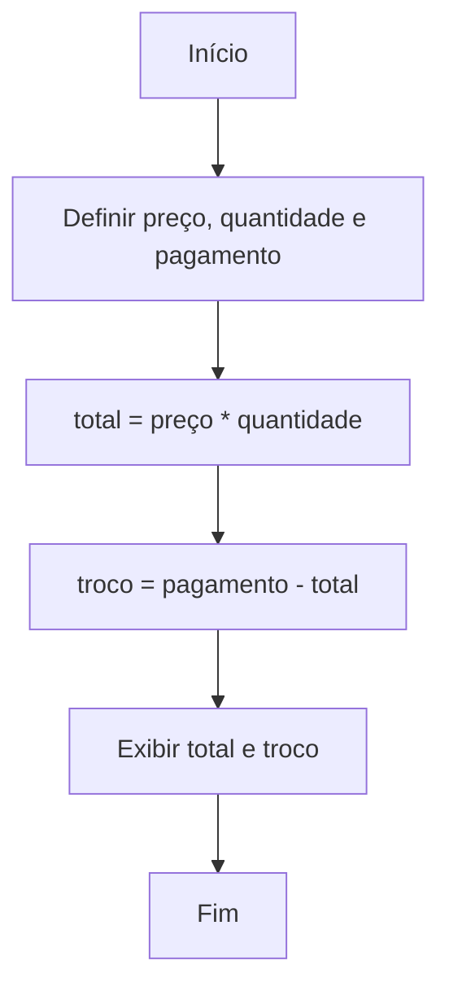

### Exemplos complementares

**Acumuladores e atribuição composta**

```js
let saldo = 100;
saldo += 35;
saldo -= 20;
console.log(saldo); // 115
```

**Constante e mutabilidade**

```js
const pedido = { quantidade: 1 };
pedido.quantidade += 2;
console.log(pedido.quantidade); // 3
// pedido = {}; seria TypeError
```

> Execute cada exemplo em um arquivo separado. Antes de executar, tente prever a saída.

### Exercícios

1. **Cálculo:** venda 5 cafés a R$ 4,50. **Esperado:** total `22.50`.
2. **Reatribuição:** aumente a quantidade de 2 para 6 e recalcule o total.
3. **Escopo:** crie uma variável com `let` dentro de `if (true) { ... }` e investigue o que acontece ao acessá-la fora do bloco.
4. **Troco:** implemente uma compra de R$ 18,00 paga com R$ 20,00. **Esperado:** `2.00`.
5. **Desafio:** registre valor inicial do caixa, some duas vendas e desconte uma despesa; imprima saldo inicial e final.
6. **Fixação adicional:** Calcule a média de 7, 8 e 9.
7. **Fixação adicional:** Troque os valores de duas variáveis a=10 e b=20 usando uma auxiliar.
8. **Fixação adicional:** Converta 120 minutos para segundos.
9. **Fixação adicional:** Simule estoque inicial 10, entrada 7 e saída 4.
10. **Fixação adicional:** Calcule desconto de 15% em uma compra de R$ 80.

**Critério de aceite:** uso adequado de `const`/`let` e resultados atualizados após reatribuições.

---

## Módulo 3 — Operações lógicas

### Problema

A cantina permite um pedido quando o estabelecimento está **aberto** e o produto está **disponível**. Também admite prioridade quando o pedido é de um professor **ou** tem autorização especial. Como combinar condições?

**Entradas:** `aberto = true`, `disponivel = false`. **Saída esperada:** pedido não permitido.

### Conceito

| Operador | Significado | Exemplo | Resultado |
|---|---|---|---|
| `&&` | E: ambas as condições devem ser verdadeiras | `true && false` | `false` |
| `\|\|` | OU: ao menos uma condição deve ser verdadeira | `true \|\| false` | `true` |
| `!` | NÃO: inverte o valor booleano | `!true` | `false` |

**Tabela-verdade:**

| A | B | A && B | A \|\| B |
|---|---|---|---|
| `false` | `false` | `false` | `false` |
| `false` | `true` | `false` | `true` |
| `true` | `false` | `false` | `true` |
| `true` | `true` | `true` | `true` |

`&&` e `||` fazem **curto-circuito**: a segunda expressão só é avaliada quando necessária. Em JavaScript eles também podem retornar operandos não booleanos; neste módulo, use expressões booleanas para estudar a lógica com clareza.

### Solução — `src/03-logicos.js`

```js
const cantinaAberta = true;
const produtoDisponivel = false;
const clienteProfessor = true;
const possuiAutorizacao = false;

const podeComprar = cantinaAberta && produtoDisponivel;
const atendimentoPrioritario = clienteProfessor || possuiAutorizacao;
const produtoIndisponivel = !produtoDisponivel;

console.log(`Pode comprar? ${podeComprar}`);               // false
console.log(`Atendimento prioritário? ${atendimentoPrioritario}`); // true
console.log(`Produto indisponível? ${produtoIndisponivel}`);       // true
```

### Diagrama

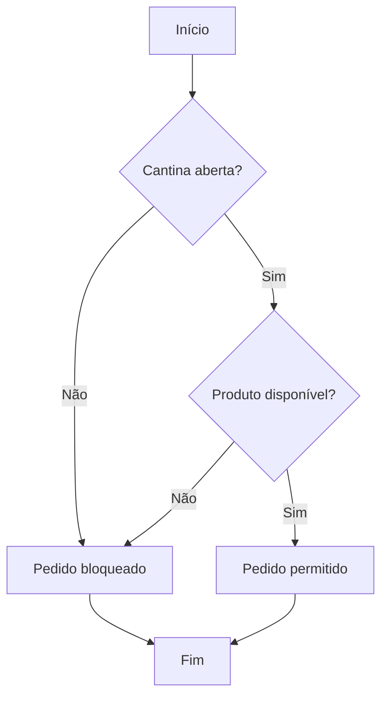

### Exemplos complementares

**Curto-circuito**

```js
const usuario = null;
console.log(usuario !== null && usuario.ativo); // false, sem acessar null
```

**Negação de condições compostas**

```js
const aberto = true, estoque = false;
console.log(!(aberto && estoque)); // true
console.log(!aberto || !estoque); // true
```

> Execute cada exemplo em um arquivo separado. Antes de executar, tente prever a saída.

### Exercícios

1. **E lógico:** teste as quatro combinações possíveis de `cantinaAberta` e `produtoDisponivel`.
2. **OU lógico:** um cliente ganha atendimento prioritário se for professor **ou** possuir passe especial. Teste todas as combinações.
3. **Negação:** crie `pedidoBloqueado` a partir de `!podeComprar`.
4. **Combinação:** autorize a compra se `(aberto && disponivel) || autorizacaoEmergencial`. Teste um caso em que a cantina está fechada, mas existe autorização.
5. **Desafio:** projete três regras independentes de um sistema de matrículas usando `&&`, `||` e `!`; registre a tabela-verdade de cada regra.
6. **Fixação adicional:** Autorize login somente com senha válida e usuário ativo.
7. **Fixação adicional:** Permita frete grátis se cliente premium ou total de pelo menos 100.
8. **Fixação adicional:** Bloqueie acesso se conta suspensa ou senha inválida.
9. **Fixação adicional:** Verifique se exatamente uma de duas opções foi escolhida usando !== entre booleanos.
10. **Fixação adicional:** Compare !(a || b) com !a && !b nas quatro combinações.

**Critério de aceite:** condições corretas para todos os cenários de teste.

---

## Módulo 4 — Operações relacionais

### Problema

É preciso conferir se há **estoque suficiente**, se a compra alcançou o **valor mínimo de desconto** e se dois códigos de produto são **idênticos**.

**Entradas:** solicitado `4`, estoque `6`, total `35`, mínimo para desconto `30`. **Saída esperada:** estoque suficiente e desconto elegível.

### Conceito

| Operador | Significado | Exemplo | Resultado |
|---|---|---|---|
| `>` | Maior que | `10 > 5` | `true` |
| `<` | Menor que | `3 < 2` | `false` |
| `>=` | Maior ou igual | `4 >= 4` | `true` |
| `<=` | Menor ou igual | `3 <= 5` | `true` |
| `===` | Igualdade estrita (valor e tipo, sem coerção) | `5 === "5"` | `false` |
| `!==` | Diferença estrita | `5 !== "5"` | `true` |

**Boa prática:** priorize `===` e `!==` em vez de `==` e `!=`, que permitem conversões implícitas de tipos. Comparações de strings são sensíveis a regras de ordenação de caracteres, não equivalem automaticamente à ordenação alfabética de um idioma.

### Solução — `src/04-relacionais.js`

```js
const quantidadeSolicitada = 4;
const estoqueAtual = 6;
const valorCompra = 35;
const valorMinimoDesconto = 30;
const codigoProduto = 101;
const codigoDigitado = "101";

const estoqueSuficiente = quantidadeSolicitada <= estoqueAtual;
const descontoElegivel = valorCompra >= valorMinimoDesconto;
const mesmoCodigo = codigoProduto === codigoDigitado;

console.log(estoqueSuficiente); // true
console.log(descontoElegivel);  // true
console.log(mesmoCodigo);       // false
console.log(codigoProduto === Number(codigoDigitado)); // true
```

### Diagrama

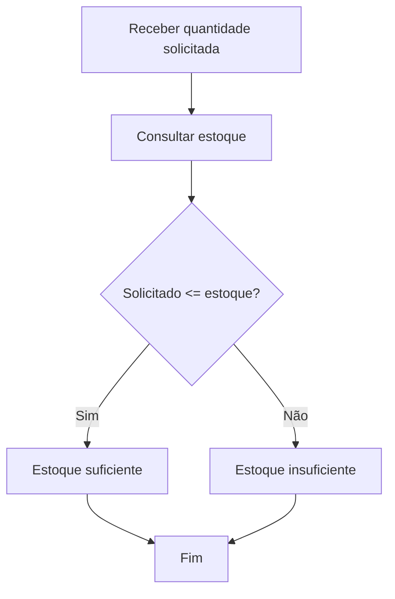

### Exemplos complementares

**Intervalos inclusivos**

```js
const nota = 7;
console.log(nota >= 0 && nota <= 10); // true
console.log(nota >= 7); // true
```

**Comparação de textos e números**

```js
console.log("10" < "2"); // true: comparação textual
console.log(Number("10") < Number("2")); // false
```

> Execute cada exemplo em um arquivo separado. Antes de executar, tente prever a saída.

### Exercícios

1. **Limite:** verifique se a compra de R$ 29,99 atende a um mínimo de R$ 30,00. **Esperado:** `false`.
2. **Igualdade:** explique e teste a diferença entre `10 === "10"` e `10 == "10"`.
3. **Estoque:** valide pedidos de quantidades `0`, `1`, `5` e `6` para estoque igual a `5`. Discuta por que `0` exige uma regra adicional.
4. **Classificação:** descubra se um aluno atingiu nota mínima `7`, usando `>=`.
5. **Desafio:** verifique simultaneamente `quantidade > 0`, `quantidade <= estoque` e `valorPago >= total`.
6. **Fixação adicional:** Verifique se idade 18 está no intervalo inclusivo de 18 a 65.
7. **Fixação adicional:** Compare dois preços 9.90 e 12.50.
8. **Fixação adicional:** Teste desigualdade estrita entre 5 e "5".
9. **Fixação adicional:** Valide nota no intervalo de 0 a 10 para -1, 0, 10, 11.
10. **Fixação adicional:** Identifique se duas quantidades são iguais após conversão explícita de "8".

**Critério de aceite:** inclusão de casos-limite (igualdade, zero e valores acima do limite).

---

## Módulo 5 — Estruturas de decisão

### Problema

A cantina oferece desconto conforme o valor da compra: **10%** para pedidos de pelo menos R$ 50, **5%** para pedidos de pelo menos R$ 30 e **0%** nos demais. Como escolher **um único caminho**?

**Entrada:** total `45`. **Saída esperada:** desconto `5%`, total final `42.75`.

### Conceito

- `if`: executa um bloco se a condição for verdadeira.
- `else if`: verifica outras condições em sequência.
- `else`: cobre os casos restantes.
- `switch`: útil para decidir entre múltiplos valores discretos, como categoria ou status; `case` é comparado por igualdade estrita.
- Operador ternário `condicao ? valorA : valorB`: útil para escolhas simples, não para substituir fluxos complexos.

**A ordem das condições importa:** teste primeiro o limite de R$ 50, depois o de R$ 30.

### Solução — `src/05-decisoes.js`

```js
const totalCompra = 45;
let taxaDesconto = 0;

if (totalCompra >= 50) {
  taxaDesconto = 0.10;
} else if (totalCompra >= 30) {
  taxaDesconto = 0.05;
} else {
  taxaDesconto = 0;
}

const totalFinal = totalCompra * (1 - taxaDesconto);
console.log(`Desconto: ${taxaDesconto * 100}%`); // 5%
console.log(`Total final: R$ ${totalFinal.toFixed(2)}`); // 42.75

const formaPagamento = "pix";
switch (formaPagamento) {
  case "pix":
    console.log("Pagamento instantâneo");
    break;
  case "cartao":
    console.log("Pagamento com cartão");
    break;
  default:
    console.log("Forma de pagamento inválida");
}
```

### Diagrama

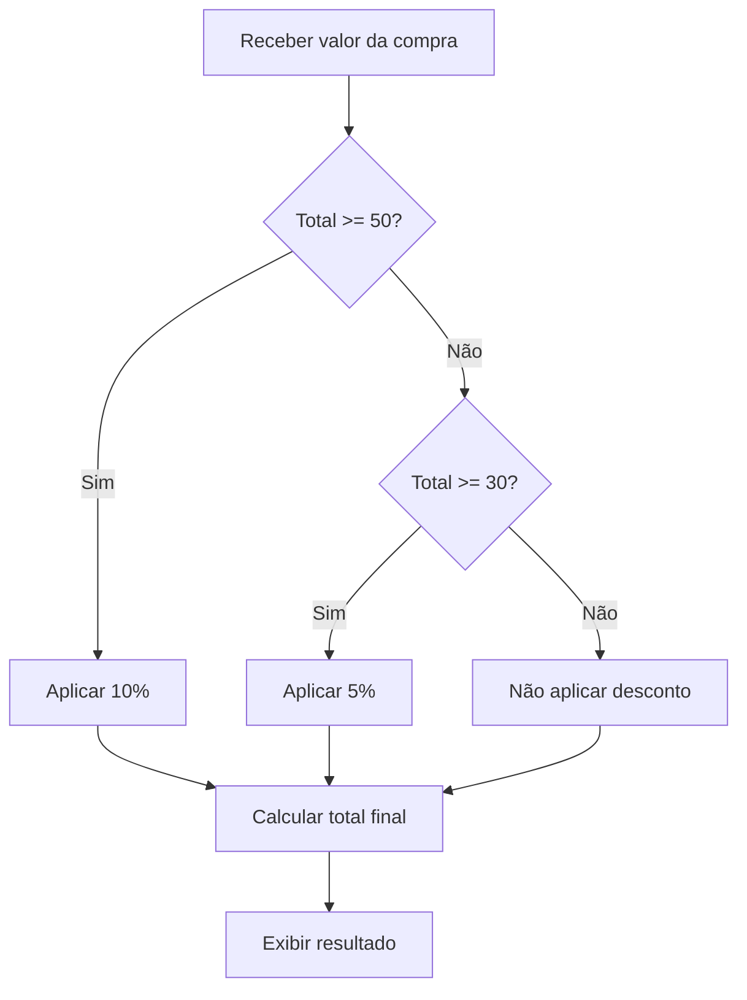

### Exemplos complementares

**Classificação de notas**

```js
const nota = 6;
if (nota < 0 || nota > 10) console.log("Inválida");
else if (nota >= 7) console.log("Aprovado");
else if (nota >= 5) console.log("Recuperação");
else console.log("Reprovado");
```

**Operador ternário**

```js
const estoque = 0;
const status = estoque > 0 ? "Disponível" : "Esgotado";
console.log(status);
```

> Execute cada exemplo em um arquivo separado. Antes de executar, tente prever a saída.

### Exercícios

1. **Faixas:** teste `29.99`, `30`, `49.99` e `50`. **Descontos esperados:** `0%`, `5%`, `5%`, `10%`.
2. **Disponibilidade:** exiba `"Em estoque"`, `"Estoque baixo"` ou `"Esgotado"` para quantidades `> 5`, entre `1` e `5`, e `0`, respectivamente.
3. **Menu:** utilize `switch` com `"cafe"`, `"suco"` e `"sanduiche"` para exibir o preço de cada item.
4. **Validação:** rejeite quantidades negativas ou iguais a zero antes de calcular qualquer preço.
5. **Desafio:** conceda benefício somente se `clienteAtivo && totalCompra >= 30`; diferencie mensagens de inelegibilidade por status e por valor.
6. **Fixação adicional:** Classifique um número como positivo, negativo ou zero.
7. **Fixação adicional:** Determine se 17 é par ou ímpar com %.
8. **Fixação adicional:** Classifique notas: >=7 aprovado, >=5 recuperação, demais reprovado; rejeite fora de 0 a 10.
9. **Fixação adicional:** Use switch para operações +, -, * com operandos 8 e 2; trate opção inválida.
10. **Fixação adicional:** Calcule tarifa: até 10 km inclusive R$ 8, acima R$ 12; rejeite distância negativa.

**Critério de aceite:** apenas uma faixa de desconto é escolhida e entradas inválidas não geram compra válida.

---

## Módulo 6 — Estruturas de repetição

### Problema

A cantina recebeu cinco pedidos. É preciso somar os valores, contar quantos pedidos foram feitos e calcular a média **sem repetir manualmente as instruções**.

**Entradas:** `[12, 8, 20, 10, 15]`. **Saídas esperadas:** total `65`, quantidade `5`, média `13`.

### Conceito

| Estrutura | Melhor uso | Cuidado |
|---|---|---|
| `for` | Repetições com controle por índice | Atenção ao limite `i < tamanho` |
| `while` | Repetir enquanto uma condição for verdadeira | Atualizar a condição para evitar loop infinito |
| `do...while` | Executar ao menos uma vez antes de testar | A primeira execução é obrigatória |
| `for...of` | Percorrer os valores de um iterável, como array | Percorre valores, não índices |

`break` encerra o laço; `continue` pula para a próxima iteração. Uma **variável acumuladora** reúne resultados; um **contador** registra ocorrências.

### Solução — `src/06-repeticoes.js`

```js
const valoresPedidos = [12, 8, 20, 10, 15];
let faturamento = 0;

for (let indice = 0; indice < valoresPedidos.length; indice++) {
  faturamento += valoresPedidos[indice];
}

const quantidadePedidos = valoresPedidos.length;
const media = quantidadePedidos > 0
  ? faturamento / quantidadePedidos
  : 0;

console.log(`Faturamento: ${faturamento}`); // 65
console.log(`Quantidade: ${quantidadePedidos}`); // 5
console.log(`Média: ${media}`); // 13

// Mesmo problema com for...of
let totalConferido = 0;
for (const valor of valoresPedidos) {
  totalConferido += valor;
}
console.log(totalConferido === faturamento); // true
```

### Diagrama

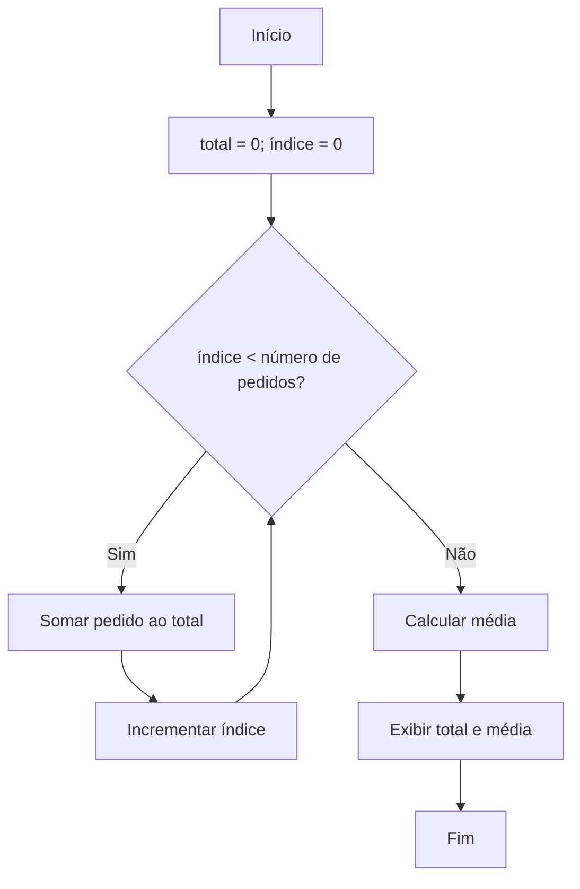

### Exemplos complementares

**Tabuada com for**

```js
for (let i = 1; i <= 10; i++) console.log(`7 x ${i} = ${7*i}`);
```

**Interromper e ignorar iterações**

```js
for (const n of [2, -1, 4, 0, 9]) {
  if (n === 0) break;
  if (n < 0) continue;
  console.log(n); // 2, 4
}
```

> Execute cada exemplo em um arquivo separado. Antes de executar, tente prever a saída.

### Exercícios

1. **Contagem:** use `for` para exibir números de `1` a `10`.
2. **Acumulação:** some os números de `1` a `100`. **Esperado:** `5050`.
3. **Filtro manual:** conte quantos pedidos de `[12, 35, 8, 50, 30]` são `>= 30`. **Esperado:** `3`.
4. **While:** simule consumo de um estoque inicial igual a `5`, retirando uma unidade por iteração até chegar a zero.
5. **Do...while:** crie um menu simulado por uma sequência de opções, encerrando ao encontrar `"sair"`.
6. **Desafio:** encontre o maior e o menor valor de um array **sem usar** `Math.max`, `Math.min` ou `sort`; trate o array vazio.
7. **Fixação adicional:** Exiba os números pares de 2 a 20.
8. **Fixação adicional:** Calcule 5! usando multiplicação acumulada.
9. **Fixação adicional:** Calcule a média de [7,8,9] usando for...of.
10. **Fixação adicional:** Conte ocorrências de "cafe" em ["cafe","suco","cafe"].
11. **Fixação adicional:** Gere uma matriz de multiplicação 3 por 3 usando laços aninhados.

**Critério de aceite:** laços terminam, índices não ultrapassam limites e array vazio não causa divisão por zero.

---

## Módulo 7 — Estruturas de dados: lista, array e set

### Problema

A cantina precisa manter um **catálogo ordenado de produtos**, um **carrinho que aceita itens repetidos** e um **conjunto de códigos únicos** de categorias já presentes no carrinho. Qual estrutura utilizar?

### Conceito

- **Lista:** conceito de estrutura de dados sequencial que organiza elementos em determinada ordem; pode ser implementada por **array** ou por uma **lista encadeada**.
- **`Array`:** estrutura nativa do JavaScript indexada a partir de `0`; preserva ordem de inserção e aceita duplicatas. Métodos frequentes: `push`, `pop`, `splice`, `includes`, `find`.
- **`Set`:** estrutura nativa que armazena **valores únicos** e mantém ordem de inserção na iteração. Métodos frequentes: `add`, `has`, `delete`. Não oferece acesso por índice como arrays.
- **Objeto (`{}`):** organiza propriedades nomeadas de uma entidade, como `id`, `nome`, `preco` e `estoque`.

> **Distinção importante:** JavaScript não possui uma estrutura nativa chamada `List`, como algumas outras linguagens. No uso cotidiano, um `Array` frequentemente representa uma lista. Já uma **lista encadeada** é uma implementação distinta, baseada em nós e referências.

| Requisito | Estrutura adequada | Por quê? |
|---|---|---|
| Itens do carrinho, inclusive repetidos | `Array` | Ordem e duplicatas |
| Conjunto de códigos sem repetição | `Set` | Unicidade |
| Dados de um produto | Objeto | Campos nomeados |
| Estudar nós e ponteiros lógicos | Lista encadeada | Compreensão da estrutura |

### Solução — `src/07-estruturas-dados.js`

```js
const catalogo = [
  { id: 1, nome: "Café", preco: 4.5, categoria: "bebida" },
  { id: 2, nome: "Suco", preco: 7, categoria: "bebida" },
  { id: 3, nome: "Sanduíche", preco: 12.5, categoria: "lanche" }
];

// Array: um mesmo produto pode aparecer mais de uma vez no carrinho.
const carrinho = [];
carrinho.push(catalogo[0]);
carrinho.push(catalogo[0]);
carrinho.push(catalogo[2]);

// Set: categorias únicas presentes no carrinho.
const categorias = new Set();
for (const produto of carrinho) {
  categorias.add(produto.categoria);
}

console.log(carrinho.length); // 3
console.log([...categorias]); // [ 'bebida', 'lanche' ]
console.log(categorias.has("bebida")); // true

// Lista encadeada simples: cada nó aponta para o próximo.
const primeiroNo = {
  valor: "Café",
  proximo: {
    valor: "Suco",
    proximo: null
  }
};

let atual = primeiroNo;
while (atual !== null) {
  console.log(atual.valor); // Café, depois Suco
  atual = atual.proximo;
}
```

### Diagrama

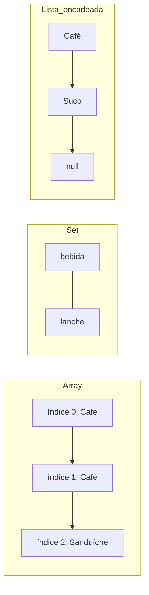

### Exemplos complementares

**Operações de array**

```js
const fila = ["Ana", "Bia"];
fila.push("Caio");
console.log(fila.shift()); // Ana
console.log(fila); // Bia, Caio
```

**Operações de conjunto**

```js
const a = new Set([1,2,3]), b = new Set([2,3,4]);
console.log([...new Set([...a,...b])]); // união
console.log([...a].filter(x => b.has(x))); // interseção
```

> Execute cada exemplo em um arquivo separado. Antes de executar, tente prever a saída.

### Exercícios

1. **Array:** adicione três produtos a um carrinho, remova o último com `pop` e exiba os restantes.
2. **Duplicatas:** crie `[1, 2, 2, 3, 3, 3]`; converta para `Set` e obtenha **3 valores únicos**.
3. **Objetos:** crie cinco produtos `{ id, nome, preco, estoque }` e exiba somente os que possuem estoque positivo.
4. **Acesso:** compare a leitura de `array[1]` com o percurso da lista encadeada até o segundo nó.
5. **Desafio:** implemente um carrinho usando array de objetos `{ produtoId, quantidade }`; some quantidades de um mesmo produto sem criar linhas duplicadas.
6. **Desafio extra:** acrescente um terceiro nó à lista encadeada e percorra todos os nós.
7. **Fixação adicional:** Remova o primeiro item de ["A","B","C"] usando shift.
8. **Fixação adicional:** Verifique se um Set de códigos contém 2; remova 2 e verifique novamente.
9. **Fixação adicional:** Encontre a união de [1,2] e [2,3] sem duplicatas.
10. **Fixação adicional:** Encontre a interseção de [1,2,3] e [2,4].
11. **Fixação adicional:** Represente uma fila de atendimento, adicione três nomes e atenda dois.

**Critério de aceite:** o array mantém ordem e pode conter repetidos; o set impede duplicatas; a lista encadeada termina em `null`.

---

## Módulo 8 — Algoritmos de busca e ordenação

### Problema

A cantina precisa **localizar rapidamente um produto pelo código** e **exibir preços em ordem crescente**. Como criar e comparar algoritmos que façam isso?

**Entradas:** produtos com IDs `5, 2, 9, 1`; busca pelo ID `9`. **Saída esperada:** localizar o item e apresentar os produtos ordenados por preço.

### Conceito

**Busca linear (sequencial):** percorre a coleção, elemento por elemento, até encontrar o alvo. Funciona mesmo que o array não esteja ordenado. Custo no pior caso: **O(n)**.

**Busca binária:** em um array **previamente ordenado pela mesma chave usada na busca**, compara o alvo com o elemento central e descarta metade do intervalo a cada passo. Custo: **O(log n)**. A ordenação prévia também tem custo e precisa ser considerada quando o array ainda não estiver ordenado.

**Ordenação:**

| Algoritmo | Ideia | Complexidade típica (pior caso) |
|---|---|---|
| Bubble sort | Trocar vizinhos fora de ordem repetidamente | O(n²) |
| Selection sort | Encontrar o menor elemento restante | O(n²) |
| Insertion sort | Inserir cada item em sua posição na parte já ordenada | O(n²) |
| `Array.prototype.sort` | Ordenador nativo da linguagem; implementação depende do motor | Não pressupor complexidade fixa pela linguagem |

**Atenção:** o método nativo `sort()` **modifica o array original**. Por padrão, compara valores como strings; para ordenar números, use uma função comparadora `(a, b) => a - b`.

### Solução — `src/08-busca-ordenacao.js`

```js
const produtos = [
  { id: 5, nome: "Suco", preco: 7 },
  { id: 2, nome: "Café", preco: 4.5 },
  { id: 9, nome: "Sanduíche", preco: 12.5 },
  { id: 1, nome: "Água", preco: 3 }
];

// Busca linear — não exige ordenação.
function buscaLinear(itens, idBuscado) {
  for (let i = 0; i < itens.length; i++) {
    if (itens[i].id === idBuscado) {
      return i;
    }
  }
  return -1;
}

// Busca binária — exige ordenação crescente por ID.
function buscaBinaria(itensOrdenados, idBuscado) {
  let inicio = 0;
  let fim = itensOrdenados.length - 1;

  while (inicio <= fim) {
    const meio = Math.floor((inicio + fim) / 2);
    const idAtual = itensOrdenados[meio].id;

    if (idAtual === idBuscado) return meio;
    if (idAtual < idBuscado) inicio = meio + 1;
    else fim = meio - 1;
  }
  return -1;
}

// Bubble sort — copia antes de ordenar e compara preços.
function ordenarPorPrecoBubble(itens) {
  const copia = [...itens];
  for (let i = 0; i < copia.length - 1; i++) {
    for (let j = 0; j < copia.length - 1 - i; j++) {
      if (copia[j].preco > copia[j + 1].preco) {
        [copia[j], copia[j + 1]] = [copia[j + 1], copia[j]];
      }
    }
  }
  return copia;
}

const ordenadosPorId = [...produtos].sort((a, b) => a.id - b.id);
const ordenadosPorPreco = ordenarPorPrecoBubble(produtos);

console.log(buscaLinear(produtos, 9)); // 2
console.log(buscaBinaria(ordenadosPorId, 9)); // 3
console.log(ordenadosPorPreco.map((p) => p.nome));
// [ 'Água', 'Café', 'Suco', 'Sanduíche' ]
console.log(buscaLinear(produtos, 99)); // -1
```

> O índice encontrado pela busca binária corresponde ao **array ordenado por ID**, não à posição original dos produtos.

### Diagramas

**Busca binária**

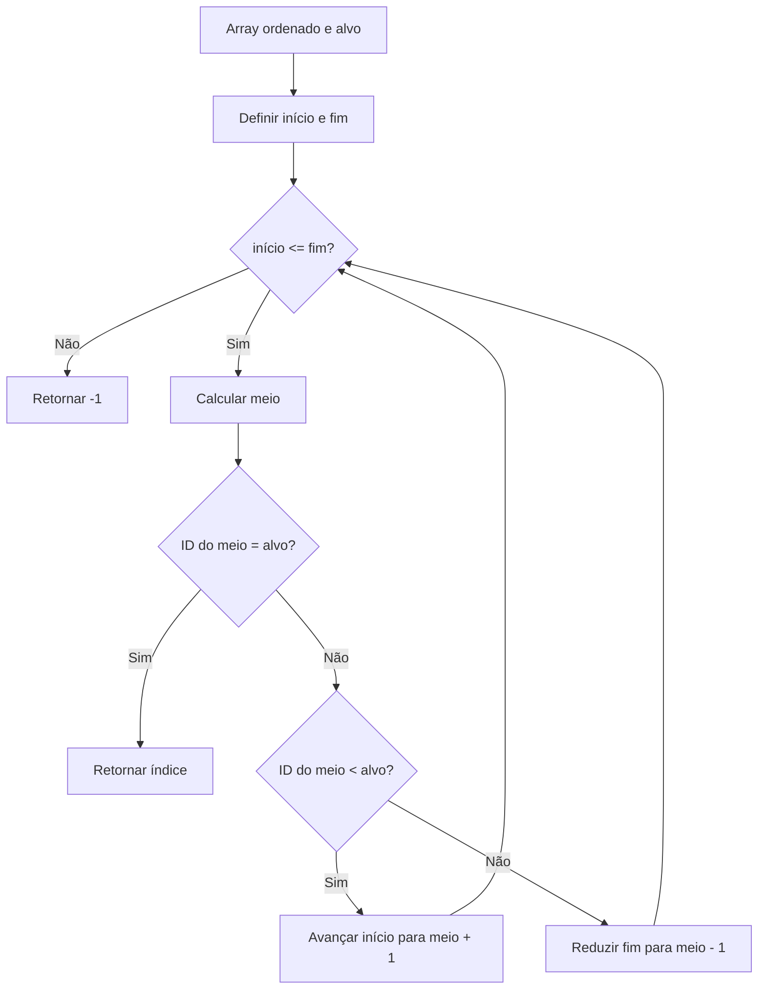

**Bubble sort**

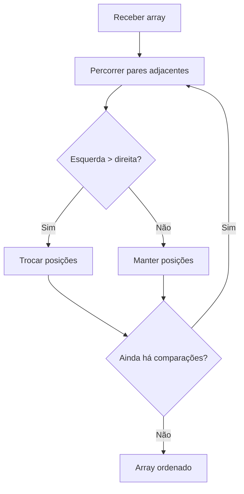

### Exemplos complementares

**Ordenação numérica nativa**

```js
const valores = [10, 2, 30];
console.log([...valores].sort()); // 10, 2, 30
console.log([...valores].sort((a,b)=>a-b)); // 2, 10, 30
```

**Busca com rastreamento**

```js
const valores = [2,4,6,8,10];
let inicio=0, fim=valores.length-1;
while(inicio<=fim){
  const meio=Math.floor((inicio+fim)/2);
  console.log({inicio,fim,meio,valor:valores[meio]});
  if(valores[meio]===8) break;
  if(valores[meio]<8) inicio=meio+1; else fim=meio-1;
}
```

> Execute cada exemplo em um arquivo separado. Antes de executar, tente prever a saída.

### Exercícios

1. **Busca linear:** localize o ID `2` e pesquise o ID inexistente `99`. **Esperado:** índice `1` no array original e `-1` para o inexistente.
2. **Busca binária:** ordene por ID, procure `1`, `5` e `99`; explique por que buscar em um array desordenado pode falhar.
3. **Bubble sort:** ordene `[7, 3, 9, 1]`. **Esperado:** `[1, 3, 7, 9]`.
4. **Selection sort:** implemente o algoritmo sem usar `sort`. Valide usando `[5, 2, 4, 2]`.
5. **Insertion sort:** implemente e teste com array vazio, já ordenado, em ordem inversa e contendo duplicatas.
6. **Comparação:** conte quantas comparações cada busca realiza em arrays de 10 e de 100 elementos ordenados. Descreva o crescimento observado.
7. **Desafio:** crie uma ordenação por **preço crescente** e, em caso de empate, por **nome em ordem alfabética**, utilizando `localeCompare("pt-BR")`.
8. **Fixação adicional:** Ordene [10,2,30] em ordem decrescente sem alterar o original.
9. **Fixação adicional:** Use busca linear para encontrar o primeiro 4 em [4,2,4].
10. **Fixação adicional:** Teste busca binária em array vazio e com um único elemento.
11. **Fixação adicional:** Registre as trocas do bubble sort para [3,2,1].
12. **Fixação adicional:** Compare o resultado dos três algoritmos de ordenação para [-2,0,3,-2].

**Critério de aceite:** preservar o array original quando necessário; busca binária somente sobre lista ordenada pela chave correta; devolver `-1` quando não encontrar.

---

## Módulo 9 — Métodos e funções

### Problema

O cálculo de subtotal e desconto aparece em várias partes do sistema. Copiar as mesmas instruções provoca inconsistências. Como **reutilizar comportamentos**, **receber parâmetros** e **retornar resultados**?

### Conceito

**Função:** bloco reutilizável de instruções que pode receber **parâmetros** e devolver um valor com `return`.

**Método:** função associada a um objeto ou estrutura, invocada por meio dela, como `carrinho.push()` ou `produto.descrever()`.

**Principais formas:** declaração `function nome(...) { ... }`, expressão de função e **arrow function** `(x) => x * 2`.

**Métodos úteis de arrays:** `find` (primeira ocorrência), `filter` (novo array filtrado), `map` (novo array transformado), `reduce` (acumulador). Aqui eles são apresentados **depois dos laços**, para que o aluno compreenda o que fazem internamente.

**Boas práticas:** função com uma responsabilidade principal; nomes descritivos; retorno explícito; validação de parâmetros; redução de efeitos colaterais.

### Solução — `src/09-funcoes-metodos.js`

```js
const produtos = [
  { id: 1, nome: "Café", preco: 4.5 },
  { id: 2, nome: "Suco", preco: 7 },
  { id: 3, nome: "Sanduíche", preco: 12.5 }
];

function calcularSubtotal(preco, quantidade) {
  if (!Number.isFinite(preco) || !Number.isInteger(quantidade)
      || preco < 0 || quantidade <= 0) {
    throw new Error("Preço ou quantidade inválidos");
  }
  return preco * quantidade;
}

function aplicarDesconto(total) {
  const taxa = total >= 50 ? 0.10 : total >= 30 ? 0.05 : 0;
  return total * (1 - taxa);
}

const pedidos = [
  { produtoId: 1, quantidade: 2 },
  { produtoId: 3, quantidade: 2 }
];

// find: procura um produto pelo ID.
// map: transforma cada pedido no subtotal correspondente.
const subtotais = pedidos.map((pedido) => {
  const produto = produtos.find((item) => item.id === pedido.produtoId);
  if (produto === undefined) {
    throw new Error("Produto não encontrado");
  }
  return calcularSubtotal(produto.preco, pedido.quantidade);
});

// reduce: soma os subtotais.
const total = subtotais.reduce((acumulador, valor) => acumulador + valor, 0);
console.log(total); // 34
console.log(aplicarDesconto(total)); // 32.3

// filter: seleciona somente os produtos de R$ 7 ou mais.
console.log(produtos.filter((produto) => produto.preco >= 7).length); // 2

// Exemplo de método criado em um objeto.
const produtoEspecial = {
  nome: "Chá",
  preco: 5,
  descrever() {
    return `${this.nome}: R$ ${this.preco.toFixed(2)}`;
  }
};
console.log(produtoEspecial.descrever()); // Chá: R$ 5.00
```

> `find`, `map`, `filter` e `reduce` são métodos de `Array`. Eles recebem funções como argumento; esta é a ideia de **callback**.

### Diagrama

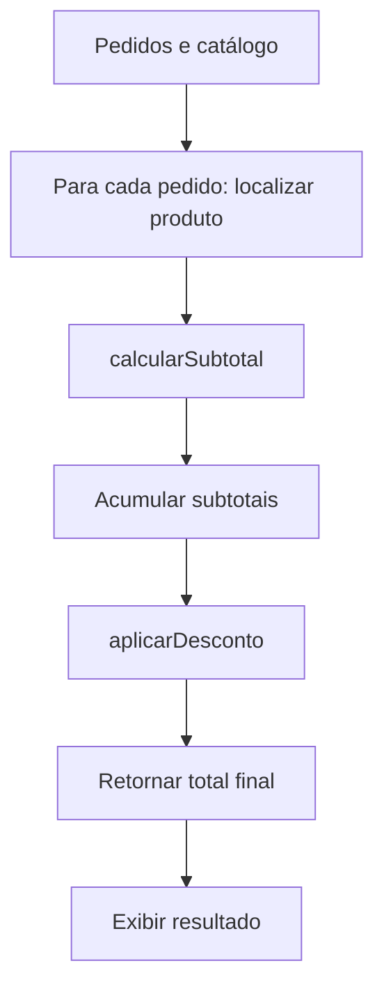

### Exemplos complementares

**Parâmetros e retorno**

```js
function calcularPreco(preco, quantidade=1){ return preco*quantidade; }
console.log(calcularPreco(7), calcularPreco(7,3)); // 7, 21
```

**Composição de métodos**

```js
const notas=[4,8,9,5];
const aprovadas=notas.filter(n=>n>=7).map(n=>n*10);
console.log(aprovadas); // 80, 90
```

> Execute cada exemplo em um arquivo separado. Antes de executar, tente prever a saída.

### Exercícios

1. **Função simples:** crie `calcularAreaRetangulo(base, altura)` e teste com `5` e `3`. **Esperado:** `15`.
2. **Reutilização:** crie `calcularTroco(valorPago, total)` e utilize a função em três compras diferentes.
3. **Busca:** escreva `localizarProdutoPorId(produtos, id)` usando `find`, retornando `undefined` para ID inexistente.
4. **Transformação:** use `map` para gerar um array com os nomes dos produtos em letras maiúsculas.
5. **Filtragem:** use `filter` para listar produtos com preço de até R$ 7.
6. **Agregação:** use `reduce` para calcular a soma de `[12, 8, 20]`. **Esperado:** `40`.
7. **Desafio:** implemente `fecharPedido(carrinho, catalogo)` que valida cada item, calcula subtotais, aplica a regra de descontos do módulo 5 e retorna `{ subtotal, desconto, total }`.
8. **Fixação adicional:** Crie função ehPar(n) que retorne booleano.
9. **Fixação adicional:** Crie função média que retorne null para array vazio.
10. **Fixação adicional:** Use some e every para verificar se há nota >=7 e se todas são >=7 em [6,8,9].
11. **Fixação adicional:** Crie método de objeto conta que acrescente um depósito positivo ao saldo.
12. **Fixação adicional:** Encadeie filter e map para obter nomes dos produtos disponíveis.

**Critério de aceite:** funções reutilizáveis com parâmetros/retornos claros, validação de entradas e resultados verificáveis.

---

## Projeto integrador — Sistema de pedidos da cantina

### Situação-problema

A cantina universitária utiliza anotações manuais para cadastrar produtos e calcular pedidos. Isso causa erros de preço, registro duplicado e dificuldade para localizar itens. Seu desafio é criar uma aplicação **de terminal**, em JavaScript, que execute um fluxo básico de vendas **sem dependências externas**.

### Requisitos funcionais

| ID | Requisito | Conteúdos mobilizados |
|---|---|---|
| RF01 | Manter catálogo de produtos com `id`, `nome`, `preco` e `estoque` | Tipos, variáveis, objetos, arrays |
| RF02 | Listar produtos e sinalizar indisponibilidade | Repetição, decisão, relações |
| RF03 | Buscar produto por ID | Busca linear; busca binária como extensão |
| RF04 | Adicionar item ao carrinho, validando quantidade positiva e estoque | Lógica, relações, decisão, array |
| RF05 | Consolidar quantidades de um mesmo produto | Arrays, laços, funções |
| RF06 | Calcular subtotal, desconto e total | Variáveis, decisões, funções |
| RF07 | Listar categorias únicas do pedido | `Set` |
| RF08 | Ordenar catálogo por preço ou nome | Algoritmos de ordenação |
| RF09 | Finalizar pedido e atualizar estoque | Funções, laços, decisão |
| RF10 | Exibir mensagens para situações inválidas | Validação, decisões |

### Regras de negócio

1. Todo produto deve ter `id` único, preço não negativo e estoque inteiro não negativo.
2. A quantidade solicitada deve ser um **inteiro maior que zero**.
3. O pedido não pode ultrapassar o estoque disponível, considerando quantidades **já adicionadas ao carrinho**.
4. Pedidos com subtotal **maior ou igual a R$ 50** recebem **10%** de desconto; com subtotal **maior ou igual a R$ 30** e inferior a R$ 50 recebem **5%**; abaixo disso, **0%**.
5. O estoque só é reduzido após a finalização bem-sucedida do pedido.
6. Ao buscar um produto inexistente, o sistema deve informar isso sem encerrar de forma inesperada.
7. O fechamento de um carrinho vazio deve ser rejeitado.

### Modelagem inicial

```js
const catalogo = [
  { id: 1, nome: "Café", preco: 4.5, estoque: 10, categoria: "bebida" },
  { id: 2, nome: "Suco", preco: 7, estoque: 8, categoria: "bebida" },
  { id: 3, nome: "Sanduíche", preco: 12.5, estoque: 5, categoria: "lanche" },
  { id: 4, nome: "Salada", preco: 18, estoque: 4, categoria: "refeição" }
];

const carrinho = [];

// Estrutura sugerida para um item do carrinho:
// { produtoId: 3, quantidade: 2 }
```

### Fluxo do projeto

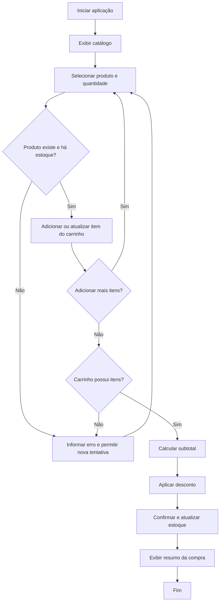

### Etapas de construção

1. **Etapa 1 — Dados:** representar os produtos usando tipos apropriados, variáveis e objetos.
2. **Etapa 2 — Regras:** criar verificações de estoque e de desconto usando operações lógicas, relacionais e condicionais.
3. **Etapa 3 — Processamento:** percorrer carrinho e catálogo com laços e acumuladores.
4. **Etapa 4 — Coleções:** usar arrays para catálogo e carrinho, `Set` para categorias únicas.
5. **Etapa 5 — Algoritmos:** implementar busca linear e ordenação; adicionar busca binária se o catálogo estiver ordenado por ID.
6. **Etapa 6 — Organização:** separar código em funções de busca, validação, adição, cálculo e fechamento.
7. **Etapa 7 — Demonstração:** executar pelo menos seis cenários de teste e registrar as saídas esperadas.

**Interface permitida:** para manter o foco em lógica, o projeto pode começar com um **roteiro de comandos simulados em `app.js`**, sem entrada interativa. Como evolução opcional, use `readline` do Node.js para criar um menu no terminal.

### Cenários mínimos de teste

| Cenário | Entrada / situação | Resultado esperado |
|---|---|---|
| T01 — Venda comum | 2 cafés (R$ 4,50 cada) | Subtotal R$ 9,00; desconto 0%; total R$ 9,00 |
| T02 — Desconto de 5% | 2 sanduíches + 1 suco = R$ 32,00 | Desconto R$ 1,60; total R$ 30,40 |
| T03 — Desconto de 10% | 4 saladas = R$ 72,00 | Desconto R$ 7,20; total R$ 64,80 |
| T04 — Estoque insuficiente | Solicitar 11 cafés com estoque 10 | Pedido rejeitado; estoque inalterado |
| T05 — Código inexistente | Buscar ID `999` | Produto não encontrado |
| T06 — Quantidade inválida | Solicitar `0` ou `-1` unidades | Pedido rejeitado |
| T07 — Carrinho acumulado | Adicionar 3 cafés e depois 8 cafés | Segunda adição rejeitada: ultrapassaria estoque 10 |
| T08 — Carrinho vazio | Tentar finalizar sem itens | Finalização rejeitada |

**Observação de implementação:** os testes devem começar com o **estoque inicial restabelecido** para que sejam independentes. Para valores monetários no projeto didático, formate as saídas com `toFixed(2)`; para soluções de produção, utilize centavos inteiros ou representação decimal adequada e política explícita de arredondamento.

### Desafios opcionais de evolução

- Implementar `selectionSort` e `insertionSort` e comparar com o `sort` nativo.
- Criar um menu interativo via `node:readline/promises`.
- Permitir cancelamento de um item do carrinho sem alterar o estoque do catálogo.
- Criar um histórico de vendas e relatório de faturamento.
- Automatizar testes com `node:test` e `node:assert/strict`.

---

## Avaliação, roteiro de estudo e referências

### Rubrica sugerida (100 pontos)

| Dimensão | Pontuação | Evidências |
|---|---:|---|
| Compreensão do problema | 15 | Entradas, saídas, regras e hipóteses identificadas |
| Correção lógica | 25 | Condições, laços, cálculos e limites corretos |
| Estruturas e algoritmos | 20 | Uso adequado de Array, Set, busca e ordenação |
| Organização e funções | 15 | Funções claras, coesão, reutilização |
| Testes e casos extremos | 15 | Evidências dos cenários T01–T08 |
| Documentação e diagramas | 10 | README do projeto e fluxograma coerente |
| **Total** | **100** | |

### Checklist individual de conclusão

- [ ] Consegui explicar as entradas, transformações e saídas antes de codificar.
- [ ] Sei diferenciar `string`, `number`, `boolean`, `null` e `undefined`.
- [ ] Sei quando utilizar `const` e `let`.
- [ ] Consigo combinar operadores lógicos e relacionais sem confundir seus papéis.
- [ ] Escrevo decisões com `if/else` e `switch`.
- [ ] Percorro arrays com `for`, `while` e `for...of`.
- [ ] Sei a diferença conceitual entre lista, array e set.
- [ ] Sei quando uma busca binária pode ser utilizada.
- [ ] Consigo implementar busca linear e ao menos um algoritmo de ordenação.
- [ ] Crio funções com parâmetros e retornos e reconheço métodos de objetos/arrays.
- [ ] Sei testar entradas inválidas, coleções vazias e casos de fronteira.
- [ ] Concluí o projeto integrador e demonstrei os casos de teste.

### Referências oficiais

- [MDN — Guia de JavaScript](https://developer.mozilla.org/pt-BR/docs/Web/JavaScript/Guide)
- [MDN — Tipos e estruturas de dados](https://developer.mozilla.org/pt-BR/docs/Web/JavaScript/Data_structures)
- [MDN — Estruturas de controle e fluxo](https://developer.mozilla.org/pt-BR/docs/Web/JavaScript/Guide/Control_flow_and_error_handling)
- [MDN — Loops e iteração](https://developer.mozilla.org/pt-BR/docs/Web/JavaScript/Guide/Loops_and_iteration)
- [MDN — Arrays](https://developer.mozilla.org/en-US/docs/Web/JavaScript/Reference/Global_Objects/Array)
- [MDN — Set](https://developer.mozilla.org/en-US/docs/Web/JavaScript/Reference/Global_Objects/Set)
- [MDN — Funções](https://developer.mozilla.org/pt-BR/docs/Web/JavaScript/Guide/Functions)
- [Node.js — Documentação](https://nodejs.org/docs/latest/api/)
- [Mermaid — Flowcharts](https://mermaid.js.org/syntax/flowchart.html)

---

**Proposta pedagógica:** cada conceito é apresentado para resolver um problema concreto. O objetivo não é memorizar comandos, e sim desenvolver raciocínio algorítmico, formular soluções, representá-las visualmente e validá-las por meio de testes.


---

## Respostas dos exercícios

Consulte o gabarito após tentar resolver as atividades. Existem diversas soluções corretas; compare os resultados e explique as decisões tomadas. Cada bloco é independente e pode ser executado com Node.js.

### Respostas — Módulo 1 — Tipos de dados

<details>
<summary>Exibir soluções dos exercícios 1 a 10</summary>

Os comentários identificam os números dos exercícios na ordem apresentada. Para questões abertas, os valores utilizados são exemplos possíveis.

```js
// 1–5: tipos e conversões
const produto = "Café", preco = 4.5, quantidade = 2, ativo = true;
console.log([produto, preco, quantidade, ativo].map(v => typeof v));
console.log(Number("15") * 4); // 60
console.log(Number.isNaN(Number("quinze"))); // true
console.log(typeof null, typeof [], Array.isArray([])); // object object true
const p = Number("9.90"), q = Number("2");
console.log(p, q, p * q, typeof p, typeof q);
// 6–10
console.log(typeof Number("42"), typeof String(42));
console.log([0, 1, "", "false"].map(Boolean)); // false true false true
for (const v of ["12", "abc", ""]) console.log(v, v.trim() !== "" && Number.isFinite(Number(v)));
console.log({ nome: "Ana", notas: [8, 9], aprovado: true });
console.log((199 * 3 / 100).toFixed(2)); // 5.97
```

</details>

### Respostas — Módulo 2 — Variáveis

<details>
<summary>Exibir soluções dos exercícios 1 a 10</summary>

Os comentários identificam os números dos exercícios na ordem apresentada. Para questões abertas, os valores utilizados são exemplos possíveis.

```js
// 1–5
console.log((5 * 4.5).toFixed(2));
let quantidade = 2; quantidade = 6; console.log(quantidade * 7);
if (true) { let local = 10; console.log(local); }
try { console.log(local); } catch (erro) { console.log(erro.name); } // ReferenceError
console.log((20 - 18).toFixed(2));
const inicial = 100; let caixa = inicial; caixa += 30; caixa += 20; caixa -= 10; console.log(inicial, caixa);
// 6–10
console.log((7 + 8 + 9) / 3); // 8
let a = 10, b = 20; const auxiliar = a; a = b; b = auxiliar; console.log(a, b);
console.log(120 * 60); // 7200
let estoque = 10; estoque += 7; estoque -= 4; console.log(estoque); // 13
const compra = 80, desconto = compra * 0.15; console.log(desconto, compra - desconto);
```

</details>

### Respostas — Módulo 3 — Operações lógicas

<details>
<summary>Exibir soluções dos exercícios 1 a 10</summary>

Os comentários identificam os números dos exercícios na ordem apresentada. Para questões abertas, os valores utilizados são exemplos possíveis.

```js
// 1–2: todas as combinações, na ordem false/false, false/true, true/false, true/true
for (const a of [false, true]) for (const b of [false, true]) console.log(a,b,a && b,a || b);
// 3–5
const podeComprar = false; console.log(!podeComprar);
console.log((false && true) || true); // true
for (const a of [false,true]) for (const b of [false,true]) console.log({ matricula: a && b, bolsa: a || b, desbloqueado: !a });
// 6–10
console.log(true && true); // login
console.log(false || 120 >= 100); // frete
console.log(false || !false); // bloqueio
console.log(true !== false); // exatamente uma
for (const a of [false,true]) for (const b of [false,true]) console.log(!(a || b) === (!a && !b));
```

</details>

### Respostas — Módulo 4 — Operações relacionais

<details>
<summary>Exibir soluções dos exercícios 1 a 10</summary>

Os comentários identificam os números dos exercícios na ordem apresentada. Para questões abertas, os valores utilizados são exemplos possíveis.

```js
// 1–5
console.log(29.99 >= 30);
console.log(10 === "10", 10 == "10"); // false true; == converte tipos
for (const q of [0,1,5,6]) console.log(q, q <= 5, q > 0 && q <= 5);
console.log(7 >= 7);
const q = 2, estoque = 5, pago = 20, total = 18; console.log(q > 0 && q <= estoque && pago >= total);
// 6–10
const idade = 18; console.log(idade >= 18 && idade <= 65);
console.log(9.90 < 12.50);
console.log(5 !== "5");
for (const nota of [-1,0,10,11]) console.log(nota, nota >= 0 && nota <= 10);
console.log(Number("8") === 8);
```

</details>

### Respostas — Módulo 5 — Estruturas de decisão

<details>
<summary>Exibir soluções dos exercícios 1 a 10</summary>

Os comentários identificam os números dos exercícios na ordem apresentada. Para questões abertas, os valores utilizados são exemplos possíveis.

```js
// 1–5
for (const t of [29.99,30,49.99,50]) console.log(t, t >= 50 ? 10 : t >= 30 ? 5 : 0);
for (const q of [6,5,0]) console.log(q > 5 ? "Em estoque" : q > 0 ? "Estoque baixo" : "Esgotado");
for (const item of ["cafe","suco","sanduiche"]) { switch(item) { case "cafe": console.log(4.5); break; case "suco": console.log(7); break; case "sanduiche": console.log(12.5); break; } }
const quantidade = 0; if (quantidade <= 0) console.log("Inválida"); else console.log(quantidade * 7);
const ativo = true, total = 25; if (!ativo) console.log("Inativo"); else if (total < 30) console.log("Valor insuficiente"); else console.log("Benefício");
// 6–10
const n = -2; console.log(n > 0 ? "Positivo" : n < 0 ? "Negativo" : "Zero");
console.log(17 % 2 === 0 ? "Par" : "Ímpar");
for (const nota of [-1,4,5,7,11]) { if (nota < 0 || nota > 10) console.log("Inválida"); else if (nota >= 7) console.log("Aprovado"); else if (nota >= 5) console.log("Recuperação"); else console.log("Reprovado"); }
for (const op of ["+","-","*","?"]) { switch(op) {case "+": console.log(8+2); break; case "-": console.log(8-2); break; case "*": console.log(8*2); break; default: console.log("Inválida");} }
for (const km of [-1,10,11]) console.log(km < 0 ? "Inválida" : km <= 10 ? 8 : 12);
```

</details>

### Respostas — Módulo 6 — Estruturas de repetição

<details>
<summary>Exibir soluções dos exercícios 1 a 11</summary>

Os comentários identificam os números dos exercícios na ordem apresentada. Para questões abertas, os valores utilizados são exemplos possíveis.

```js
// 1–6
for(let i=1;i<=10;i++) console.log(i);
let soma=0; for(let i=1;i<=100;i++) soma+=i; console.log(soma);
let cont=0; for(const n of [12,35,8,50,30]) if(n>=30) cont++; console.log(cont);
let estoque=5; while(estoque>0) { estoque--; console.log(estoque); }
const opcoes=["listar","sair"]; let i=0; do { console.log(opcoes[i]); } while(opcoes[i++]!=="sair" && i<opcoes.length);
for(const valores of [[4,1,9],[]]) { if(!valores.length) {console.log("Vazio"); continue;} let min=valores[0],max=min; for(const v of valores){if(v<min)min=v;if(v>max)max=v;} console.log(min,max); }
// 7–11
for(let j=2;j<=20;j+=2) console.log(j);
let fat=1; for(let j=1;j<=5;j++) fat*=j; console.log(fat); // 120
let total=0; const notas=[7,8,9]; for(const n of notas)total+=n; console.log(total/notas.length);
let cafes=0; for(const item of ["cafe","suco","cafe"]) if(item==="cafe")cafes++; console.log(cafes);
for(let linha=1;linha<=3;linha++){const valores=[];for(let col=1;col<=3;col++)valores.push(linha*col);console.log(valores);}
```

</details>

### Respostas — Módulo 7 — Estruturas de dados: lista, array e set

<details>
<summary>Exibir soluções dos exercícios 1 a 11</summary>

Os comentários identificam os números dos exercícios na ordem apresentada. Para questões abertas, os valores utilizados são exemplos possíveis.

```js
// 1–6
const carrinho=[]; carrinho.push("Café","Suco","Pão"); carrinho.pop(); console.log(carrinho);
console.log(new Set([1,2,2,3,3,3]).size);
const produtos=[1,2,3,4,5].map(id=>({id,nome:`P${id}`,preco:id,estoque:id%2})); for(const p of produtos) if(p.estoque>0) console.log(p);
const lista={valor:"A",proximo:{valor:"B",proximo:null}}; console.log(["A","B"][1],lista.proximo.valor); // acesso por índice vs seguir referência
const itens=[]; for(const id of [1,2,1]) { const item=itens.find(x=>x.produtoId===id); if(item)item.quantidade++;else itens.push({produtoId:id,quantidade:1}); } console.log(itens);
lista.proximo.proximo={valor:"C",proximo:null}; for(let no=lista;no!==null;no=no.proximo)console.log(no.valor);
// 7–11
const letras=["A","B","C"]; letras.shift(); console.log(letras);
const codigos=new Set([1,2]); console.log(codigos.has(2)); codigos.delete(2); console.log(codigos.has(2));
console.log([...new Set([1,2,2,3])]);
const b=new Set([2,4]); console.log([1,2,3].filter(x=>b.has(x)));
const fila=[]; fila.push("Ana","Bia","Caio"); console.log(fila.shift(),fila.shift(),fila);
```

</details>

### Respostas — Módulo 8 — Algoritmos de busca e ordenação

<details>
<summary>Exibir soluções dos exercícios 1 a 12</summary>

Os comentários identificam os números dos exercícios na ordem apresentada. Para questões abertas, os valores utilizados são exemplos possíveis.

```js
// Funções auxiliares para 1–12
function linear(a,x){let c=0;for(let i=0;i<a.length;i++){c++;if(a[i]===x)return [i,c];}return [-1,c];}
function binaria(a,x){let l=0,r=a.length-1,c=0;while(l<=r){let m=Math.floor((l+r)/2);c++;if(a[m]===x)return [m,c];if(a[m]<x)l=m+1;else r=m-1;}return [-1,c];}
function bubble(a,rastrear=false){a=[...a];for(let i=0;i<a.length-1;i++)for(let j=0;j<a.length-1-i;j++)if(a[j]>a[j+1]){[a[j],a[j+1]]=[a[j+1],a[j]];if(rastrear)console.log([...a]);}return a;}
function selection(a){a=[...a];for(let i=0;i<a.length-1;i++){let m=i;for(let j=i+1;j<a.length;j++)if(a[j]<a[m])m=j;[a[i],a[m]]=[a[m],a[i]];}return a;}
function insertion(a){a=[...a];for(let i=1;i<a.length;i++){let v=a[i],j=i-1;while(j>=0&&a[j]>v){a[j+1]=a[j];j--;}a[j+1]=v;}return a;}
// 1–7
console.log(linear([5,2,9,1],2)[0],linear([5,2,9,1],99)[0]);
for(const x of [1,5,99])console.log(binaria([1,2,5,9],x)[0]); // 0,2,-1
console.log(bubble([7,3,9,1]));
console.log(selection([5,2,4,2]));
for(const a of [[],[1,2],[3,2,1],[2,2,1]])console.log(insertion(a));
for(const n of [10,100]){const a=Array.from({length:n},(_,i)=>i);console.log(n,linear(a,-1)[1],binaria(a,-1)[1]);}
const produtos=[{nome:"Suco",preco:7},{nome:"Água",preco:7},{nome:"Café",preco:4}];console.log([...produtos].sort((a,b)=>a.preco-b.preco||a.nome.localeCompare(b.nome,"pt-BR")));
// 8–12
const a=[10,2,30];console.log([...a].sort((a,b)=>b-a),a);
console.log(linear([4,2,4],4)[0]);
console.log(binaria([],1),binaria([1],1),binaria([1],2));
console.log(bubble([3,2,1],true));
for(const ordenar of [bubble,selection,insertion])console.log(ordenar([-2,0,3,-2]));
```

</details>

### Respostas — Módulo 9 — Métodos e funções

<details>
<summary>Exibir soluções dos exercícios 1 a 12</summary>

Os comentários identificam os números dos exercícios na ordem apresentada. Para questões abertas, os valores utilizados são exemplos possíveis.

```js
// 1–6
function calcularAreaRetangulo(b,h){return b*h;} console.log(calcularAreaRetangulo(5,3));
function calcularTroco(pago,total){return pago-total;} for(const [p,t] of [[20,18],[50,32],[10,7]])console.log(calcularTroco(p,t));
const produtos=[{id:1,nome:"Café",preco:4.5,estoque:10},{id:2,nome:"Suco",preco:7,estoque:0},{id:3,nome:"Pão",preco:12.5,estoque:5}];
function localizarProdutoPorId(ps,id){return ps.find(p=>p.id===id);} console.log(localizarProdutoPorId(produtos,1),localizarProdutoPorId(produtos,99));
console.log(produtos.map(p=>p.nome.toUpperCase()));
console.log(produtos.filter(p=>p.preco<=7));
console.log([12,8,20].reduce((a,b)=>a+b,0));
// 7: valida também quantidades acumuladas
function fecharPedido(carrinho,catalogo){if(!carrinho.length)throw Error("Vazio");const quantidades=new Map();let subtotal=0;for(const item of carrinho){const p=localizarProdutoPorId(catalogo,item.produtoId);if(!p||!Number.isInteger(item.quantidade)||item.quantidade<=0)throw Error("Item inválido");const q=(quantidades.get(p.id)||0)+item.quantidade;if(q>p.estoque)throw Error("Estoque insuficiente");quantidades.set(p.id,q);subtotal+=p.preco*item.quantidade;}const desconto=subtotal*(subtotal>=50?0.10:subtotal>=30?0.05:0);return {subtotal,desconto,total:subtotal-desconto};} console.log(fecharPedido([{produtoId:3,quantidade:3}],produtos));
// 8–12
const ehPar=n=>n%2===0; console.log(ehPar(8),ehPar(7));
function media(a){return a.length?a.reduce((s,n)=>s+n,0)/a.length:null;} console.log(media([7,8,9]),media([]));
console.log([6,8,9].some(n=>n>=7),[6,8,9].every(n=>n>=7));
const conta={saldo:10,depositar(v){if(Number.isFinite(v)&&v>0)this.saldo+=v;}};conta.depositar(20);console.log(conta.saldo);
console.log(produtos.filter(p=>p.estoque>0).map(p=>p.nome));
```

</details>

