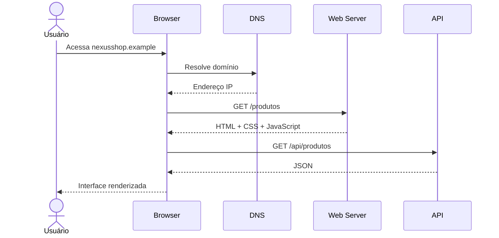

# Semana 01 — Como a Web funciona

## Objetivos

Compreender o caminho percorrido entre a ação do usuário no navegador e a resposta entregue por uma aplicação Web.

Ao final desta semana, você deverá ser capaz de:

- explicar os principais conceitos com suas próprias palavras;
- relacionar os conceitos ao estudo de caso da NexusShop;
- interpretar o diagrama da solução;
- executar o laboratório proposto;
- registrar o resultado no GitHub.

---

## 1. Conceitos

### 1. Internet x Web

Internet é a infraestrutura de redes que conecta dispositivos. A Web é um dos serviços executados sobre essa infraestrutura, baseado principalmente em HTTP, URLs, navegadores e servidores.

### 2. Cliente e servidor

O navegador normalmente atua como cliente. Ele solicita recursos ou dados a servidores, que processam a requisição e devolvem uma resposta.

### 3. HTTP e HTTPS

HTTP define como clientes e servidores trocam mensagens. HTTPS adiciona criptografia TLS, autenticidade e proteção contra interceptação.

### 4. DNS e URL

O DNS traduz nomes como `app.exemplo.com` para endereços IP. A URL identifica o recurso, protocolo, host, porta, caminho e parâmetros.

### 5. Request e Response

Uma requisição possui método, URL, headers e opcionalmente body. A resposta contém status HTTP, headers e conteúdo.

### 6. HTML, CSS e JavaScript

HTML estrutura o documento, CSS define apresentação e JavaScript adiciona comportamento e interação.

### 7. DOM

O navegador transforma o HTML em uma árvore de objetos que pode ser consultada e alterada pelo JavaScript.

---

## 2. Estudo de Caso — NexusShop

Um usuário acessa `https://nexusshop.example/produtos`. O DNS resolve o domínio, o navegador abre uma conexão HTTPS, solicita a página e recebe HTML, CSS e JavaScript. Depois, o JavaScript pode realizar novas chamadas HTTP para obter o catálogo em JSON.

### O que devemos observar

O foco do estudo de caso não é apenas implementar uma solução, mas entender **por que** determinada técnica é utilizada, quais problemas ela resolve e como se conecta às demais etapas do roadmap.

---

## 3. Diagrama

---

## 4. Laboratório

### Objetivo do laboratório

Aplicar os conceitos da semana em uma evolução prática da NexusShop.

### Passo a passo

1. Abra um site público no Chrome ou Firefox.
2. Abra **DevTools → Network** e recarregue a página.
3. Identifique a requisição principal do documento HTML.
4. Observe método HTTP, status, headers, tamanho e tempo.
5. Localize requisições de CSS, JavaScript, imagens e chamadas `fetch/XHR`.
6. Na aba **Elements**, identifique a árvore DOM e altere temporariamente um texto.
7. Na aba **Console**, execute `document.title` e `document.querySelector('body')`.

### Evidências esperadas

- código versionado;
- commits relacionados à atividade;
- documentação quando aplicável;
- captura de tela ou link quando a atividade envolver interface;
- README atualizado quando houver mudança importante na forma de executar o projeto.

### Entrega

Crie `docs/semana-01-web.md` registrando pelo menos cinco requisições observadas, seus métodos, status e finalidade.

---

## 5. Perguntas para revisão

1. Qual problema principal os conceitos desta semana resolvem?
2. Qual é o erro mais comum ao aplicar esses conceitos?
3. Como o conteúdo desta semana se conecta à semana anterior?
4. Como você explicaria a solução implementada para outro desenvolvedor?
5. O que mudaria em um projeto real de maior escala?

---

## 6. Checklist da semana

- [ ] Estudei os conceitos.
- [ ] Entendi o estudo de caso.
- [ ] Interpretei o diagrama Mermaid.
- [ ] Executei o laboratório.
- [ ] Registrei as evidências no GitHub.
- [ ] Revisei os principais aprendizados.

---

[Voltar para o mês](../README.md) | [Voltar para o roadmap](../../README.md)
