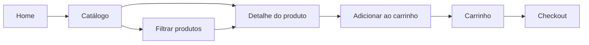

# Semana 02 — Fundamentos de UX/UI

## Objetivos

Separar experiência do usuário de interface visual e transformar uma necessidade de negócio em fluxo e wireframe.

Ao final desta semana, você deverá ser capaz de:

- explicar os principais conceitos com suas próprias palavras;
- relacionar os conceitos ao estudo de caso da NexusShop;
- interpretar o diagrama da solução;
- executar o laboratório proposto;
- registrar o resultado no GitHub.

---

## 1. Conceitos

### 1. UX

User Experience trata da experiência completa do usuário ao tentar atingir um objetivo.

### 2. UI

User Interface trata dos elementos visuais e interativos por meio dos quais o usuário utiliza o sistema.

### 3. Jornada do usuário

Representa etapas, necessidades, dúvidas e pontos de fricção durante uma interação.

### 4. User Flow

Descreve o caminho percorrido para completar uma tarefa específica.

### 5. Arquitetura da informação

Organiza páginas, conteúdos, menus e relações de navegação.

### 6. Wireframe

É uma representação de baixa fidelidade focada em estrutura, hierarquia e fluxo, não em acabamento visual.

### 7. Usabilidade

Avalia se a interface é fácil de entender, eficiente, consistente e previsível.

---

## 2. Estudo de Caso — NexusShop

A NexusShop precisa permitir que um visitante encontre um produto, visualize seus detalhes e adicione-o ao carrinho com o menor número possível de decisões desnecessárias.

### O que devemos observar

O foco do estudo de caso não é apenas implementar uma solução, mas entender **por que** determinada técnica é utilizada, quais problemas ela resolve e como se conecta às demais etapas do roadmap.

---

## 3. Diagrama

---

## 4. Laboratório

### Objetivo do laboratório

Aplicar os conceitos da semana em uma evolução prática da NexusShop.

### Passo a passo

1. Defina a persona principal da NexusShop em 4 ou 5 linhas.
2. Escreva o objetivo principal: localizar e adicionar um produto ao carrinho.
3. Desenhe o User Flow dessa tarefa.
4. Crie wireframes de baixa fidelidade para Home, Catálogo, Produto e Carrinho.
5. Revise se cada tela apresenta uma ação principal clara.
6. Identifique pelo menos três possíveis pontos de fricção e proponha melhorias.

### Evidências esperadas

- código versionado;
- commits relacionados à atividade;
- documentação quando aplicável;
- captura de tela ou link quando a atividade envolver interface;
- README atualizado quando houver mudança importante na forma de executar o projeto.

### Entrega

Crie `docs/ux/user-flow.md` e salve imagens ou links dos quatro wireframes.

---

## 5. Perguntas para revisão

1. Qual problema principal os conceitos desta semana resolvem?
2. Qual é o erro mais comum ao aplicar esses conceitos?
3. Como o conteúdo desta semana se conecta à semana anterior?
4. Como você explicaria a solução implementada para outro desenvolvedor?
5. O que mudaria em um projeto real de maior escala?

---

## 6. Checklist da semana

- [ ] Estudei os conceitos.
- [ ] Entendi o estudo de caso.
- [ ] Interpretei o diagrama Mermaid.
- [ ] Executei o laboratório.
- [ ] Registrei as evidências no GitHub.
- [ ] Revisei os principais aprendizados.

---

[Voltar para o mês](../README.md) | [Voltar para o roadmap](../../README.md)
