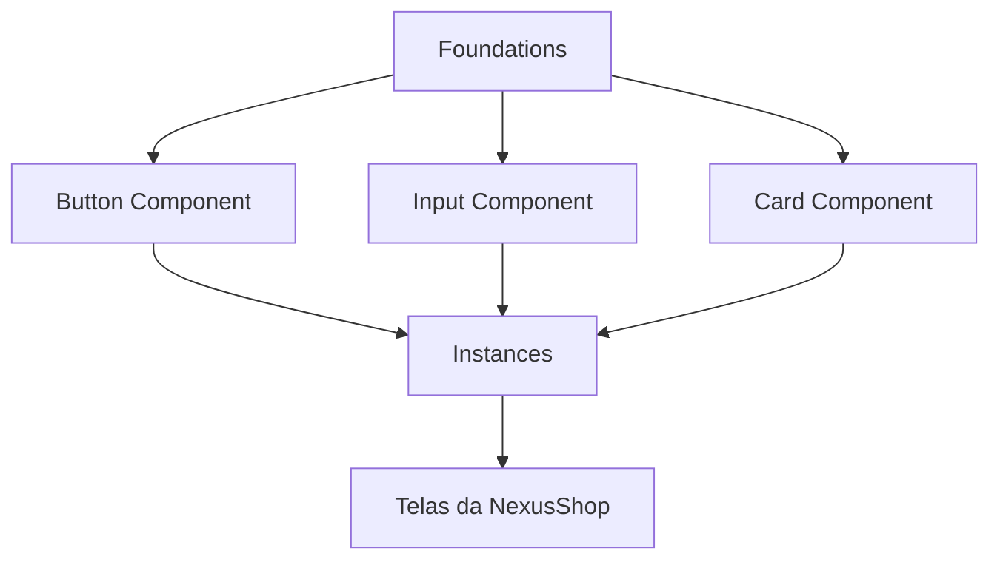

# Semana 03 — Figma

## Objetivos

Criar interfaces organizadas e reutilizáveis utilizando os principais recursos de componentização do Figma.

Ao final desta semana, você deverá ser capaz de:

- explicar os principais conceitos com suas próprias palavras;
- relacionar os conceitos ao estudo de caso da NexusShop;
- interpretar o diagrama da solução;
- executar o laboratório proposto;
- registrar o resultado no GitHub.

---

## 1. Conceitos

### 1. Frames

Representam telas, regiões ou containers e permitem definir dimensões e comportamento responsivo.

### 2. Layers

Todo elemento visual aparece como uma camada; organização e nomenclatura facilitam manutenção.

### 3. Auto Layout

Permite criar componentes e containers que se ajustam automaticamente ao conteúdo.

### 4. Components

Transformam elementos recorrentes em unidades reutilizáveis.

### 5. Instances

São usos de um componente principal, mantendo vínculo com a definição original.

### 6. Variants

Agrupam estados ou versões de um mesmo componente, como tamanho, cor e estado.

### 7. Constraints

Definem como elementos se comportam quando um frame muda de tamanho.

---

## 2. Estudo de Caso — NexusShop

A equipe da NexusShop percebe que botões, campos e cards estão sendo desenhados repetidamente. O objetivo agora é criar componentes reutilizáveis para reduzir inconsistências.

### O que devemos observar

O foco do estudo de caso não é apenas implementar uma solução, mas entender **por que** determinada técnica é utilizada, quais problemas ela resolve e como se conecta às demais etapas do roadmap.

---

## 3. Diagrama

---

## 4. Laboratório

### Objetivo do laboratório

Aplicar os conceitos da semana em uma evolução prática da NexusShop.

### Passo a passo

1. Crie um arquivo Figma para a NexusShop.
2. Crie frames para Mobile e Desktop.
3. Implemente um botão usando Auto Layout.
4. Converta o botão em componente.
5. Crie variantes `primary`, `secondary` e `disabled`.
6. Crie componentes para Input e Product Card.
7. Monte uma tela de catálogo utilizando apenas instâncias dos componentes.

### Evidências esperadas

- código versionado;
- commits relacionados à atividade;
- documentação quando aplicável;
- captura de tela ou link quando a atividade envolver interface;
- README atualizado quando houver mudança importante na forma de executar o projeto.

### Entrega

Compartilhe o link do arquivo Figma e documente em `docs/design/figma.md` os componentes criados.

---

## 5. Perguntas para revisão

1. Qual problema principal os conceitos desta semana resolvem?
2. Qual é o erro mais comum ao aplicar esses conceitos?
3. Como o conteúdo desta semana se conecta à semana anterior?
4. Como você explicaria a solução implementada para outro desenvolvedor?
5. O que mudaria em um projeto real de maior escala?

---

## 6. Checklist da semana

- [ ] Estudei os conceitos.
- [ ] Entendi o estudo de caso.
- [ ] Interpretei o diagrama Mermaid.
- [ ] Executei o laboratório.
- [ ] Registrei as evidências no GitHub.
- [ ] Revisei os principais aprendizados.

---

[Voltar para o mês](../README.md) | [Voltar para o roadmap](../../README.md)
