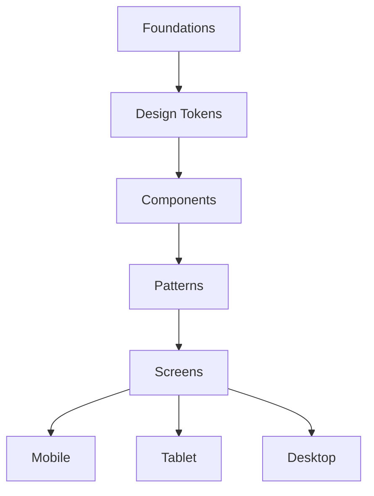

# Semana 04 — Responsive Design e Design System

## Objetivos

Projetar interfaces adaptáveis e compreender como foundations, tokens e componentes formam um Design System.

Ao final desta semana, você deverá ser capaz de:

- explicar os principais conceitos com suas próprias palavras;
- relacionar os conceitos ao estudo de caso da NexusShop;
- interpretar o diagrama da solução;
- executar o laboratório proposto;
- registrar o resultado no GitHub.

---

## 1. Conceitos

### 1. Responsive Design

Adapta layout e componentes à largura disponível, ao dispositivo e ao contexto de uso.

### 2. Mobile First

Começa pelo menor viewport e adiciona capacidades progressivamente.

### 3. Breakpoints

Pontos nos quais o layout muda devido à necessidade do conteúdo, e não apenas por modelos de dispositivos.

### 4. Design System

Conjunto governado de fundamentos, tokens, componentes, padrões e documentação.

### 5. Foundations

Definem cor, tipografia, espaçamento, bordas, elevação e outras bases visuais.

### 6. Design Tokens

Representam decisões de design com nomes reutilizáveis, possibilitando conexão entre design e código.

---

## 2. Estudo de Caso — NexusShop

A NexusShop será usada em smartphones e desktops. Além disso, diferentes telas estão começando a usar tons e espaçamentos inconsistentes. A equipe decide criar uma base de Design System.

### O que devemos observar

O foco do estudo de caso não é apenas implementar uma solução, mas entender **por que** determinada técnica é utilizada, quais problemas ela resolve e como se conecta às demais etapas do roadmap.

---

## 3. Diagrama

---

## 4. Laboratório

### Objetivo do laboratório

Aplicar os conceitos da semana em uma evolução prática da NexusShop.

### Passo a passo

1. Defina uma escala de spacing.
2. Defina paleta primária, neutra e semântica.
3. Defina escala tipográfica.
4. Crie tokens no Figma para cores, spacing e radius.
5. Adapte o catálogo para Mobile e Desktop.
6. Documente quando o layout muda e por quê.
7. Crie uma página `Design System` no Figma reunindo foundations e componentes.

### Evidências esperadas

- código versionado;
- commits relacionados à atividade;
- documentação quando aplicável;
- captura de tela ou link quando a atividade envolver interface;
- README atualizado quando houver mudança importante na forma de executar o projeto.

### Entrega

Crie `docs/design/design-system.md` descrevendo foundations, tokens, componentes e regras responsivas.

---

## 5. Perguntas para revisão

1. Qual problema principal os conceitos desta semana resolvem?
2. Qual é o erro mais comum ao aplicar esses conceitos?
3. Como o conteúdo desta semana se conecta à semana anterior?
4. Como você explicaria a solução implementada para outro desenvolvedor?
5. O que mudaria em um projeto real de maior escala?

---

## 6. Checklist da semana

- [ ] Estudei os conceitos.
- [ ] Entendi o estudo de caso.
- [ ] Interpretei o diagrama Mermaid.
- [ ] Executei o laboratório.
- [ ] Registrei as evidências no GitHub.
- [ ] Revisei os principais aprendizados.

---

[Voltar para o mês](../README.md) | [Voltar para o roadmap](../../README.md)
