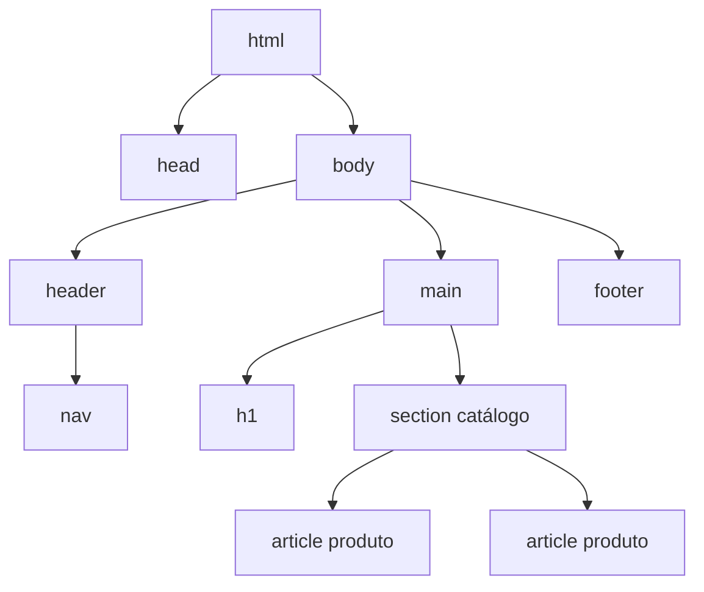

# Semana 05 — HTML e Semântica

## Objetivos

Transformar uma especificação visual em uma estrutura HTML semântica, acessível e preparada para estilização.

Ao final desta semana, você deverá ser capaz de:

- explicar os principais conceitos com suas próprias palavras;
- relacionar os conceitos ao estudo de caso da NexusShop;
- interpretar o diagrama da solução;
- executar o laboratório proposto;
- registrar o resultado no GitHub.

---

## 1. Conceitos

### 1. HTML

Linguagem de marcação usada para representar a estrutura e o significado do conteúdo.

### 2. Semântica

Escolher elementos pelo significado — e não apenas pela aparência — melhora acessibilidade, SEO e manutenção.

### 3. Estrutura do documento

`html`, `head` e `body` formam a base; `header`, `nav`, `main`, `section`, `article` e `footer` descrevem regiões.

### 4. Formulários

`form`, `label`, `input`, `select`, `textarea` e `button` permitem entrada de dados.

### 5. Atributos

Atributos fornecem configuração e metadados, como `id`, `name`, `type`, `href`, `alt` e `aria-*`.

---

## 2. Estudo de Caso — NexusShop

O catálogo da NexusShop já existe no Figma. Agora a primeira tela será implementada em HTML, preservando a hierarquia definida no design.

### O que devemos observar

O foco do estudo de caso não é apenas implementar uma solução, mas entender **por que** determinada técnica é utilizada, quais problemas ela resolve e como se conecta às demais etapas do roadmap.

---

## 3. Diagrama

---

## 4. Laboratório

### Objetivo do laboratório

Aplicar os conceitos da semana em uma evolução prática da NexusShop.

### Passo a passo

1. Crie `index.html`.
2. Implemente `header`, `nav`, `main` e `footer`.
3. Represente cada produto com `article`.
4. Use apenas um `h1` e organize os demais títulos hierarquicamente.
5. Adicione imagens com texto alternativo adequado.
6. Crie um formulário de busca com `label` associado ao campo.
7. Valide o HTML utilizando as ferramentas do navegador ou um validador HTML.

### Evidências esperadas

- código versionado;
- commits relacionados à atividade;
- documentação quando aplicável;
- captura de tela ou link quando a atividade envolver interface;
- README atualizado quando houver mudança importante na forma de executar o projeto.

### Entrega

Página do catálogo estruturada somente com HTML semântico, sem preocupação inicial com CSS.

---

## 5. Perguntas para revisão

1. Qual problema principal os conceitos desta semana resolvem?
2. Qual é o erro mais comum ao aplicar esses conceitos?
3. Como o conteúdo desta semana se conecta à semana anterior?
4. Como você explicaria a solução implementada para outro desenvolvedor?
5. O que mudaria em um projeto real de maior escala?

---

## 6. Checklist da semana

- [ ] Estudei os conceitos.
- [ ] Entendi o estudo de caso.
- [ ] Interpretei o diagrama Mermaid.
- [ ] Executei o laboratório.
- [ ] Registrei as evidências no GitHub.
- [ ] Revisei os principais aprendizados.

---

[Voltar para o mês](../README.md) | [Voltar para o roadmap](../../README.md)
