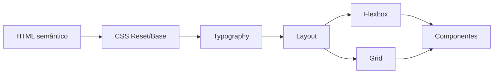

# Semana 06 — CSS: Fundamentos e Layout

## Objetivos

Aplicar o Design System da NexusShop em CSS e dominar os mecanismos fundamentais de layout.

Ao final desta semana, você deverá ser capaz de:

- explicar os principais conceitos com suas próprias palavras;
- relacionar os conceitos ao estudo de caso da NexusShop;
- interpretar o diagrama da solução;
- executar o laboratório proposto;
- registrar o resultado no GitHub.

---

## 1. Conceitos

### 1. Cascade

Quando várias regras afetam o mesmo elemento, o navegador resolve conflitos considerando origem, especificidade e ordem.

### 2. Specificity

Define o peso relativo dos seletores.

### 3. Box Model

Todo elemento é composto por conteúdo, padding, border e margin.

### 4. Flexbox

Ideal para organização unidimensional de elementos em linha ou coluna.

### 5. CSS Grid

Ideal para layouts bidimensionais com linhas e colunas.

### 6. Position

Controla posicionamento normal, relativo, absoluto, fixo e sticky.

---

## 2. Estudo de Caso — NexusShop

O HTML do catálogo está semanticamente correto, mas ainda não representa o layout do Figma. O objetivo é construir o layout sem recorrer a posições absolutas desnecessárias.

### O que devemos observar

O foco do estudo de caso não é apenas implementar uma solução, mas entender **por que** determinada técnica é utilizada, quais problemas ela resolve e como se conecta às demais etapas do roadmap.

---

## 3. Diagrama

---

## 4. Laboratório

### Objetivo do laboratório

Aplicar os conceitos da semana em uma evolução prática da NexusShop.

### Passo a passo

1. Crie `styles.css` e conecte ao HTML.
2. Aplique `box-sizing: border-box`.
3. Defina tipografia e cores básicas.
4. Implemente o header com Flexbox.
5. Implemente o catálogo com CSS Grid.
6. Estilize Product Card, Button e Input.
7. Compare visualmente o resultado com o Figma.

### Evidências esperadas

- código versionado;
- commits relacionados à atividade;
- documentação quando aplicável;
- captura de tela ou link quando a atividade envolver interface;
- README atualizado quando houver mudança importante na forma de executar o projeto.

### Entrega

Versão Desktop do catálogo implementada com HTML e CSS.

---

## 5. Perguntas para revisão

1. Qual problema principal os conceitos desta semana resolvem?
2. Qual é o erro mais comum ao aplicar esses conceitos?
3. Como o conteúdo desta semana se conecta à semana anterior?
4. Como você explicaria a solução implementada para outro desenvolvedor?
5. O que mudaria em um projeto real de maior escala?

---

## 6. Checklist da semana

- [ ] Estudei os conceitos.
- [ ] Entendi o estudo de caso.
- [ ] Interpretei o diagrama Mermaid.
- [ ] Executei o laboratório.
- [ ] Registrei as evidências no GitHub.
- [ ] Revisei os principais aprendizados.

---

[Voltar para o mês](../README.md) | [Voltar para o roadmap](../../README.md)
