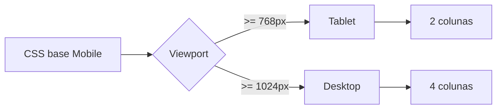

# Semana 07 — CSS Responsivo

## Objetivos

Adaptar a interface para diferentes tamanhos de viewport utilizando estratégia Mobile First.

Ao final desta semana, você deverá ser capaz de:

- explicar os principais conceitos com suas próprias palavras;
- relacionar os conceitos ao estudo de caso da NexusShop;
- interpretar o diagrama da solução;
- executar o laboratório proposto;
- registrar o resultado no GitHub.

---

## 1. Conceitos

### 1. Viewport

Área disponível para renderização da página.

### 2. Media Queries

Aplicam regras condicionais com base em características como largura.

### 3. Mobile First

Mantém o CSS-base voltado ao menor layout e adiciona melhorias para telas maiores.

### 4. Unidades relativas

`rem`, `%`, `vw` e outras unidades permitem composições mais flexíveis.

### 5. Layout fluido

Elementos crescem e encolhem dentro de limites adequados.

### 6. Imagens responsivas

Imagens devem respeitar o container e evitar overflow.

---

## 2. Estudo de Caso — NexusShop

Usuários da NexusShop acessam o catálogo principalmente por smartphones. A versão Desktop quebra em telas pequenas e precisa ser adaptada.

### O que devemos observar

O foco do estudo de caso não é apenas implementar uma solução, mas entender **por que** determinada técnica é utilizada, quais problemas ela resolve e como se conecta às demais etapas do roadmap.

---

## 3. Diagrama

---

## 4. Laboratório

### Objetivo do laboratório

Aplicar os conceitos da semana em uma evolução prática da NexusShop.

### Passo a passo

1. Altere o CSS para começar com uma coluna no Mobile.
2. Crie um breakpoint para Tablet com duas colunas.
3. Crie um breakpoint para Desktop com quatro colunas.
4. Garanta que imagens tenham largura máxima adequada.
5. Teste a navegação no modo responsivo do DevTools.
6. Verifique se nenhum conteúdo exige rolagem horizontal.

### Evidências esperadas

- código versionado;
- commits relacionados à atividade;
- documentação quando aplicável;
- captura de tela ou link quando a atividade envolver interface;
- README atualizado quando houver mudança importante na forma de executar o projeto.

### Entrega

Catálogo responsivo testado em pelo menos três larguras.

---

## 5. Perguntas para revisão

1. Qual problema principal os conceitos desta semana resolvem?
2. Qual é o erro mais comum ao aplicar esses conceitos?
3. Como o conteúdo desta semana se conecta à semana anterior?
4. Como você explicaria a solução implementada para outro desenvolvedor?
5. O que mudaria em um projeto real de maior escala?

---

## 6. Checklist da semana

- [ ] Estudei os conceitos.
- [ ] Entendi o estudo de caso.
- [ ] Interpretei o diagrama Mermaid.
- [ ] Executei o laboratório.
- [ ] Registrei as evidências no GitHub.
- [ ] Revisei os principais aprendizados.

---

[Voltar para o mês](../README.md) | [Voltar para o roadmap](../../README.md)
