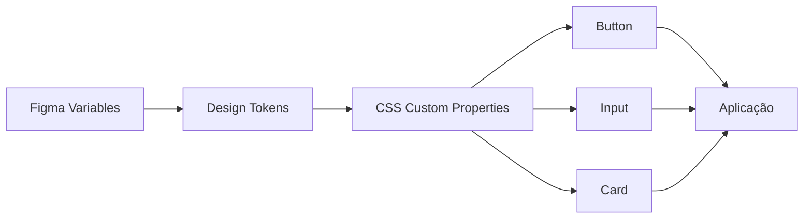

# Semana 08 — Design Tokens no CSS

## Objetivos

Traduzir decisões do Design System para tokens técnicos reutilizáveis no código.

Ao final desta semana, você deverá ser capaz de:

- explicar os principais conceitos com suas próprias palavras;
- relacionar os conceitos ao estudo de caso da NexusShop;
- interpretar o diagrama da solução;
- executar o laboratório proposto;
- registrar o resultado no GitHub.

---

## 1. Conceitos

### 1. Tokens globais

Representam valores primitivos, como uma cor específica ou escala de spacing.

### 2. Tokens semânticos

Representam intenção: `color-text-primary`, `color-feedback-error`.

### 3. CSS Custom Properties

Variáveis CSS permitem centralizar tokens e reaplicá-los em toda a interface.

### 4. Temas

Tokens semânticos permitem trocar valores sem alterar a implementação dos componentes.

### 5. Consistência

Componentes deixam de usar valores arbitrários e passam a consumir decisões centralizadas.

---

## 2. Estudo de Caso — NexusShop

A NexusShop possui dezenas de ocorrências de cores e espaçamentos escritos diretamente no CSS. Uma mudança de identidade visual exigiria várias alterações manuais.

### O que devemos observar

O foco do estudo de caso não é apenas implementar uma solução, mas entender **por que** determinada técnica é utilizada, quais problemas ela resolve e como se conecta às demais etapas do roadmap.

---

## 3. Diagrama

---

## 4. Laboratório

### Objetivo do laboratório

Aplicar os conceitos da semana em uma evolução prática da NexusShop.

### Passo a passo

1. Crie `tokens.css`.
2. Defina tokens de cor, spacing, radius e typography.
3. Separe tokens primitivos de tokens semânticos.
4. Substitua valores fixos dos componentes por `var(--token)`.
5. Altere o valor de `--color-primary` e observe o efeito global.
6. Documente a convenção de nomes adotada.

### Evidências esperadas

- código versionado;
- commits relacionados à atividade;
- documentação quando aplicável;
- captura de tela ou link quando a atividade envolver interface;
- README atualizado quando houver mudança importante na forma de executar o projeto.

### Entrega

`tokens.css` aplicado ao catálogo e documentação da estratégia em `docs/design-tokens.md`.

---

## 5. Perguntas para revisão

1. Qual problema principal os conceitos desta semana resolvem?
2. Qual é o erro mais comum ao aplicar esses conceitos?
3. Como o conteúdo desta semana se conecta à semana anterior?
4. Como você explicaria a solução implementada para outro desenvolvedor?
5. O que mudaria em um projeto real de maior escala?

---

## 6. Checklist da semana

- [ ] Estudei os conceitos.
- [ ] Entendi o estudo de caso.
- [ ] Interpretei o diagrama Mermaid.
- [ ] Executei o laboratório.
- [ ] Registrei as evidências no GitHub.
- [ ] Revisei os principais aprendizados.

---

[Voltar para o mês](../README.md) | [Voltar para o roadmap](../../README.md)
