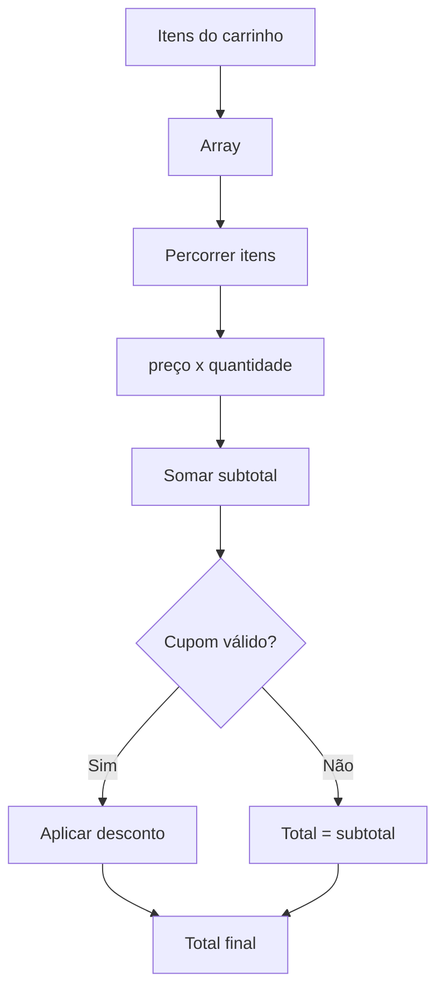

# Semana 09 — Fundamentos de JavaScript

## Objetivos

Dominar estruturas fundamentais da linguagem antes de manipular interfaces ou utilizar frameworks.

Ao final desta semana, você deverá ser capaz de:

- explicar os principais conceitos com suas próprias palavras;
- relacionar os conceitos ao estudo de caso da NexusShop;
- interpretar o diagrama da solução;
- executar o laboratório proposto;
- registrar o resultado no GitHub.

---

## 1. Conceitos

### 1. Valores e tipos

Strings, numbers, booleans, null, undefined e objetos formam a base dos dados manipulados.

### 2. Variáveis

`const` deve ser a escolha padrão; `let` é usado quando a referência precisa mudar.

### 3. Operadores

Permitem cálculos, comparações e combinações lógicas.

### 4. Condicionais

`if`, `else` e `switch` controlam caminhos de execução.

### 5. Loops

`for`, `for...of` e métodos de arrays processam coleções.

### 6. Funções

Encapsulam comportamento e permitem reutilização.

### 7. Arrays e objetos

São estruturas centrais para representar dados em aplicações Web.

---

## 2. Estudo de Caso — NexusShop

A NexusShop precisa calcular subtotal, desconto e quantidade de itens a partir de uma coleção de produtos do carrinho.

### O que devemos observar

O foco do estudo de caso não é apenas implementar uma solução, mas entender **por que** determinada técnica é utilizada, quais problemas ela resolve e como se conecta às demais etapas do roadmap.

---

## 3. Diagrama

---

## 4. Laboratório

### Objetivo do laboratório

Aplicar os conceitos da semana em uma evolução prática da NexusShop.

### Passo a passo

1. Crie um array de produtos com `id`, `nome`, `preco` e `quantidade`.
2. Calcule o subtotal.
3. Crie função para calcular desconto percentual.
4. Crie função que retorne a quantidade total de itens.
5. Filtre produtos acima de um determinado valor.
6. Imprima um resumo formatado no console.

### Evidências esperadas

- código versionado;
- commits relacionados à atividade;
- documentação quando aplicável;
- captura de tela ou link quando a atividade envolver interface;
- README atualizado quando houver mudança importante na forma de executar o projeto.

### Entrega

Arquivo `src/js/cart-calculator.js` com funções pequenas e reutilizáveis.

---

## 5. Perguntas para revisão

1. Qual problema principal os conceitos desta semana resolvem?
2. Qual é o erro mais comum ao aplicar esses conceitos?
3. Como o conteúdo desta semana se conecta à semana anterior?
4. Como você explicaria a solução implementada para outro desenvolvedor?
5. O que mudaria em um projeto real de maior escala?

---

## 6. Checklist da semana

- [ ] Estudei os conceitos.
- [ ] Entendi o estudo de caso.
- [ ] Interpretei o diagrama Mermaid.
- [ ] Executei o laboratório.
- [ ] Registrei as evidências no GitHub.
- [ ] Revisei os principais aprendizados.

---

[Voltar para o mês](../README.md) | [Voltar para o roadmap](../../README.md)
