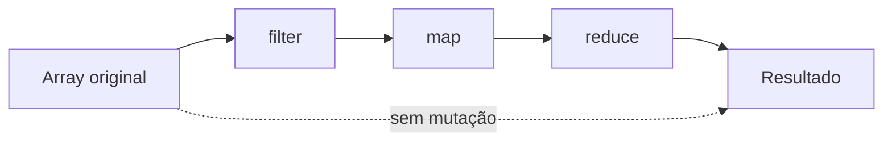

# Semana 10 — JavaScript Moderno

## Objetivos

Escrever JavaScript moderno, expressivo e adequado para aplicações frontend contemporâneas.

Ao final desta semana, você deverá ser capaz de:

- explicar os principais conceitos com suas próprias palavras;
- relacionar os conceitos ao estudo de caso da NexusShop;
- interpretar o diagrama da solução;
- executar o laboratório proposto;
- registrar o resultado no GitHub.

---

## 1. Conceitos

### 1. Arrow Functions

Oferecem sintaxe concisa e comportamento específico de `this`.

### 2. Template Literals

Facilitam interpolação e construção de strings.

### 3. Destructuring

Extrai propriedades de objetos e posições de arrays.

### 4. Spread

Expande arrays ou objetos e facilita criação de novas estruturas imutáveis.

### 5. Rest

Agrupa argumentos ou propriedades restantes.

### 6. Métodos de arrays

`map`, `filter`, `find`, `some`, `every` e `reduce` são essenciais para transformação de dados.

---

## 2. Estudo de Caso — NexusShop

O código inicial do carrinho possui loops imperativos e mutações. A equipe quer tornar as transformações mais declarativas.

### O que devemos observar

O foco do estudo de caso não é apenas implementar uma solução, mas entender **por que** determinada técnica é utilizada, quais problemas ela resolve e como se conecta às demais etapas do roadmap.

---

## 3. Diagrama

---

## 4. Laboratório

### Objetivo do laboratório

Aplicar os conceitos da semana em uma evolução prática da NexusShop.

### Passo a passo

1. Reescreva o cálculo do carrinho usando `reduce`.
2. Use `filter` para obter produtos disponíveis.
3. Use `map` para criar uma representação simplificada.
4. Use destructuring nos parâmetros das funções.
5. Atualize um objeto usando spread, sem mutar o original.
6. Crie mensagens utilizando template literals.

### Evidências esperadas

- código versionado;
- commits relacionados à atividade;
- documentação quando aplicável;
- captura de tela ou link quando a atividade envolver interface;
- README atualizado quando houver mudança importante na forma de executar o projeto.

### Entrega

Refatoração de `cart-calculator.js` utilizando JavaScript moderno.

---

## 5. Perguntas para revisão

1. Qual problema principal os conceitos desta semana resolvem?
2. Qual é o erro mais comum ao aplicar esses conceitos?
3. Como o conteúdo desta semana se conecta à semana anterior?
4. Como você explicaria a solução implementada para outro desenvolvedor?
5. O que mudaria em um projeto real de maior escala?

---

## 6. Checklist da semana

- [ ] Estudei os conceitos.
- [ ] Entendi o estudo de caso.
- [ ] Interpretei o diagrama Mermaid.
- [ ] Executei o laboratório.
- [ ] Registrei as evidências no GitHub.
- [ ] Revisei os principais aprendizados.

---

[Voltar para o mês](../README.md) | [Voltar para o roadmap](../../README.md)
