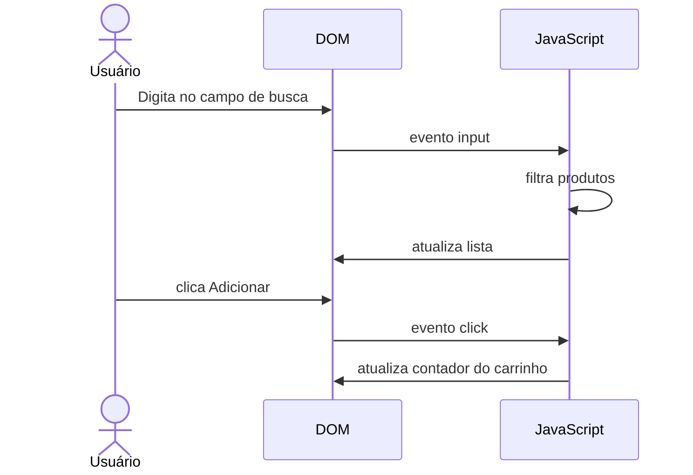

# Semana 11 — JavaScript e DOM

## Objetivos

Criar interfaces interativas manipulando o DOM e reagindo a eventos do usuário.

Ao final desta semana, você deverá ser capaz de:

- explicar os principais conceitos com suas próprias palavras;
- relacionar os conceitos ao estudo de caso da NexusShop;
- interpretar o diagrama da solução;
- executar o laboratório proposto;
- registrar o resultado no GitHub.

---

## 1. Conceitos

### 1. DOM

Representa o documento HTML como uma árvore de objetos.

### 2. Seletores

`querySelector` e `querySelectorAll` localizam elementos.

### 3. Eventos

Cliques, submissões, digitação e mudanças de estado podem disparar funções.

### 4. Bubbling

Eventos normalmente propagam do elemento de origem para seus ancestrais.

### 5. Manipulação

JavaScript pode criar, alterar, remover e reorganizar elementos.

### 6. Validação

A interface pode fornecer feedback antes de enviar dados.

---

## 2. Estudo de Caso — NexusShop

O catálogo da NexusShop deve permitir pesquisar produtos e adicioná-los ao carrinho sem recarregar a página.

### O que devemos observar

O foco do estudo de caso não é apenas implementar uma solução, mas entender **por que** determinada técnica é utilizada, quais problemas ela resolve e como se conecta às demais etapas do roadmap.

---

## 3. Diagrama

---

## 4. Laboratório

### Objetivo do laboratório

Aplicar os conceitos da semana em uma evolução prática da NexusShop.

### Passo a passo

1. Crie uma lista de produtos no JavaScript.
2. Renderize os produtos dinamicamente no DOM.
3. Implemente filtro por nome usando o evento `input`.
4. Adicione botão `Adicionar ao carrinho` em cada card.
5. Atualize um contador no header.
6. Utilize delegação de eventos para os botões dos produtos.
7. Exiba mensagem quando nenhum produto for encontrado.

### Evidências esperadas

- código versionado;
- commits relacionados à atividade;
- documentação quando aplicável;
- captura de tela ou link quando a atividade envolver interface;
- README atualizado quando houver mudança importante na forma de executar o projeto.

### Entrega

Catálogo interativo sem framework.

---

## 5. Perguntas para revisão

1. Qual problema principal os conceitos desta semana resolvem?
2. Qual é o erro mais comum ao aplicar esses conceitos?
3. Como o conteúdo desta semana se conecta à semana anterior?
4. Como você explicaria a solução implementada para outro desenvolvedor?
5. O que mudaria em um projeto real de maior escala?

---

## 6. Checklist da semana

- [ ] Estudei os conceitos.
- [ ] Entendi o estudo de caso.
- [ ] Interpretei o diagrama Mermaid.
- [ ] Executei o laboratório.
- [ ] Registrei as evidências no GitHub.
- [ ] Revisei os principais aprendizados.

---

[Voltar para o mês](../README.md) | [Voltar para o roadmap](../../README.md)
