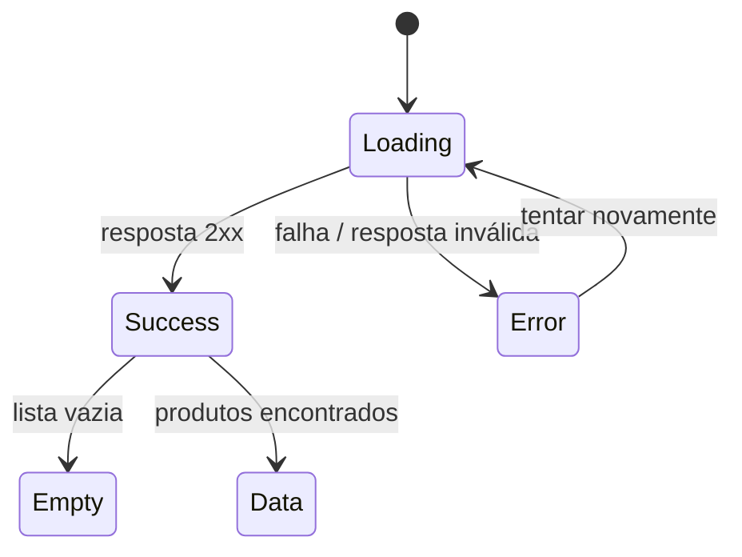

# Semana 12 — JavaScript Assíncrono e APIs

## Objetivos

Consumir APIs sem bloquear a interface e tratar estados de carregamento, sucesso e falha.

Ao final desta semana, você deverá ser capaz de:

- explicar os principais conceitos com suas próprias palavras;
- relacionar os conceitos ao estudo de caso da NexusShop;
- interpretar o diagrama da solução;
- executar o laboratório proposto;
- registrar o resultado no GitHub.

---

## 1. Conceitos

### 1. Assincronicidade

Operações de rede não devem bloquear a execução da interface.

### 2. Promise

Representa um resultado que poderá ser resolvido ou rejeitado no futuro.

### 3. async/await

Permite escrever código assíncrono com fluxo semelhante ao síncrono.

### 4. fetch

API do navegador para realizar requisições HTTP.

### 5. JSON

Formato comum para troca de dados entre frontend e backend.

### 6. Tratamento de erros

Falhas de rede e status HTTP precisam resultar em feedback apropriado ao usuário.

---

## 2. Estudo de Caso — NexusShop

Até agora os produtos da NexusShop estavam hardcoded. Eles passarão a ser carregados de uma API REST.

### O que devemos observar

O foco do estudo de caso não é apenas implementar uma solução, mas entender **por que** determinada técnica é utilizada, quais problemas ela resolve e como se conecta às demais etapas do roadmap.

---

## 3. Diagrama

---

## 4. Laboratório

### Objetivo do laboratório

Aplicar os conceitos da semana em uma evolução prática da NexusShop.

### Passo a passo

1. Escolha uma API REST pública de produtos ou utilize um mock local.
2. Crie função `loadProducts()` usando `fetch` e `async/await`.
3. Mostre estado de loading.
4. Valide `response.ok`.
5. Renderize os produtos em caso de sucesso.
6. Mostre Empty State quando a lista estiver vazia.
7. Implemente Error State com botão `Tentar novamente`.

### Evidências esperadas

- código versionado;
- commits relacionados à atividade;
- documentação quando aplicável;
- captura de tela ou link quando a atividade envolver interface;
- README atualizado quando houver mudança importante na forma de executar o projeto.

### Entrega

Catálogo consumindo dados de API e tratando os quatro principais estados da interface.

---

## 5. Perguntas para revisão

1. Qual problema principal os conceitos desta semana resolvem?
2. Qual é o erro mais comum ao aplicar esses conceitos?
3. Como o conteúdo desta semana se conecta à semana anterior?
4. Como você explicaria a solução implementada para outro desenvolvedor?
5. O que mudaria em um projeto real de maior escala?

---

## 6. Checklist da semana

- [ ] Estudei os conceitos.
- [ ] Entendi o estudo de caso.
- [ ] Interpretei o diagrama Mermaid.
- [ ] Executei o laboratório.
- [ ] Registrei as evidências no GitHub.
- [ ] Revisei os principais aprendizados.

---

[Voltar para o mês](../README.md) | [Voltar para o roadmap](../../README.md)
