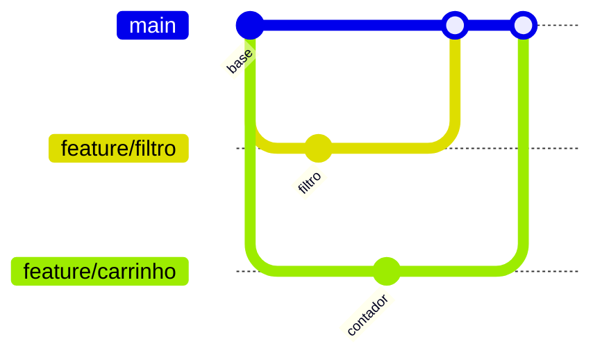

# Semana 13 — Git

## Objetivos

Compreender versionamento distribuído e utilizar commits e branches para controlar a evolução do código.

Ao final desta semana, você deverá ser capaz de:

- explicar os principais conceitos com suas próprias palavras;
- relacionar os conceitos ao estudo de caso da NexusShop;
- interpretar o diagrama da solução;
- executar o laboratório proposto;
- registrar o resultado no GitHub.

---

## 1. Conceitos

### 1. Repository

Armazena histórico e metadados do projeto.

### 2. Working Tree

Representa os arquivos atuais do diretório de trabalho.

### 3. Staging Area

Seleciona quais mudanças farão parte do próximo commit.

### 4. Commit

Snapshot lógico e identificado do estado do projeto.

### 5. Branch

Linha independente de desenvolvimento.

### 6. Merge

Integra históricos divergentes.

### 7. Conflict

Ocorre quando o Git não consegue decidir automaticamente como combinar mudanças.

---

## 2. Estudo de Caso — NexusShop

Duas melhorias da NexusShop serão desenvolvidas em paralelo: filtro de produtos e contador do carrinho. A equipe precisa evitar alterações diretas na branch principal.

### O que devemos observar

O foco do estudo de caso não é apenas implementar uma solução, mas entender **por que** determinada técnica é utilizada, quais problemas ela resolve e como se conecta às demais etapas do roadmap.

---

## 3. Diagrama

---

## 4. Laboratório

### Objetivo do laboratório

Aplicar os conceitos da semana em uma evolução prática da NexusShop.

### Passo a passo

1. Inicialize um repositório Git.
2. Crie um `.gitignore` adequado.
3. Faça o primeiro commit.
4. Crie a branch `feature/filtro-produtos`.
5. Faça uma alteração e commit.
6. Crie outra branch para uma segunda funcionalidade.
7. Faça merge das branches.
8. Provoque e resolva um conflito simples em ambiente controlado.

### Evidências esperadas

- código versionado;
- commits relacionados à atividade;
- documentação quando aplicável;
- captura de tela ou link quando a atividade envolver interface;
- README atualizado quando houver mudança importante na forma de executar o projeto.

### Entrega

Histórico Git com commits pequenos, descritivos e branches de feature.

---

## 5. Perguntas para revisão

1. Qual problema principal os conceitos desta semana resolvem?
2. Qual é o erro mais comum ao aplicar esses conceitos?
3. Como o conteúdo desta semana se conecta à semana anterior?
4. Como você explicaria a solução implementada para outro desenvolvedor?
5. O que mudaria em um projeto real de maior escala?

---

## 6. Checklist da semana

- [ ] Estudei os conceitos.
- [ ] Entendi o estudo de caso.
- [ ] Interpretei o diagrama Mermaid.
- [ ] Executei o laboratório.
- [ ] Registrei as evidências no GitHub.
- [ ] Revisei os principais aprendizados.

---

[Voltar para o mês](../README.md) | [Voltar para o roadmap](../../README.md)
