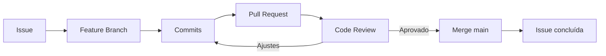

# Semana 14 — GitHub e Colaboração

## Objetivos

Aplicar práticas de colaboração utilizando repositórios remotos, Issues, Pull Requests e Code Review.

Ao final desta semana, você deverá ser capaz de:

- explicar os principais conceitos com suas próprias palavras;
- relacionar os conceitos ao estudo de caso da NexusShop;
- interpretar o diagrama da solução;
- executar o laboratório proposto;
- registrar o resultado no GitHub.

---

## 1. Conceitos

### 1. Remote

Conecta o repositório local a um servidor Git.

### 2. Pull Request

Solicita integração de uma branch e cria espaço para revisão.

### 3. Issue

Registra trabalho, defeitos, melhorias ou decisões.

### 4. Code Review

Processo de análise técnica antes da integração.

### 5. Protected Branch

Evita alterações diretas e aplica regras à branch principal.

### 6. Release

Representa uma versão distribuível ou marco do produto.

---

## 2. Estudo de Caso — NexusShop

A NexusShop passou a ser desenvolvida por mais de uma pessoa. Alterações precisam ser rastreáveis e revisadas antes de entrar na `main`.

### O que devemos observar

O foco do estudo de caso não é apenas implementar uma solução, mas entender **por que** determinada técnica é utilizada, quais problemas ela resolve e como se conecta às demais etapas do roadmap.

---

## 3. Diagrama

---

## 4. Laboratório

### Objetivo do laboratório

Aplicar os conceitos da semana em uma evolução prática da NexusShop.

### Passo a passo

1. Publique o repositório da NexusShop no GitHub.
2. Crie uma Issue para uma melhoria.
3. Crie uma branch vinculada à Issue.
4. Implemente e envie commits.
5. Abra um Pull Request.
6. Preencha descrição com objetivo, mudanças e como testar.
7. Realize uma revisão e faça o merge.

### Evidências esperadas

- código versionado;
- commits relacionados à atividade;
- documentação quando aplicável;
- captura de tela ou link quando a atividade envolver interface;
- README atualizado quando houver mudança importante na forma de executar o projeto.

### Entrega

Uma Issue encerrada por um Pull Request integrado.

---

## 5. Perguntas para revisão

1. Qual problema principal os conceitos desta semana resolvem?
2. Qual é o erro mais comum ao aplicar esses conceitos?
3. Como o conteúdo desta semana se conecta à semana anterior?
4. Como você explicaria a solução implementada para outro desenvolvedor?
5. O que mudaria em um projeto real de maior escala?

---

## 6. Checklist da semana

- [ ] Estudei os conceitos.
- [ ] Entendi o estudo de caso.
- [ ] Interpretei o diagrama Mermaid.
- [ ] Executei o laboratório.
- [ ] Registrei as evidências no GitHub.
- [ ] Revisei os principais aprendizados.

---

[Voltar para o mês](../README.md) | [Voltar para o roadmap](../../README.md)
