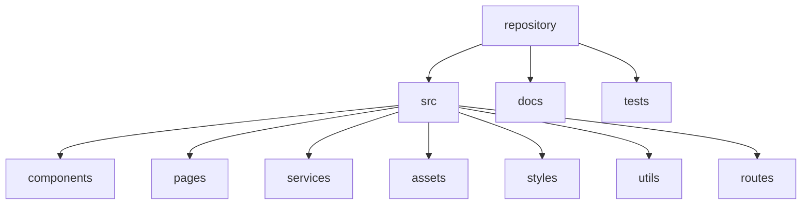

# Semana 15 — Estrutura de Repositório Frontend

## Objetivos

Organizar arquivos e responsabilidades para melhorar legibilidade, evolução e colaboração.

Ao final desta semana, você deverá ser capaz de:

- explicar os principais conceitos com suas próprias palavras;
- relacionar os conceitos ao estudo de caso da NexusShop;
- interpretar o diagrama da solução;
- executar o laboratório proposto;
- registrar o resultado no GitHub.

---

## 1. Conceitos

### 1. src

Código-fonte da aplicação.

### 2. public

Arquivos servidos diretamente, quando necessários.

### 3. components

Componentes reutilizáveis da interface.

### 4. pages

Composições que representam páginas ou rotas.

### 5. services

Integrações externas e acesso a APIs.

### 6. styles

Tokens, estilos globais e temas.

### 7. docs

Arquitetura, decisões e documentação técnica.

### 8. tests

Testes automatizados organizados conforme a estratégia escolhida.

---

## 2. Estudo de Caso — NexusShop

A NexusShop começou com HTML, CSS e JavaScript em poucos arquivos. À medida que cresce, localizar responsabilidades se torna difícil.

### O que devemos observar

O foco do estudo de caso não é apenas implementar uma solução, mas entender **por que** determinada técnica é utilizada, quais problemas ela resolve e como se conecta às demais etapas do roadmap.

---

## 3. Diagrama

---

## 4. Laboratório

### Objetivo do laboratório

Aplicar os conceitos da semana em uma evolução prática da NexusShop.

### Passo a passo

1. Crie a estrutura base do repositório.
2. Mova estilos compartilhados para `src/styles`.
3. Separe código de acesso à API em `src/services`.
4. Crie `docs/architecture.md` explicando as pastas.
5. Atualize o README com instruções de execução.
6. Revise se cada pasta possui uma responsabilidade clara.

### Evidências esperadas

- código versionado;
- commits relacionados à atividade;
- documentação quando aplicável;
- captura de tela ou link quando a atividade envolver interface;
- README atualizado quando houver mudança importante na forma de executar o projeto.

### Entrega

Repositório reorganizado e documentado.

---

## 5. Perguntas para revisão

1. Qual problema principal os conceitos desta semana resolvem?
2. Qual é o erro mais comum ao aplicar esses conceitos?
3. Como o conteúdo desta semana se conecta à semana anterior?
4. Como você explicaria a solução implementada para outro desenvolvedor?
5. O que mudaria em um projeto real de maior escala?

---

## 6. Checklist da semana

- [ ] Estudei os conceitos.
- [ ] Entendi o estudo de caso.
- [ ] Interpretei o diagrama Mermaid.
- [ ] Executei o laboratório.
- [ ] Registrei as evidências no GitHub.
- [ ] Revisei os principais aprendizados.

---

[Voltar para o mês](../README.md) | [Voltar para o roadmap](../../README.md)
