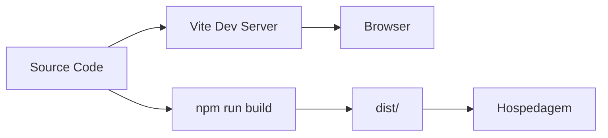

# Semana 16 — Node.js, npm e Vite

## Objetivos

Compreender o ecossistema de build do frontend e utilizar um gerenciador de pacotes e dev server.

Ao final desta semana, você deverá ser capaz de:

- explicar os principais conceitos com suas próprias palavras;
- relacionar os conceitos ao estudo de caso da NexusShop;
- interpretar o diagrama da solução;
- executar o laboratório proposto;
- registrar o resultado no GitHub.

---

## 1. Conceitos

### 1. Node.js

Runtime JavaScript utilizado por grande parte das ferramentas de desenvolvimento frontend.

### 2. npm

Gerenciador de pacotes e scripts.

### 3. package.json

Manifesto do projeto com metadados, scripts e dependências.

### 4. dependencies

Pacotes necessários em runtime.

### 5. devDependencies

Pacotes utilizados principalmente no desenvolvimento e build.

### 6. Vite

Ferramenta moderna que oferece servidor de desenvolvimento e processo de build.

### 7. Semantic Versioning

Modelo `MAJOR.MINOR.PATCH` para comunicar compatibilidade de versões.

---

## 2. Estudo de Caso — NexusShop

A NexusShop precisa migrar de arquivos estáticos executados diretamente no navegador para uma estrutura moderna que futuramente receberá React.

### O que devemos observar

O foco do estudo de caso não é apenas implementar uma solução, mas entender **por que** determinada técnica é utilizada, quais problemas ela resolve e como se conecta às demais etapas do roadmap.

---

## 3. Diagrama

---

## 4. Laboratório

### Objetivo do laboratório

Aplicar os conceitos da semana em uma evolução prática da NexusShop.

### Passo a passo

1. Confirme a instalação do Node.js.
2. Crie um projeto com Vite.
3. Analise o `package.json`.
4. Execute `npm install` e observe `node_modules` e lockfile.
5. Crie scripts adicionais simples.
6. Execute o servidor de desenvolvimento.
7. Execute o build e analise a pasta `dist`.

### Evidências esperadas

- código versionado;
- commits relacionados à atividade;
- documentação quando aplicável;
- captura de tela ou link quando a atividade envolver interface;
- README atualizado quando houver mudança importante na forma de executar o projeto.

### Entrega

NexusShop executando por meio do Vite.

---

## 5. Perguntas para revisão

1. Qual problema principal os conceitos desta semana resolvem?
2. Qual é o erro mais comum ao aplicar esses conceitos?
3. Como o conteúdo desta semana se conecta à semana anterior?
4. Como você explicaria a solução implementada para outro desenvolvedor?
5. O que mudaria em um projeto real de maior escala?

---

## 6. Checklist da semana

- [ ] Estudei os conceitos.
- [ ] Entendi o estudo de caso.
- [ ] Interpretei o diagrama Mermaid.
- [ ] Executei o laboratório.
- [ ] Registrei as evidências no GitHub.
- [ ] Revisei os principais aprendizados.

---

[Voltar para o mês](../README.md) | [Voltar para o roadmap](../../README.md)
