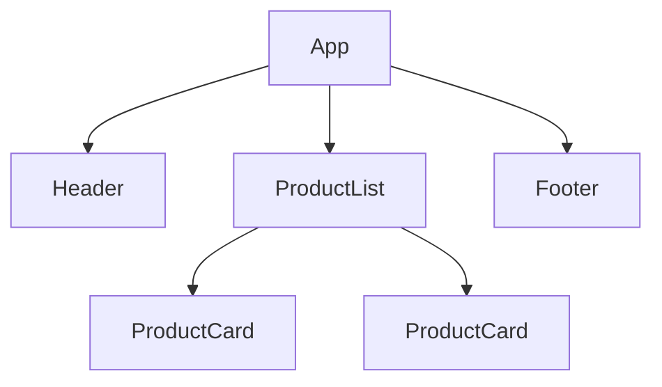

# Semana 17 — Fundamentos de React

## Objetivos

Compreender o modelo declarativo e baseado em componentes do React.

Ao final desta semana, você deverá ser capaz de:

- explicar os principais conceitos com suas próprias palavras;
- relacionar os conceitos ao estudo de caso da NexusShop;
- interpretar o diagrama da solução;
- executar o laboratório proposto;
- registrar o resultado no GitHub.

---

## 1. Conceitos

### 1. Component

Função que descreve uma parte reutilizável da interface.

### 2. JSX

Sintaxe que permite declarar árvores de UI próximas ao HTML dentro do JavaScript.

### 3. Props

Dados recebidos por um componente.

### 4. State

Dados internos que, quando alterados, causam nova renderização.

### 5. Renderização declarativa

O desenvolvedor descreve o estado desejado da UI; React sincroniza o DOM.

### 6. Keys

Identificadores estáveis usados ao renderizar listas.

---

## 2. Estudo de Caso — NexusShop

A versão JavaScript da NexusShop manipula o DOM manualmente. A equipe vai migrar o catálogo para React, dividindo a interface em componentes.

### O que devemos observar

O foco do estudo de caso não é apenas implementar uma solução, mas entender **por que** determinada técnica é utilizada, quais problemas ela resolve e como se conecta às demais etapas do roadmap.

---

## 3. Diagrama

---

## 4. Laboratório

### Objetivo do laboratório

Aplicar os conceitos da semana em uma evolução prática da NexusShop.

### Passo a passo

1. Crie um projeto React com Vite.
2. Crie `Header`, `ProductList`, `ProductCard` e `Footer`.
3. Passe os dados dos produtos via props.
4. Renderize a lista utilizando `map` e `key`.
5. Adicione estado simples para contador do carrinho.
6. Compare o fluxo declarativo com a manipulação direta do DOM.

### Evidências esperadas

- código versionado;
- commits relacionados à atividade;
- documentação quando aplicável;
- captura de tela ou link quando a atividade envolver interface;
- README atualizado quando houver mudança importante na forma de executar o projeto.

### Entrega

Primeira versão React da NexusShop.

---

## 5. Perguntas para revisão

1. Qual problema principal os conceitos desta semana resolvem?
2. Qual é o erro mais comum ao aplicar esses conceitos?
3. Como o conteúdo desta semana se conecta à semana anterior?
4. Como você explicaria a solução implementada para outro desenvolvedor?
5. O que mudaria em um projeto real de maior escala?

---

## 6. Checklist da semana

- [ ] Estudei os conceitos.
- [ ] Entendi o estudo de caso.
- [ ] Interpretei o diagrama Mermaid.
- [ ] Executei o laboratório.
- [ ] Registrei as evidências no GitHub.
- [ ] Revisei os principais aprendizados.

---

[Voltar para o mês](../README.md) | [Voltar para o roadmap](../../README.md)
