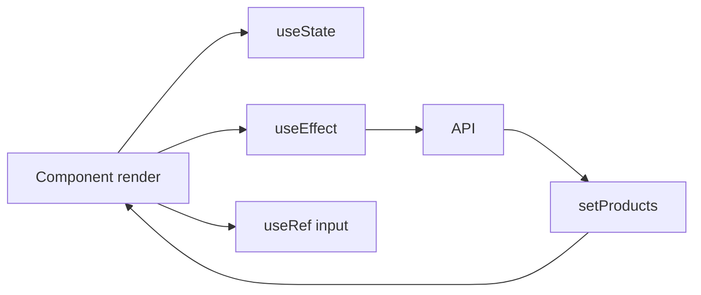

# Semana 18 — React Hooks

## Objetivos

Gerenciar estado, efeitos e referências em componentes funcionais.

Ao final desta semana, você deverá ser capaz de:

- explicar os principais conceitos com suas próprias palavras;
- relacionar os conceitos ao estudo de caso da NexusShop;
- interpretar o diagrama da solução;
- executar o laboratório proposto;
- registrar o resultado no GitHub.

---

## 1. Conceitos

### 1. useState

Armazena estado local do componente.

### 2. useEffect

Sincroniza o componente com sistemas externos ou efeitos colaterais.

### 3. useRef

Mantém referência mutável sem disparar renderização e pode acessar elementos.

### 4. Custom Hook

Extrai comportamento reutilizável entre componentes.

### 5. useMemo

Memoriza valores derivados quando o cálculo é relevante.

### 6. useCallback

Memoriza referências de funções em cenários específicos de otimização.

---

## 2. Estudo de Caso — NexusShop

A NexusShop precisa carregar produtos da API, controlar filtros e focar automaticamente o campo de busca.

### O que devemos observar

O foco do estudo de caso não é apenas implementar uma solução, mas entender **por que** determinada técnica é utilizada, quais problemas ela resolve e como se conecta às demais etapas do roadmap.

---

## 3. Diagrama

---

## 4. Laboratório

### Objetivo do laboratório

Aplicar os conceitos da semana em uma evolução prática da NexusShop.

### Passo a passo

1. Use `useState` para produtos, filtro e loading.
2. Use `useEffect` para carregar produtos.
3. Use `useRef` para focar o campo de pesquisa.
4. Crie o Custom Hook `useProducts`.
5. Extraia carregamento, erro e retry para o hook.
6. Documente quando um efeito é realmente necessário.

### Evidências esperadas

- código versionado;
- commits relacionados à atividade;
- documentação quando aplicável;
- captura de tela ou link quando a atividade envolver interface;
- README atualizado quando houver mudança importante na forma de executar o projeto.

### Entrega

Catálogo React consumindo API por meio de um Custom Hook.

---

## 5. Perguntas para revisão

1. Qual problema principal os conceitos desta semana resolvem?
2. Qual é o erro mais comum ao aplicar esses conceitos?
3. Como o conteúdo desta semana se conecta à semana anterior?
4. Como você explicaria a solução implementada para outro desenvolvedor?
5. O que mudaria em um projeto real de maior escala?

---

## 6. Checklist da semana

- [ ] Estudei os conceitos.
- [ ] Entendi o estudo de caso.
- [ ] Interpretei o diagrama Mermaid.
- [ ] Executei o laboratório.
- [ ] Registrei as evidências no GitHub.
- [ ] Revisei os principais aprendizados.

---

[Voltar para o mês](../README.md) | [Voltar para o roadmap](../../README.md)
