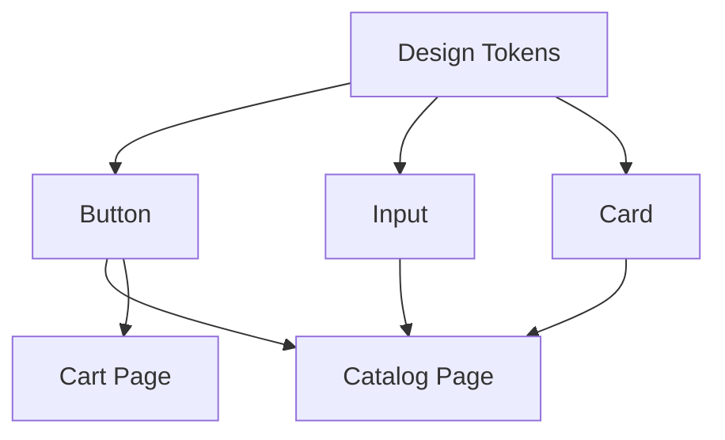

# Semana 19 — Componentização e Design System

## Objetivos

Projetar componentes reutilizáveis, previsíveis e coerentes com o Design System.

Ao final desta semana, você deverá ser capaz de:

- explicar os principais conceitos com suas próprias palavras;
- relacionar os conceitos ao estudo de caso da NexusShop;
- interpretar o diagrama da solução;
- executar o laboratório proposto;
- registrar o resultado no GitHub.

---

## 1. Conceitos

### 1. API do componente

Props formam o contrato de uso do componente.

### 2. Variants

Permitem variações controladas, como `primary`, `secondary` e `danger`.

### 3. Composition

Componentes podem receber conteúdo e outros componentes.

### 4. Single Responsibility

Um componente deve ter uma responsabilidade suficientemente clara.

### 5. Controlled Design

Valores visuais devem vir de tokens e variantes, evitando customização arbitrária.

### 6. Acessibilidade

Componente reutilizável deve preservar foco, semântica e comportamento por teclado.

---

## 2. Estudo de Caso — NexusShop

Botões diferentes da NexusShop foram criados diretamente dentro de páginas. O objetivo é substituí-los por uma única implementação governada.

### O que devemos observar

O foco do estudo de caso não é apenas implementar uma solução, mas entender **por que** determinada técnica é utilizada, quais problemas ela resolve e como se conecta às demais etapas do roadmap.

---

## 3. Diagrama

---

## 4. Laboratório

### Objetivo do laboratório

Aplicar os conceitos da semana em uma evolução prática da NexusShop.

### Passo a passo

1. Crie componente `Button`.
2. Implemente variantes `primary`, `secondary` e `danger`.
3. Implemente tamanhos `sm`, `md` e `lg`.
4. Garanta estado `disabled`.
5. Crie `Input` com label e mensagem de erro.
6. Substitua implementações duplicadas nas páginas pelos novos componentes.

### Evidências esperadas

- código versionado;
- commits relacionados à atividade;
- documentação quando aplicável;
- captura de tela ou link quando a atividade envolver interface;
- README atualizado quando houver mudança importante na forma de executar o projeto.

### Entrega

Biblioteca inicial de componentes reutilizáveis em `src/components`.

---

## 5. Perguntas para revisão

1. Qual problema principal os conceitos desta semana resolvem?
2. Qual é o erro mais comum ao aplicar esses conceitos?
3. Como o conteúdo desta semana se conecta à semana anterior?
4. Como você explicaria a solução implementada para outro desenvolvedor?
5. O que mudaria em um projeto real de maior escala?

---

## 6. Checklist da semana

- [ ] Estudei os conceitos.
- [ ] Entendi o estudo de caso.
- [ ] Interpretei o diagrama Mermaid.
- [ ] Executei o laboratório.
- [ ] Registrei as evidências no GitHub.
- [ ] Revisei os principais aprendizados.

---

[Voltar para o mês](../README.md) | [Voltar para o roadmap](../../README.md)
