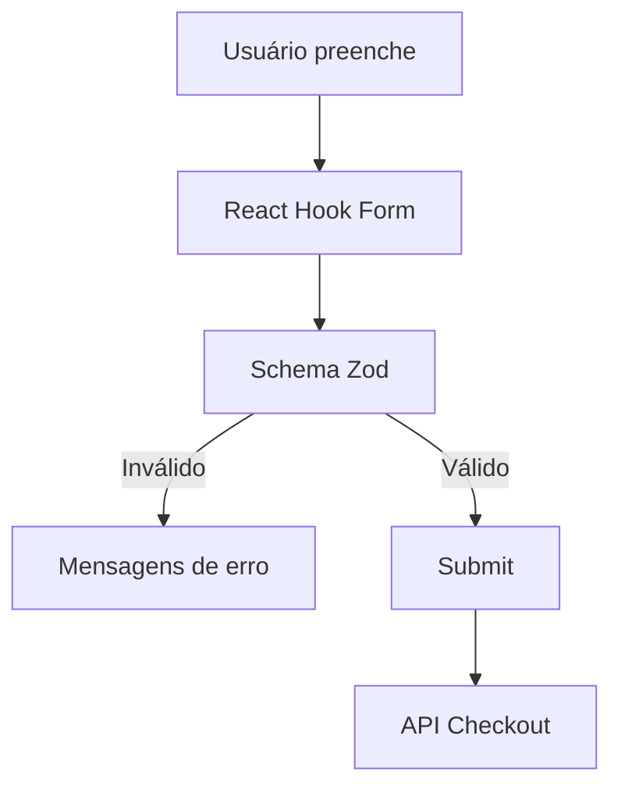

# Semana 21 — Formulários em React

## Objetivos

Construir formulários acessíveis, validados e com feedback claro.

Ao final desta semana, você deverá ser capaz de:

- explicar os principais conceitos com suas próprias palavras;
- relacionar os conceitos ao estudo de caso da NexusShop;
- interpretar o diagrama da solução;
- executar o laboratório proposto;
- registrar o resultado no GitHub.

---

## 1. Conceitos

### 1. Controlled Components

O React mantém o valor do campo em estado.

### 2. Validação

Regras verificam formato e consistência dos dados.

### 3. Touched/Dirty

Estados auxiliam a decidir quando apresentar feedback.

### 4. React Hook Form

Biblioteca que reduz boilerplate e melhora controle de formulários.

### 5. Zod

Permite definir schemas e validações reutilizáveis.

### 6. Feedback

Erros precisam estar próximos do campo e ser compreensíveis.

---

## 2. Estudo de Caso — NexusShop

A NexusShop precisa implementar um formulário de checkout com nome, e-mail, CEP e endereço.

### O que devemos observar

O foco do estudo de caso não é apenas implementar uma solução, mas entender **por que** determinada técnica é utilizada, quais problemas ela resolve e como se conecta às demais etapas do roadmap.

---

## 3. Diagrama

---

## 4. Laboratório

### Objetivo do laboratório

Aplicar os conceitos da semana em uma evolução prática da NexusShop.

### Passo a passo

1. Instale React Hook Form e Zod.
2. Crie schema de checkout.
3. Implemente os campos com labels.
4. Mostre erros de validação.
5. Desabilite o botão durante submissão.
6. Implemente mensagem de sucesso ou falha.

### Evidências esperadas

- código versionado;
- commits relacionados à atividade;
- documentação quando aplicável;
- captura de tela ou link quando a atividade envolver interface;
- README atualizado quando houver mudança importante na forma de executar o projeto.

### Entrega

Formulário de checkout com validação de cliente e feedback.

---

## 5. Perguntas para revisão

1. Qual problema principal os conceitos desta semana resolvem?
2. Qual é o erro mais comum ao aplicar esses conceitos?
3. Como o conteúdo desta semana se conecta à semana anterior?
4. Como você explicaria a solução implementada para outro desenvolvedor?
5. O que mudaria em um projeto real de maior escala?

---

## 6. Checklist da semana

- [ ] Estudei os conceitos.
- [ ] Entendi o estudo de caso.
- [ ] Interpretei o diagrama Mermaid.
- [ ] Executei o laboratório.
- [ ] Registrei as evidências no GitHub.
- [ ] Revisei os principais aprendizados.

---

[Voltar para o mês](../README.md) | [Voltar para o roadmap](../../README.md)
