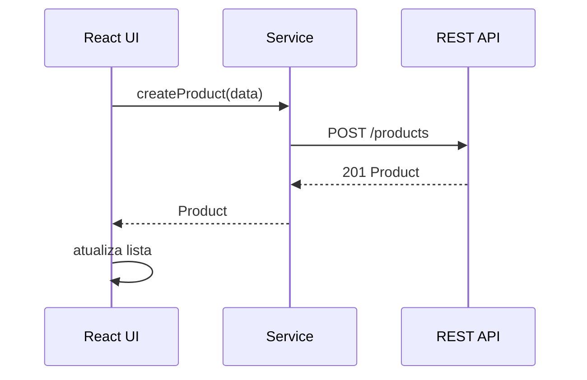

# Semana 22 — React + APIs REST

## Objetivos

Integrar componentes React a operações CRUD e modelar corretamente os estados da interface.

Ao final desta semana, você deverá ser capaz de:

- explicar os principais conceitos com suas próprias palavras;
- relacionar os conceitos ao estudo de caso da NexusShop;
- interpretar o diagrama da solução;
- executar o laboratório proposto;
- registrar o resultado no GitHub.

---

## 1. Conceitos

### 1. GET

Consulta recursos.

### 2. POST

Cria recursos.

### 3. PUT/PATCH

Atualizam recursos, com semânticas diferentes.

### 4. DELETE

Remove um recurso.

### 5. Loading State

Indica que uma operação está em andamento.

### 6. Error State

Explica que a operação falhou e oferece recuperação.

### 7. Empty State

Representa sucesso sem dados.

### 8. Optimistic UI

Atualiza a interface antecipadamente quando a estratégia é segura e reversível.

---

## 2. Estudo de Caso — NexusShop

A administração da NexusShop precisa gerenciar produtos por meio de uma API REST.

### O que devemos observar

O foco do estudo de caso não é apenas implementar uma solução, mas entender **por que** determinada técnica é utilizada, quais problemas ela resolve e como se conecta às demais etapas do roadmap.

---

## 3. Diagrama

---

## 4. Laboratório

### Objetivo do laboratório

Aplicar os conceitos da semana em uma evolução prática da NexusShop.

### Passo a passo

1. Crie tela administrativa de produtos.
2. Liste produtos com GET.
3. Crie produto com POST.
4. Edite utilizando PUT ou PATCH.
5. Remova utilizando DELETE.
6. Implemente loading e tratamento de erros.
7. Peça confirmação antes de exclusões destrutivas.

### Evidências esperadas

- código versionado;
- commits relacionados à atividade;
- documentação quando aplicável;
- captura de tela ou link quando a atividade envolver interface;
- README atualizado quando houver mudança importante na forma de executar o projeto.

### Entrega

CRUD de produtos integrado à API.

---

## 5. Perguntas para revisão

1. Qual problema principal os conceitos desta semana resolvem?
2. Qual é o erro mais comum ao aplicar esses conceitos?
3. Como o conteúdo desta semana se conecta à semana anterior?
4. Como você explicaria a solução implementada para outro desenvolvedor?
5. O que mudaria em um projeto real de maior escala?

---

## 6. Checklist da semana

- [ ] Estudei os conceitos.
- [ ] Entendi o estudo de caso.
- [ ] Interpretei o diagrama Mermaid.
- [ ] Executei o laboratório.
- [ ] Registrei as evidências no GitHub.
- [ ] Revisei os principais aprendizados.

---

[Voltar para o mês](../README.md) | [Voltar para o roadmap](../../README.md)
