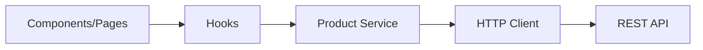

# Semana 23 — Camada de Services

## Objetivos

Separar integração HTTP da camada de apresentação e melhorar testabilidade e manutenção.

Ao final desta semana, você deverá ser capaz de:

- explicar os principais conceitos com suas próprias palavras;
- relacionar os conceitos ao estudo de caso da NexusShop;
- interpretar o diagrama da solução;
- executar o laboratório proposto;
- registrar o resultado no GitHub.

---

## 1. Conceitos

### 1. Separation of Concerns

UI não deve conhecer todos os detalhes de transporte da API.

### 2. Service

Módulo que encapsula operações relacionadas a uma integração.

### 3. HTTP Client

Pode centralizar base URL, headers e tratamento transversal.

### 4. DTO

Representa o formato trocado com uma API.

### 5. Mapping

Pode converter formato externo para formato adequado ao domínio da UI.

### 6. Error normalization

Traduz diferentes erros técnicos para uma representação previsível.

---

## 2. Estudo de Caso — NexusShop

Os componentes da NexusShop possuem URLs e chamadas `fetch` espalhadas. A API vai mudar de host e a manutenção ficou difícil.

### O que devemos observar

O foco do estudo de caso não é apenas implementar uma solução, mas entender **por que** determinada técnica é utilizada, quais problemas ela resolve e como se conecta às demais etapas do roadmap.

---

## 3. Diagrama

---

## 4. Laboratório

### Objetivo do laboratório

Aplicar os conceitos da semana em uma evolução prática da NexusShop.

### Passo a passo

1. Crie `src/services/httpClient.js`.
2. Centralize a base URL.
3. Crie `productService` com métodos CRUD.
4. Remova chamadas HTTP diretas dos componentes.
5. Normalize erros em uma estrutura simples.
6. Atualize o Custom Hook para consumir o service.

### Evidências esperadas

- código versionado;
- commits relacionados à atividade;
- documentação quando aplicável;
- captura de tela ou link quando a atividade envolver interface;
- README atualizado quando houver mudança importante na forma de executar o projeto.

### Entrega

Componentes sem dependência direta de URLs ou detalhes HTTP.

---

## 5. Perguntas para revisão

1. Qual problema principal os conceitos desta semana resolvem?
2. Qual é o erro mais comum ao aplicar esses conceitos?
3. Como o conteúdo desta semana se conecta à semana anterior?
4. Como você explicaria a solução implementada para outro desenvolvedor?
5. O que mudaria em um projeto real de maior escala?

---

## 6. Checklist da semana

- [ ] Estudei os conceitos.
- [ ] Entendi o estudo de caso.
- [ ] Interpretei o diagrama Mermaid.
- [ ] Executei o laboratório.
- [ ] Registrei as evidências no GitHub.
- [ ] Revisei os principais aprendizados.

---

[Voltar para o mês](../README.md) | [Voltar para o roadmap](../../README.md)
