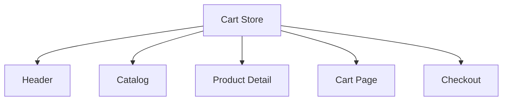

# Semana 24 — Gerenciamento de Estado

## Objetivos

Escolher o nível adequado de estado e evitar transformar toda informação em estado global.

Ao final desta semana, você deverá ser capaz de:

- explicar os principais conceitos com suas próprias palavras;
- relacionar os conceitos ao estudo de caso da NexusShop;
- interpretar o diagrama da solução;
- executar o laboratório proposto;
- registrar o resultado no GitHub.

---

## 1. Conceitos

### 1. Local State

Pertence a um componente ou pequena subárvore.

### 2. Lift State Up

Move estado para o ancestral comum quando irmãos precisam compartilhá-lo.

### 3. Context

Distribui valores para uma árvore sem prop drilling excessivo.

### 4. Global State

Útil quando diversos fluxos independentes dependem do mesmo estado.

### 5. Server State

Dados originados do backend têm características próprias e não devem ser confundidos com estado local.

### 6. Zustand

Biblioteca enxuta para estado global baseado em stores.

---

## 2. Estudo de Caso — NexusShop

O carrinho precisa ser acessado pelo Header, catálogo, detalhe do produto e checkout. Passar props por várias camadas começou a gerar acoplamento.

### O que devemos observar

O foco do estudo de caso não é apenas implementar uma solução, mas entender **por que** determinada técnica é utilizada, quais problemas ela resolve e como se conecta às demais etapas do roadmap.

---

## 3. Diagrama

---

## 4. Laboratório

### Objetivo do laboratório

Aplicar os conceitos da semana em uma evolução prática da NexusShop.

### Passo a passo

1. Mapeie quais estados atuais são locais e quais são compartilhados.
2. Mantenha filtros locais na página de catálogo.
3. Crie estado global somente para o carrinho.
4. Implemente store com Context API ou Zustand.
5. Adicione, remova e altere quantidade de itens.
6. Calcule subtotal como valor derivado, evitando armazená-lo quando não necessário.

### Evidências esperadas

- código versionado;
- commits relacionados à atividade;
- documentação quando aplicável;
- captura de tela ou link quando a atividade envolver interface;
- README atualizado quando houver mudança importante na forma de executar o projeto.

### Entrega

Carrinho compartilhado sem prop drilling desnecessário.

---

## 5. Perguntas para revisão

1. Qual problema principal os conceitos desta semana resolvem?
2. Qual é o erro mais comum ao aplicar esses conceitos?
3. Como o conteúdo desta semana se conecta à semana anterior?
4. Como você explicaria a solução implementada para outro desenvolvedor?
5. O que mudaria em um projeto real de maior escala?

---

## 6. Checklist da semana

- [ ] Estudei os conceitos.
- [ ] Entendi o estudo de caso.
- [ ] Interpretei o diagrama Mermaid.
- [ ] Executei o laboratório.
- [ ] Registrei as evidências no GitHub.
- [ ] Revisei os principais aprendizados.

---

[Voltar para o mês](../README.md) | [Voltar para o roadmap](../../README.md)
