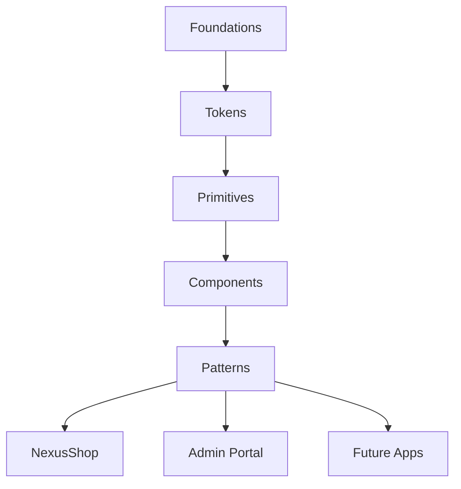

# Semana 25 — Design System em React

## Objetivos

Transformar foundations e componentes em um produto reutilizável e documentado.

Ao final desta semana, você deverá ser capaz de:

- explicar os principais conceitos com suas próprias palavras;
- relacionar os conceitos ao estudo de caso da NexusShop;
- interpretar o diagrama da solução;
- executar o laboratório proposto;
- registrar o resultado no GitHub.

---

## 1. Conceitos

### 1. Foundations

Definem bases visuais e comportamentais.

### 2. Tokens

Conectam decisões do Design System ao código.

### 3. Primitives

Componentes básicos e altamente reutilizáveis.

### 4. Components

Combinam primitives e regras de interação.

### 5. Patterns

Soluções recorrentes compostas por vários componentes.

### 6. Governança

Define como componentes entram, evoluem e são depreciados.

---

## 2. Estudo de Caso — NexusShop

Outras aplicações da empresa querem utilizar os mesmos componentes da NexusShop. O Design System deixa de ser apenas uma pasta do projeto e passa a ser tratado como produto.

### O que devemos observar

O foco do estudo de caso não é apenas implementar uma solução, mas entender **por que** determinada técnica é utilizada, quais problemas ela resolve e como se conecta às demais etapas do roadmap.

---

## 3. Diagrama

---

## 4. Laboratório

### Objetivo do laboratório

Aplicar os conceitos da semana em uma evolução prática da NexusShop.

### Passo a passo

1. Liste componentes já existentes.
2. Separe tokens, primitives e componentes.
3. Padronize API de props.
4. Crie Button, Input, Select, Card e Modal.
5. Adicione documentação mínima de uso.
6. Registre decisões de design e desenvolvimento.

### Evidências esperadas

- código versionado;
- commits relacionados à atividade;
- documentação quando aplicável;
- captura de tela ou link quando a atividade envolver interface;
- README atualizado quando houver mudança importante na forma de executar o projeto.

### Entrega

Design System React inicial com estrutura e documentação próprias.

---

## 5. Perguntas para revisão

1. Qual problema principal os conceitos desta semana resolvem?
2. Qual é o erro mais comum ao aplicar esses conceitos?
3. Como o conteúdo desta semana se conecta à semana anterior?
4. Como você explicaria a solução implementada para outro desenvolvedor?
5. O que mudaria em um projeto real de maior escala?

---

## 6. Checklist da semana

- [ ] Estudei os conceitos.
- [ ] Entendi o estudo de caso.
- [ ] Interpretei o diagrama Mermaid.
- [ ] Executei o laboratório.
- [ ] Registrei as evidências no GitHub.
- [ ] Revisei os principais aprendizados.

---

[Voltar para o mês](../README.md) | [Voltar para o roadmap](../../README.md)
