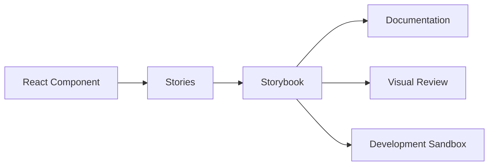

# Semana 27 — Storybook

## Objetivos

Criar documentação viva e ambiente isolado para desenvolvimento de componentes.

Ao final desta semana, você deverá ser capaz de:

- explicar os principais conceitos com suas próprias palavras;
- relacionar os conceitos ao estudo de caso da NexusShop;
- interpretar o diagrama da solução;
- executar o laboratório proposto;
- registrar o resultado no GitHub.

---

## 1. Conceitos

### 1. Story

Exemplo renderizável de um estado do componente.

### 2. Controls

Permitem experimentar props na interface do Storybook.

### 3. Args

Definem valores usados pela story.

### 4. Documentation

Explica propósito, uso, variações e limitações.

### 5. Isolation

Permite desenvolver componente sem depender da aplicação completa.

### 6. Visual Review

Facilita comparação manual e automação futura de regressões visuais.

---

## 2. Estudo de Caso — NexusShop

Desenvolvedores querem conhecer variantes dos componentes sem navegar por todas as páginas da NexusShop.

### O que devemos observar

O foco do estudo de caso não é apenas implementar uma solução, mas entender **por que** determinada técnica é utilizada, quais problemas ela resolve e como se conecta às demais etapas do roadmap.

---

## 3. Diagrama

---

## 4. Laboratório

### Objetivo do laboratório

Aplicar os conceitos da semana em uma evolução prática da NexusShop.

### Passo a passo

1. Instale e configure Storybook.
2. Crie stories para Button.
3. Documente variantes e tamanhos.
4. Crie stories para Input em Default, Error e Disabled.
5. Use Controls para testar props.
6. Adicione página de documentação inicial do Design System.

### Evidências esperadas

- código versionado;
- commits relacionados à atividade;
- documentação quando aplicável;
- captura de tela ou link quando a atividade envolver interface;
- README atualizado quando houver mudança importante na forma de executar o projeto.

### Entrega

Storybook executável com documentação de pelo menos três componentes.

---

## 5. Perguntas para revisão

1. Qual problema principal os conceitos desta semana resolvem?
2. Qual é o erro mais comum ao aplicar esses conceitos?
3. Como o conteúdo desta semana se conecta à semana anterior?
4. Como você explicaria a solução implementada para outro desenvolvedor?
5. O que mudaria em um projeto real de maior escala?

---

## 6. Checklist da semana

- [ ] Estudei os conceitos.
- [ ] Entendi o estudo de caso.
- [ ] Interpretei o diagrama Mermaid.
- [ ] Executei o laboratório.
- [ ] Registrei as evidências no GitHub.
- [ ] Revisei os principais aprendizados.

---

[Voltar para o mês](../README.md) | [Voltar para o roadmap](../../README.md)
