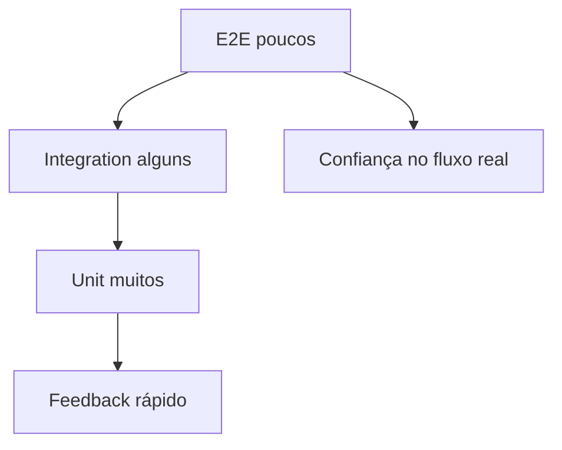

# Semana 28 — Testes Frontend

## Objetivos

Aplicar diferentes níveis de teste de acordo com risco, comportamento e custo de manutenção.

Ao final desta semana, você deverá ser capaz de:

- explicar os principais conceitos com suas próprias palavras;
- relacionar os conceitos ao estudo de caso da NexusShop;
- interpretar o diagrama da solução;
- executar o laboratório proposto;
- registrar o resultado no GitHub.

---

## 1. Conceitos

### 1. Unit Test

Valida uma unidade pequena de comportamento.

### 2. Integration Test

Valida colaboração entre componentes ou módulos.

### 3. E2E

Valida um fluxo real da aplicação no navegador.

### 4. Testing Library

Prioriza testes próximos à forma como o usuário interage.

### 5. Mock

Substitui dependências quando necessário, mas deve ser usado com critério.

### 6. Pyramid

Sugere mais testes rápidos e específicos e menos testes E2E caros.

---

## 2. Estudo de Caso — NexusShop

Uma alteração no carrinho quebrou o cálculo de subtotal sem ser percebida. A NexusShop precisa construir uma rede mínima de segurança.

### O que devemos observar

O foco do estudo de caso não é apenas implementar uma solução, mas entender **por que** determinada técnica é utilizada, quais problemas ela resolve e como se conecta às demais etapas do roadmap.

---

## 3. Diagrama

---

## 4. Laboratório

### Objetivo do laboratório

Aplicar os conceitos da semana em uma evolução prática da NexusShop.

### Passo a passo

1. Configure Vitest.
2. Teste funções de cálculo do carrinho.
3. Configure React Testing Library.
4. Teste interação `Adicionar ao carrinho`.
5. Teste formulário com erro de validação.
6. Configure Playwright.
7. Crie E2E: abrir catálogo → adicionar produto → abrir carrinho.

### Evidências esperadas

- código versionado;
- commits relacionados à atividade;
- documentação quando aplicável;
- captura de tela ou link quando a atividade envolver interface;
- README atualizado quando houver mudança importante na forma de executar o projeto.

### Entrega

Suíte com pelo menos testes unitários, um teste de integração e um fluxo E2E.

---

## 5. Perguntas para revisão

1. Qual problema principal os conceitos desta semana resolvem?
2. Qual é o erro mais comum ao aplicar esses conceitos?
3. Como o conteúdo desta semana se conecta à semana anterior?
4. Como você explicaria a solução implementada para outro desenvolvedor?
5. O que mudaria em um projeto real de maior escala?

---

## 6. Checklist da semana

- [ ] Estudei os conceitos.
- [ ] Entendi o estudo de caso.
- [ ] Interpretei o diagrama Mermaid.
- [ ] Executei o laboratório.
- [ ] Registrei as evidências no GitHub.
- [ ] Revisei os principais aprendizados.

---

[Voltar para o mês](../README.md) | [Voltar para o roadmap](../../README.md)
