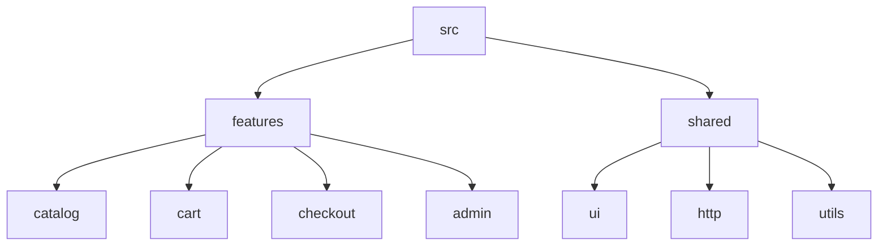

# Semana 29 — Arquitetura Frontend

## Objetivos

Organizar aplicações por domínio e responsabilidades para facilitar evolução em escala.

Ao final desta semana, você deverá ser capaz de:

- explicar os principais conceitos com suas próprias palavras;
- relacionar os conceitos ao estudo de caso da NexusShop;
- interpretar o diagrama da solução;
- executar o laboratório proposto;
- registrar o resultado no GitHub.

---

## 1. Conceitos

### 1. Feature-based Architecture

Agrupa código pelo domínio/feature, não apenas pelo tipo técnico.

### 2. Shared

Contém elementos realmente reutilizados entre features.

### 3. Boundaries

Dependências devem respeitar limites claros.

### 4. Separation of Concerns

UI, domínio e integração devem possuir responsabilidades distinguíveis.

### 5. Colocation

Arquivos que mudam juntos tendem a permanecer próximos.

### 6. ADR

Architecture Decision Record registra decisões importantes e seus trade-offs.

---

## 2. Estudo de Caso — NexusShop

A NexusShop já possui catálogo, carrinho, checkout e administração. Pastas globais de components e services cresceram e perderam contexto.

### O que devemos observar

O foco do estudo de caso não é apenas implementar uma solução, mas entender **por que** determinada técnica é utilizada, quais problemas ela resolve e como se conecta às demais etapas do roadmap.

---

## 3. Diagrama

---

## 4. Laboratório

### Objetivo do laboratório

Aplicar os conceitos da semana em uma evolução prática da NexusShop.

### Passo a passo

1. Mapeie as features atuais.
2. Crie estrutura `features/catalog`, `features/cart`, `features/checkout`.
3. Mova código específico para a feature correspondente.
4. Mantenha em `shared` apenas componentes realmente genéricos.
5. Defina regra de dependência entre features.
6. Crie um ADR explicando a escolha.

### Evidências esperadas

- código versionado;
- commits relacionados à atividade;
- documentação quando aplicável;
- captura de tela ou link quando a atividade envolver interface;
- README atualizado quando houver mudança importante na forma de executar o projeto.

### Entrega

NexusShop reorganizada por features, com ADR da arquitetura.

---

## 5. Perguntas para revisão

1. Qual problema principal os conceitos desta semana resolvem?
2. Qual é o erro mais comum ao aplicar esses conceitos?
3. Como o conteúdo desta semana se conecta à semana anterior?
4. Como você explicaria a solução implementada para outro desenvolvedor?
5. O que mudaria em um projeto real de maior escala?

---

## 6. Checklist da semana

- [ ] Estudei os conceitos.
- [ ] Entendi o estudo de caso.
- [ ] Interpretei o diagrama Mermaid.
- [ ] Executei o laboratório.
- [ ] Registrei as evidências no GitHub.
- [ ] Revisei os principais aprendizados.

---

[Voltar para o mês](../README.md) | [Voltar para o roadmap](../../README.md)
