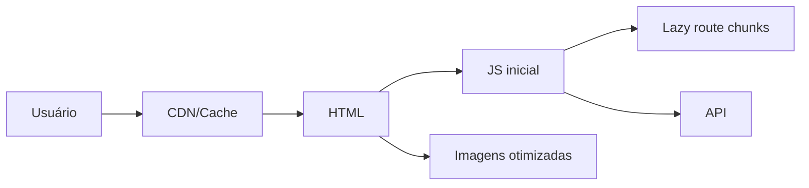

# Semana 30 — Performance Web

## Objetivos

Medir e otimizar experiência de carregamento e interação usando evidências, não suposições.

Ao final desta semana, você deverá ser capaz de:

- explicar os principais conceitos com suas próprias palavras;
- relacionar os conceitos ao estudo de caso da NexusShop;
- interpretar o diagrama da solução;
- executar o laboratório proposto;
- registrar o resultado no GitHub.

---

## 1. Conceitos

### 1. Core Web Vitals

Conjunto de métricas centradas na experiência real do usuário.

### 2. LCP

Mede o tempo de renderização do maior conteúdo relevante visível.

### 3. CLS

Mede instabilidade visual.

### 4. INP

Mede responsividade das interações.

### 5. Code Splitting

Divide código para carregar apenas o necessário.

### 6. Lazy Loading

Posterga carregamento de recursos até serem necessários.

### 7. Image Optimization

Reduz custo de transferência e renderização de imagens.

### 8. Caching

Evita downloads e processamentos repetidos quando apropriado.

---

## 2. Estudo de Caso — NexusShop

A NexusShop começou a carregar lentamente em conexões móveis e seu bundle cresceu com novas telas administrativas.

### O que devemos observar

O foco do estudo de caso não é apenas implementar uma solução, mas entender **por que** determinada técnica é utilizada, quais problemas ela resolve e como se conecta às demais etapas do roadmap.

---

## 3. Diagrama

---

## 4. Laboratório

### Objetivo do laboratório

Aplicar os conceitos da semana em uma evolução prática da NexusShop.

### Passo a passo

1. Execute Lighthouse e registre métricas iniciais.
2. Analise tamanho do bundle.
3. Implemente lazy loading nas rotas menos acessadas.
4. Otimize imagens e dimensões.
5. Evite layout shift reservando espaço para mídia.
6. Execute novamente o Lighthouse.
7. Compare antes e depois.

### Evidências esperadas

- código versionado;
- commits relacionados à atividade;
- documentação quando aplicável;
- captura de tela ou link quando a atividade envolver interface;
- README atualizado quando houver mudança importante na forma de executar o projeto.

### Entrega

Relatório `docs/performance.md` com baseline, mudanças e resultados.

---

## 5. Perguntas para revisão

1. Qual problema principal os conceitos desta semana resolvem?
2. Qual é o erro mais comum ao aplicar esses conceitos?
3. Como o conteúdo desta semana se conecta à semana anterior?
4. Como você explicaria a solução implementada para outro desenvolvedor?
5. O que mudaria em um projeto real de maior escala?

---

## 6. Checklist da semana

- [ ] Estudei os conceitos.
- [ ] Entendi o estudo de caso.
- [ ] Interpretei o diagrama Mermaid.
- [ ] Executei o laboratório.
- [ ] Registrei as evidências no GitHub.
- [ ] Revisei os principais aprendizados.

---

[Voltar para o mês](../README.md) | [Voltar para o roadmap](../../README.md)
