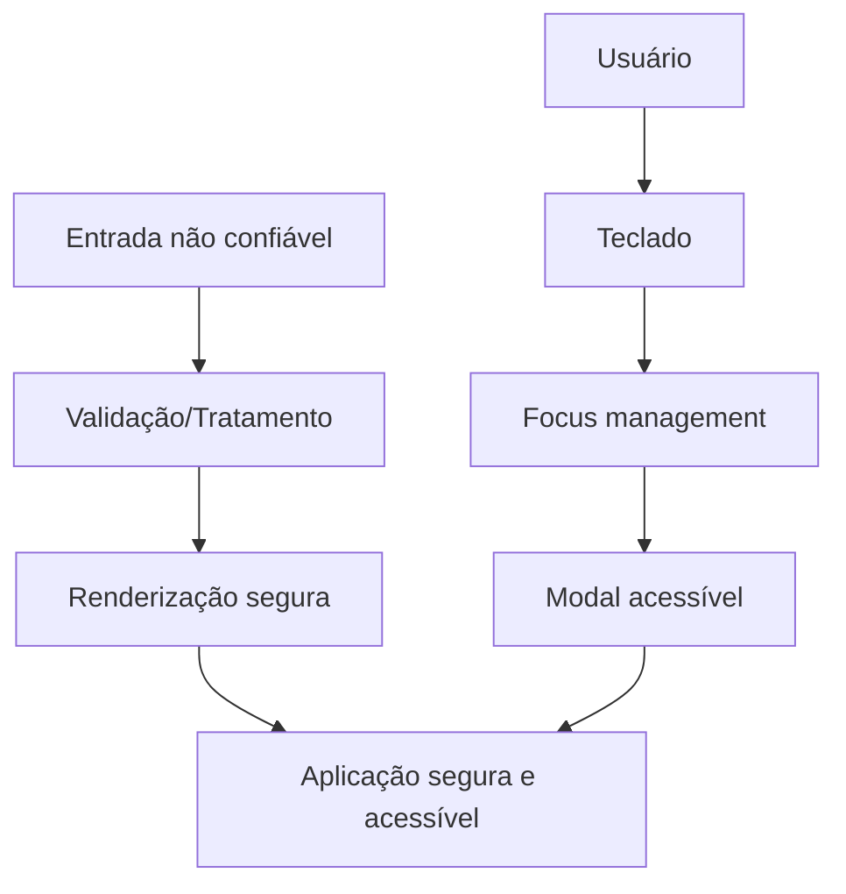

# Semana 31 — Segurança e Acessibilidade

## Objetivos

Reconhecer riscos comuns do frontend e aplicar práticas fundamentais de acessibilidade.

Ao final desta semana, você deverá ser capaz de:

- explicar os principais conceitos com suas próprias palavras;
- relacionar os conceitos ao estudo de caso da NexusShop;
- interpretar o diagrama da solução;
- executar o laboratório proposto;
- registrar o resultado no GitHub.

---

## 1. Conceitos

### 1. XSS

Execução de conteúdo malicioso no contexto da aplicação por entrada não confiável.

### 2. CSRF

Aproveita credenciais já existentes para induzir ações não desejadas em determinadas arquiteturas.

### 3. CORS

Política do navegador que controla requisições entre origens; não é mecanismo de autenticação.

### 4. Autenticação

Frontend participa do fluxo, mas não deve ser considerado ambiente confiável para segredos.

### 5. Semantic HTML

É a primeira camada de acessibilidade.

### 6. ARIA

Complementa semântica quando HTML nativo não é suficiente.

### 7. Focus Management

Interfaces dinâmicas precisam manter navegação previsível.

### 8. WCAG

Diretrizes estruturadas em princípios de conteúdo perceptível, operável, compreensível e robusto.

---

## 2. Estudo de Caso — NexusShop

A área de comentários da NexusShop começa a exibir conteúdo fornecido por usuários. Ao mesmo tempo, auditoria encontra modais com foco inacessível por teclado.

### O que devemos observar

O foco do estudo de caso não é apenas implementar uma solução, mas entender **por que** determinada técnica é utilizada, quais problemas ela resolve e como se conecta às demais etapas do roadmap.

---

## 3. Diagrama

---

## 4. Laboratório

### Objetivo do laboratório

Aplicar os conceitos da semana em uma evolução prática da NexusShop.

### Passo a passo

1. Revise qualquer uso de `dangerouslySetInnerHTML`.
2. Garanta que nenhum segredo esteja no código frontend.
3. Revise fluxo de autenticação conceitualmente.
4. Teste a aplicação somente por teclado.
5. Revise labels, headings, landmarks e textos alternativos.
6. Execute auditoria de acessibilidade no Lighthouse.
7. Corrija pelo menos três problemas encontrados.

### Evidências esperadas

- código versionado;
- commits relacionados à atividade;
- documentação quando aplicável;
- captura de tela ou link quando a atividade envolver interface;
- README atualizado quando houver mudança importante na forma de executar o projeto.

### Entrega

Checklist de segurança e acessibilidade em `docs/security-accessibility.md`.

---

## 5. Perguntas para revisão

1. Qual problema principal os conceitos desta semana resolvem?
2. Qual é o erro mais comum ao aplicar esses conceitos?
3. Como o conteúdo desta semana se conecta à semana anterior?
4. Como você explicaria a solução implementada para outro desenvolvedor?
5. O que mudaria em um projeto real de maior escala?

---

## 6. Checklist da semana

- [ ] Estudei os conceitos.
- [ ] Entendi o estudo de caso.
- [ ] Interpretei o diagrama Mermaid.
- [ ] Executei o laboratório.
- [ ] Registrei as evidências no GitHub.
- [ ] Revisei os principais aprendizados.

---

[Voltar para o mês](../README.md) | [Voltar para o roadmap](../../README.md)
