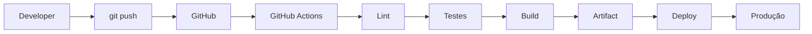

# Semana 32 — CI/CD e Deploy

## Objetivos

Automatizar verificações de qualidade e publicação da aplicação.

Ao final desta semana, você deverá ser capaz de:

- explicar os principais conceitos com suas próprias palavras;
- relacionar os conceitos ao estudo de caso da NexusShop;
- interpretar o diagrama da solução;
- executar o laboratório proposto;
- registrar o resultado no GitHub.

---

## 1. Conceitos

### 1. Continuous Integration

Cada mudança é integrada com validações automáticas frequentes.

### 2. Continuous Delivery

Mantém o software em condição publicável.

### 3. Pipeline

Sequência automatizada de etapas, como lint, testes e build.

### 4. Artifact

Resultado imutável de um build.

### 5. Environment

Contexto de execução como preview, homologação ou produção.

### 6. Deploy

Publicação do artifact em uma plataforma de hospedagem.

### 7. Rollback

Estratégia para retornar a uma versão anterior quando necessário.

---

## 2. Estudo de Caso — NexusShop

A NexusShop é publicada manualmente e uma versão foi enviada sem executar testes. O time decide automatizar o processo com GitHub Actions.

### O que devemos observar

O foco do estudo de caso não é apenas implementar uma solução, mas entender **por que** determinada técnica é utilizada, quais problemas ela resolve e como se conecta às demais etapas do roadmap.

---

## 3. Diagrama

---

## 4. Laboratório

### Objetivo do laboratório

Aplicar os conceitos da semana em uma evolução prática da NexusShop.

### Passo a passo

1. Crie `.github/workflows/ci.yml`.
2. Configure checkout e Node.js.
3. Execute instalação reprodutível de dependências.
4. Adicione etapa de lint.
5. Adicione testes automatizados.
6. Adicione build.
7. Configure deploy em GitHub Pages, Vercel, Netlify ou outra plataforma.
8. Documente como realizar rollback.

### Evidências esperadas

- código versionado;
- commits relacionados à atividade;
- documentação quando aplicável;
- captura de tela ou link quando a atividade envolver interface;
- README atualizado quando houver mudança importante na forma de executar o projeto.

### Entrega

Pipeline funcionando do Pull Request ao build e deploy da aplicação.

---

## 5. Perguntas para revisão

1. Qual problema principal os conceitos desta semana resolvem?
2. Qual é o erro mais comum ao aplicar esses conceitos?
3. Como o conteúdo desta semana se conecta à semana anterior?
4. Como você explicaria a solução implementada para outro desenvolvedor?
5. O que mudaria em um projeto real de maior escala?

---

## 6. Checklist da semana

- [ ] Estudei os conceitos.
- [ ] Entendi o estudo de caso.
- [ ] Interpretei o diagrama Mermaid.
- [ ] Executei o laboratório.
- [ ] Registrei as evidências no GitHub.
- [ ] Revisei os principais aprendizados.

---

[Voltar para o mês](../README.md) | [Voltar para o roadmap](../../README.md)
