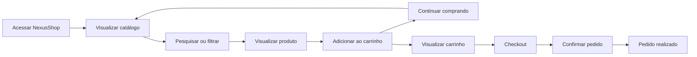
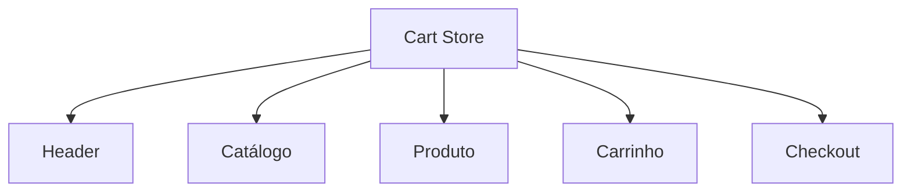
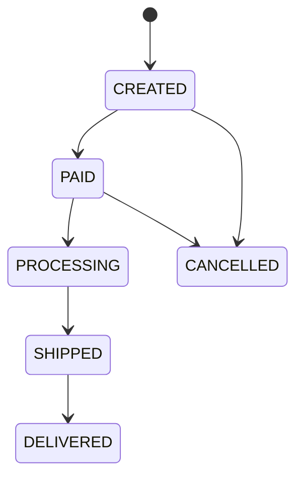
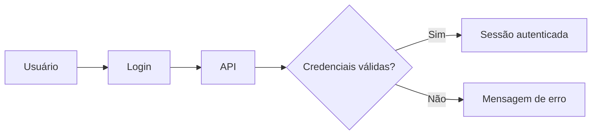
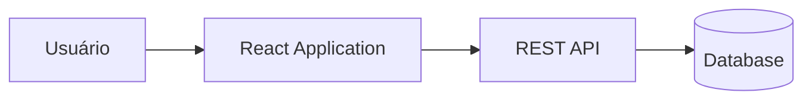
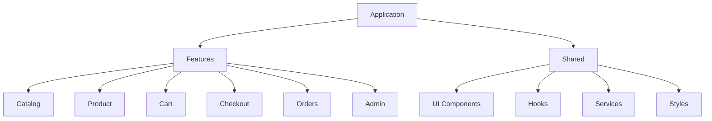
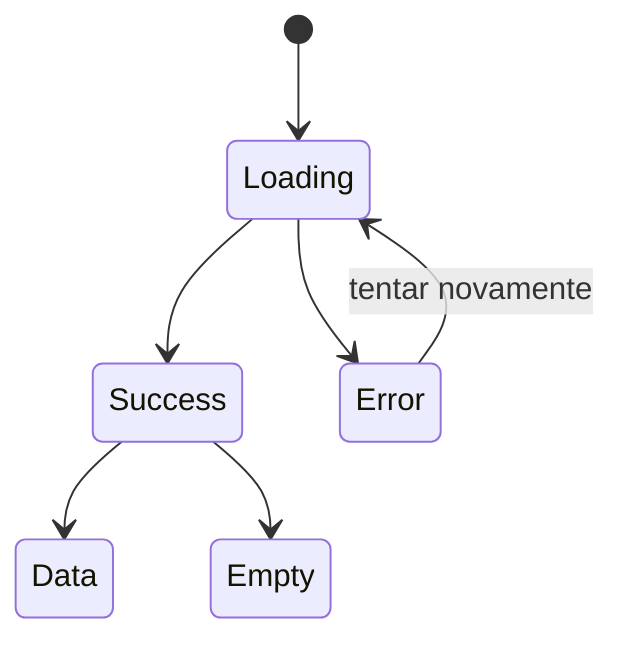
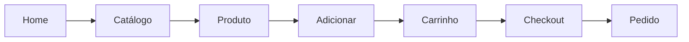
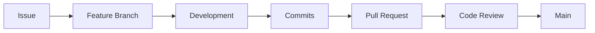
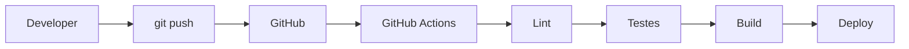

# Projeto Integrador — NexusShop

## 1. Objetivo do projeto

O projeto integrador deverá consolidar os conhecimentos desenvolvidos ao longo do roadmap de Frontend Web Developer.

O participante deverá transformar um problema de negócio em uma solução Web completa, passando por:

```text
Problema
   ↓
Requisitos
   ↓
UX
   ↓
Wireframe
   ↓
Figma
   ↓
Design System
   ↓
HTML / CSS
   ↓
JavaScript
   ↓
React
   ↓
API
   ↓
Testes
   ↓
CI/CD
   ↓
Deploy
```

O objetivo não é apenas construir telas.

O participante deverá demonstrar capacidade de:

- compreender um problema;
- identificar usuários;
- definir fluxos;
- criar uma experiência;
- modelar componentes;
- implementar funcionalidades;
- consumir APIs;
- tratar estados da aplicação;
- organizar código;
- testar;
- documentar;
- publicar a solução.

---

# 2. Caso de Uso

## NexusShop

A **NexusShop** é uma pequena empresa de comércio eletrônico que atualmente vende seus produtos utilizando redes sociais e atendimento por mensagens.

A empresa possui aproximadamente 150 produtos distribuídos em categorias como:

- eletrônicos;
- acessórios;
- informática;
- casa;
- escritório.

Atualmente os clientes visualizam os produtos nas redes sociais e precisam entrar em contato com um atendente para:

- consultar preço;
- verificar disponibilidade;
- escolher produtos;
- calcular o pedido;
- informar endereço;
- finalizar a compra.

Esse processo gera diversos problemas.

---

# 3. Problema de negócio

A empresa identificou os seguintes problemas:

- atendimento manual;
- demora para responder clientes;
- informações de produtos descentralizadas;
- dificuldade para encontrar produtos;
- ausência de catálogo organizado;
- erros durante montagem de pedidos;
- dificuldade para acompanhar pedidos;
- baixa capacidade de atendimento simultâneo;
- experiência diferente para cada cliente.

A NexusShop decidiu criar uma aplicação Web para permitir que seus clientes encontrem produtos e realizem pedidos de forma independente.

---

# 4. Objetivo da solução

Construir uma aplicação Web responsiva que permita ao cliente:

```text
Encontrar produtos
        ↓
Visualizar detalhes
        ↓
Adicionar ao carrinho
        ↓
Revisar pedido
        ↓
Informar dados
        ↓
Finalizar compra
        ↓
Acompanhar pedido
```

---

# 5. Perfis de usuário

A aplicação possuirá inicialmente dois perfis.

## Cliente

Responsável por navegar e comprar produtos.

Principais necessidades:

- encontrar produtos rapidamente;
- compreender preço e disponibilidade;
- visualizar detalhes;
- organizar itens no carrinho;
- finalizar pedidos;
- acompanhar pedidos.

## Administrador

Responsável por manter o catálogo da NexusShop.

Principais necessidades:

- cadastrar produtos;
- editar produtos;
- remover produtos;
- alterar preço;
- controlar disponibilidade;
- visualizar pedidos.

---

# 6. Persona principal

## Cliente

**Nome fictício:** Mariana

**Contexto:**

Mariana utiliza principalmente o smartphone para realizar compras online.

Ela quer encontrar rapidamente um produto e comparar opções sem precisar conversar com um atendente.

### Necessidades

- interface simples;
- navegação rápida;
- busca;
- filtros;
- informações claras;
- processo de compra curto.

### Frustrações

- páginas lentas;
- preços escondidos;
- formulários grandes;
- dificuldade para voltar ao catálogo;
- carrinhos que perdem produtos;
- erros sem explicação.

---

# 7. Jornada principal



---

# 8. Features principais

O projeto será organizado em features.

```text
NexusShop

├── Catálogo
├── Busca
├── Filtros
├── Produto
├── Carrinho
├── Checkout
├── Pedidos
├── Autenticação
└── Administração
```

---

# 9. Feature — Catálogo

## Objetivo

Permitir ao cliente visualizar os produtos disponíveis.

## Informações exibidas

Cada produto deverá apresentar:

- imagem;
- nome;
- categoria;
- preço;
- disponibilidade;
- avaliação opcional;
- botão para visualizar detalhes;
- botão para adicionar ao carrinho.

## Regras

Produtos indisponíveis devem permanecer visíveis, mas não podem ser adicionados ao carrinho.

---

# 10. Feature — Busca

## Objetivo

Permitir ao usuário encontrar produtos por texto.

O usuário poderá buscar por:

- nome;
- descrição;
- categoria.

### Exemplo

```text
Busca:

"mouse"

Resultado:

Mouse Gamer
Mouse Wireless
Mouse Ergonômico
```

---

# 11. Feature — Filtros

O catálogo deverá permitir filtros.

## Filtros mínimos

- categoria;
- faixa de preço;
- disponibilidade.

## Opcional

- avaliação;
- marca;
- ordenação.

Exemplos de ordenação:

```text
Menor preço

Maior preço

Nome A-Z

Mais populares
```

---

# 12. Feature — Detalhes do Produto

Cada produto deverá possuir uma página própria.

Exemplo de rota:

```text
/products/123
```

## Informações

- imagem;
- nome;
- descrição;
- preço;
- categoria;
- estoque;
- especificações;
- quantidade desejada;
- botão de adicionar ao carrinho.

---

# 13. Feature — Carrinho

O carrinho será uma das principais features do projeto.

O usuário deverá conseguir:

- adicionar produto;
- remover produto;
- alterar quantidade;
- visualizar subtotal;
- visualizar quantidade total;
- limpar carrinho;
- continuar comprando;
- iniciar checkout.

---

# 14. Regras do carrinho

## Quantidade

A quantidade deverá ser:

```text
quantidade >= 1
```

e não poderá ultrapassar o estoque disponível.

## Cálculo

```text
subtotal item =
preço × quantidade
```

O subtotal do carrinho será:

```text
subtotal =
soma dos subtotais dos itens
```

---

# 15. Estado global do carrinho

O carrinho deverá estar disponível em diferentes partes da aplicação.



---

# 16. Feature — Checkout

O checkout deverá permitir ao cliente informar os dados necessários para realizar o pedido.

## Dados pessoais

- nome;
- e-mail;
- telefone.

## Endereço

- CEP;
- rua;
- número;
- complemento;
- bairro;
- cidade;
- estado.

---

# 17. Validação

Exemplos de regras:

```text
nome:
obrigatório

email:
formato válido

CEP:
8 dígitos

estado:
2 caracteres

número:
obrigatório
```

Mensagens de erro deverão ser exibidas próximas aos campos correspondentes.

---

# 18. Resumo do pedido

Antes de finalizar a compra, o usuário deverá visualizar:

- produtos;
- quantidades;
- preços;
- subtotal;
- endereço;
- valor total.

---

# 19. Feature — Pedido

Após confirmação, deverá ser criado um pedido.

Exemplo:

```json
{
  "id": "ORD-10234",
  "customer": {
    "name": "Mariana"
  },
  "items": [
    {
      "productId": 12,
      "quantity": 2
    }
  ],
  "status": "CREATED"
}
```

---

# 20. Status do pedido

O pedido poderá possuir os seguintes estados:

```text
CREATED
PAID
PROCESSING
SHIPPED
DELIVERED
CANCELLED
```

---

# 21. Fluxo do pedido



---

# 22. Feature — Acompanhamento de Pedido

O usuário deverá conseguir consultar um pedido.

Informações:

- número do pedido;
- data;
- produtos;
- valor;
- status;
- endereço de entrega.

---

# 23. Feature — Autenticação

Essa feature pode ser adicionada após as funcionalidades principais.

O usuário poderá:

- criar conta;
- fazer login;
- fazer logout;
- acessar seus pedidos.

Fluxo:



---

# 24. Área administrativa

A aplicação poderá possuir uma área separada:

```text
/admin
```

Apenas usuários administradores poderão acessá-la.

---

# 25. Feature — Administração de Produtos

O administrador deverá conseguir:

```text
Listar
Criar
Editar
Excluir
```

produtos.

---

# 26. CRUD de Produtos

## Create

Cadastrar produto.

Campos:

- nome;
- descrição;
- preço;
- categoria;
- estoque;
- imagem.

## Read

Listar produtos.

## Update

Alterar:

- descrição;
- preço;
- categoria;
- estoque;
- disponibilidade.

## Delete

Excluir um produto.

Antes da exclusão deverá existir uma confirmação.

---

# 27. Interface administrativa

Exemplo:

```text
Produtos

------------------------------------------------
Nome              Categoria       Preço   Ações
------------------------------------------------
Mouse Gamer       Eletrônicos     199     Editar
Notebook Pro      Informática    5900     Editar
Teclado Mecânico  Eletrônicos     350     Editar
------------------------------------------------

[ Novo Produto ]
```

---

# 28. Arquitetura conceitual

A solução deverá inicialmente possuir uma arquitetura simples.



---

# 29. Arquitetura Frontend

Sugestão:

```text
src/

├── features/
│
│   ├── catalog/
│   ├── product/
│   ├── cart/
│   ├── checkout/
│   ├── orders/
│   ├── auth/
│   └── admin/
│
├── shared/
│
│   ├── components/
│   ├── hooks/
│   ├── services/
│   ├── styles/
│   └── utils/
│
├── routes/
│
└── app/
```

---

# 30. Arquitetura baseada em features



---

# 31. API

Inicialmente poderá ser utilizada:

- API pública;
- JSON Server;
- Mock API;
- backend desenvolvido pelo aluno;
- serviço próprio.

O objetivo principal do projeto é o Frontend.

---

# 32. Endpoints sugeridos

## Produtos

```text
GET /products

GET /products/:id

POST /products

PATCH /products/:id

DELETE /products/:id
```

## Pedidos

```text
POST /orders

GET /orders/:id

GET /orders
```

---

# 33. Modelo de Produto

Exemplo conceitual:

```json
{
  "id": 123,
  "name": "Mouse Wireless",
  "description": "Mouse sem fio",
  "price": 149.90,
  "category": "Eletrônicos",
  "stock": 15,
  "image": "/images/mouse.jpg"
}
```

---

# 34. Design System

Antes de implementar as páginas, deverão ser criados fundamentos visuais.

## Cores

Exemplo conceitual:

```text
Primary
Secondary
Background
Surface
Text
Success
Warning
Error
```

---

# 35. Tipografia

Definir:

```text
Heading XL
Heading LG
Heading MD

Body LG
Body MD
Body SM
```

---

# 36. Spacing

Criar escala consistente.

Exemplo:

```text
4
8
12
16
24
32
48
64
```

---

# 37. Componentes obrigatórios

O Design System deverá possuir pelo menos:

- Button;
- Input;
- Select;
- Checkbox;
- Badge;
- Card;
- Modal;
- Table;
- Toast;
- Loading;
- Empty State.

---

# 38. Estados obrigatórios

Os principais componentes devem considerar:

```text
Default

Hover

Focus

Active

Disabled

Loading

Error
```

---

# 39. Responsividade

A solução deverá funcionar em pelo menos:

```text
Mobile
Tablet
Desktop
```

O desenvolvimento deverá preferencialmente utilizar abordagem:

```text
Mobile First
```

---

# 40. Telas mínimas

A aplicação deverá possuir pelo menos:

```text
Home

Catálogo

Detalhe do Produto

Carrinho

Checkout

Pedido Confirmado

Consulta de Pedido

Login

Admin Produtos

Cadastro/Edição de Produto
```

---

# 41. Estados de interface

As telas que dependem de APIs deverão considerar os principais estados.



---

# 42. Loading State

Exemplos:

- skeleton;
- spinner;
- texto de carregamento.

A aplicação nunca deverá simplesmente ficar sem resposta enquanto dados são carregados.

---

# 43. Empty State

Exemplos:

```text
Nenhum produto encontrado.

Seu carrinho está vazio.

Nenhum pedido encontrado.
```

O Empty State deverá orientar o usuário sobre o próximo passo.

---

# 44. Error State

Uma falha de API deverá gerar feedback claro.

Exemplo:

```text
Não foi possível carregar os produtos.

[Tentar novamente]
```

---

# 45. Testes

O projeto deverá possuir uma estratégia mínima de testes.

```text
           E2E
          /   \
     Integration
       /      \
      Unit
```

---

# 46. Testes unitários

Exemplos:

- cálculo do subtotal;
- cálculo de desconto;
- validações;
- funções utilitárias.

---

# 47. Testes de integração

Exemplos:

- adicionar item ao carrinho;
- remover item;
- alterar quantidade;
- validar formulário;
- pesquisar produto.

---

# 48. Testes E2E

Fluxo principal sugerido:



Esse fluxo deverá ser automatizado.

---

# 49. Performance

O projeto deverá ser analisado utilizando:

- Chrome DevTools;
- Lighthouse.

Avaliar:

- bundle;
- imagens;
- lazy loading;
- code splitting;
- cache;
- Core Web Vitals.

---

# 50. Acessibilidade

Verificar:

- HTML semântico;
- heading hierarchy;
- labels;
- alt text;
- foco visível;
- navegação por teclado;
- contraste;
- ARIA quando necessário.

---

# 51. Segurança

O aluno deverá compreender pelo menos:

- HTTPS;
- XSS;
- CORS;
- CSRF;
- autenticação;
- autorização;
- armazenamento de tokens;
- exposição de segredos.

Princípio fundamental:

```text
Frontend não é ambiente confiável.
```

Nenhum segredo deverá estar presente no código JavaScript entregue ao navegador.

---

# 52. Git

O desenvolvimento deverá utilizar branches.

Sugestão:

```text
main

feature/catalog

feature/product

feature/cart

feature/checkout

feature/admin
```

---

# 53. Fluxo de trabalho



---

# 54. Issues

Cada feature poderá ser representada por uma Issue.

Exemplo:

```text
Feature: Carrinho

- adicionar item
- remover item
- alterar quantidade
- calcular subtotal
```

---

# 55. Pull Requests

Cada Pull Request deverá informar:

- problema;
- solução;
- alterações;
- como testar;
- screenshots quando aplicável.

---

# 56. CI/CD

O projeto deverá possuir pipeline automatizado.



---

# 57. Pipeline mínimo

O pipeline deverá executar:

```text
install
lint
test
build
```

Opcionalmente:

```text
deploy
```

---

# 58. Deploy

A aplicação deverá estar publicamente acessível.

Podem ser utilizados:

- GitHub Pages;
- Vercel;
- Netlify;
- Firebase Hosting;
- Cloud Storage;
- Cloud Run.

---

# 59. Documentação

O repositório deverá possuir um README completo.

O README deverá apresentar:

- objetivo;
- problema;
- solução;
- arquitetura;
- tecnologias;
- execução local;
- screenshots;
- Figma;
- Design System;
- testes;
- deploy.

---

# 60. Estrutura de documentação

Sugestão:

```text
docs/

├── architecture/
│   ├── overview.md
│   └── decisions/
│
├── design/
│   ├── ux.md
│   ├── design-system.md
│   └── figma.md
│
├── api/
│   └── endpoints.md
│
└── testing/
    └── strategy.md
```

---

# 61. ADR

O aluno deverá registrar pelo menos uma decisão arquitetural.

Exemplo:

```text
ADR-001

Uso de arquitetura frontend baseada em features.
```

Estrutura:

```text
Contexto

Decisão

Alternativas

Consequências
```

---

# 62. MVP

Nem todas as funcionalidades precisam ser implementadas inicialmente.

O projeto poderá ser desenvolvido incrementalmente.

## MVP

```text
Catálogo
+
Produto
+
Carrinho
+
Checkout
+
Pedido
```

---

# 63. Segunda evolução

Adicionar:

```text
Busca

Filtros

Responsividade avançada

Design System

Testes
```

---

# 64. Terceira evolução

Adicionar:

```text
Login

Pedidos

Administração

CI/CD

Deploy
```

---

# 65. Backlog sugerido

## Epic — Catálogo

- listar produtos;
- visualizar produto;
- pesquisar produto;
- filtrar produto.

## Epic — Carrinho

- adicionar produto;
- remover produto;
- alterar quantidade;
- calcular subtotal.

## Epic — Checkout

- informar dados;
- validar formulário;
- revisar pedido;
- criar pedido.

## Epic — Administração

- listar produtos;
- criar produto;
- editar produto;
- remover produto.

---

# 66. Critérios de aceitação — exemplo

## Adicionar produto ao carrinho

**Dado** que o usuário está na página de um produto disponível,

**Quando** clicar em `Adicionar ao carrinho`,

**Então** o produto deverá ser adicionado ao carrinho,

**E** o contador exibido no Header deverá ser atualizado.

---

# 67. Critério — Produto indisponível

**Dado** que um produto possui estoque igual a zero,

**Quando** o usuário visualizar esse produto,

**Então** o sistema deverá indicar que ele está indisponível,

**E** não deverá permitir adicioná-lo ao carrinho.

---

# 68. Critério — Busca

**Dado** que o usuário está no catálogo,

**Quando** informar um termo de busca,

**Então** deverão ser exibidos apenas produtos compatíveis.

Caso nenhum produto seja encontrado:

```text
Nenhum produto encontrado.
```

---

# 69. Critério — Finalização

**Dado** que o carrinho possui produtos,

**E** todos os campos obrigatórios do checkout estão válidos,

**Quando** o usuário confirmar,

**Então** um novo pedido deverá ser criado,

**E** o usuário deverá visualizar o número do pedido.

---

# 70. Desafio arquitetural

Ao final do projeto, o participante deverá conseguir explicar:

```text
Por que a aplicação foi organizada dessa maneira?

Por que determinados estados são locais?

Por que o carrinho é compartilhado?

Onde ficam as chamadas HTTP?

Como componentes se conectam ao Design System?

Como erros são tratados?

Como a aplicação é testada?

Como o código chega até produção?
```

---

# 71. Resultado esperado

Ao concluir o projeto, o participante deverá possuir um projeto de portfólio que demonstre muito mais do que domínio de React.

Ele deverá mostrar conhecimento em:

```text
UX
+
UI
+
Figma
+
Design System
+
HTML
+
CSS
+
JavaScript
+
React
+
APIs
+
Git
+
Testes
+
Arquitetura
+
CI/CD
+
Deploy
```

---

# 72. Resultado profissional

O objetivo final é permitir que o participante consiga responder:

> Eu consigo transformar um problema de negócio em uma aplicação Web funcional, testável, documentada e publicada.

Esse é o principal objetivo do **Projeto Integrador NexusShop**.
